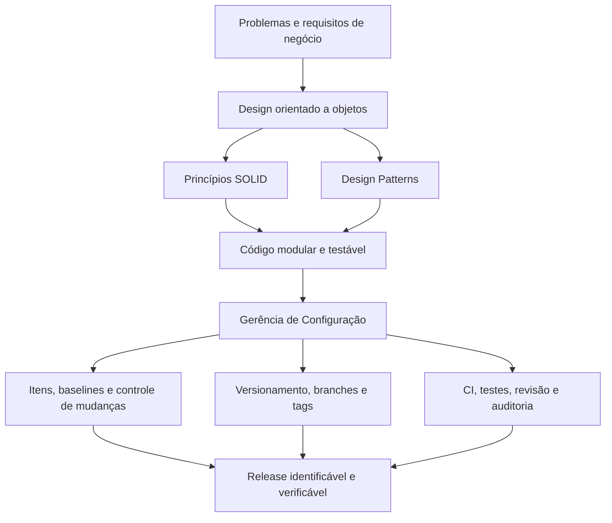

# Design Patterns e Gerência de Configuração: do Projeto ao Controle de Versões

> **Disciplina:** Design Patterns e gerência de configuração: do projeto ao controle de versões  
> **Material de referência:** [disciplina no ambiente Kroton/Anhanguera](https://kroton.platosedu.io/v2/lms/aluno/disciplina/conteudo/30034012/17630957), código WBA0882_v2.0  
> **Autor do material-base:** Nilton Raimundo de Assis Júnior  
> **Revisão acadêmica:** Paulo Henrique Santini  
> **Idioma da documentação:** português brasileiro  
> **Formato:** Markdown + diagramas Mermaid, compatíveis com GitHub

## Objetivo deste repositório

Documentar, de maneira didática e consultável, a relação entre o **design de software** (como organizar responsabilidades e interações) e a **Gerência de Configuração** (como registrar, validar, auditar e liberar alterações ao longo do tempo).

**Ideia central:** Design Patterns orientam **como o software é estruturado**; a Gerência de Configuração ajuda a garantir **que sua evolução seja rastreável, reproduzível e controlada**.

## Conteúdo

| Tema | Documento | Conceitos principais |
|---|---|---|
| 01 | [Fundamentos de Design Patterns](temas/01-fundamentos-design-patterns.md) | GoF, padrões criacionais/estruturais/comportamentais, SOLID, Singleton, Factory Method, Observer |
| 02 | [Gerência de Configuração de Software](temas/02-gerencia-configuracao-software.md) | Itens de configuração, mudanças, auditoria, baselines, releases e integração contínua |
| 03 | [Ferramentas de Controle de Versão](temas/03-controle-versao-versionamento.md) | Git, SVN, Git Flow, GitHub Flow, Trunk-Based, merge, revert, rebase, cherry-pick e tags |
| 04 | [Integração entre Patterns e Gerência de Configuração](temas/04-integracao-patterns-configuracao.md) | Arquitetura versionada, revisões, ADRs, automação, estudo de caso integrado |
| Apoio | [Revisão para a prova](apoio/revisao-prova.md) | Quadros comparativos, perguntas de fixação e gabarito comentado |
| Apoio | [Glossário e referências](apoio/glossario-referencias.md) | Terminologia, notas técnicas, referência aos PDFs utilizados |

## Mapa conceitual da disciplina



## Padrão didático adotado nos quatro temas

Cada capítulo segue, sempre que aplicável, a mesma sequência:

1. **Objetivos de aprendizagem** e resumo do conteúdo acadêmico.
2. **Conceitos essenciais**, definições e comparações.
3. **Diagramas Mermaid**, substituindo ou complementando figuras do material original.
4. **Exemplos práticos** alinhados a cenários de sistemas reais.
5. **Boas práticas e limitações**, com distinção entre o que é ensinado e o que é recomendação técnica complementar.
6. **Revisão para prova**, com síntese e questões de fixação.
7. **Fontes utilizadas** do conjunto de PDFs fornecido.

## Convenção editorial

- **[Conteúdo-base]**: conceitos centrais apresentados nos materiais acadêmicos.
- **[Complemento técnico]**: detalhamento profissional, ressalvas ou correções de simplificações didáticas. Complementos não devem ser confundidos com afirmações literais do professor.
- As figuras Mermaid representam **modelos conceituais**, não reproduções pixel a pixel dos slides.
- Comandos Git são exemplos; confirme branch ativa, permissões e políticas do repositório antes de executá-los.
- A documentação acadêmica não pressupõe que exista um único workflow, pattern ou ferramenta adequado para todos os projetos.

## Como colocar no GitHub

1. Extraia o ZIP deste material preservando as pastas `temas/` e `apoio/`.
2. Crie um repositório GitHub vazio (ou integre os arquivos ao repositório de estudos já existente).
3. Faça commit do `README.md` e das pastas; **não é necessário incluir os PDFs acadêmicos originais**.
4. Ao abrir qualquer arquivo `.md` na interface do GitHub, os blocos `mermaid` deverão ser exibidos como diagramas.
5. Para atualização, mantenha as referências originais, registre notas técnicas novas e ajuste os links internos.

**Exemplo para repositório novo** (dentro da pasta extraída, antes de configurar um remoto):

```bash
git init
git add README.md temas/ apoio/
git commit -m "docs: adicionar disciplina de design patterns e configuracao"
```

Depois, associe o remoto conforme a URL **real** do repositório criado em sua conta.

## Materiais analisados

- `ebook-00.pdf` — apresentação da disciplina.
- `ebook-01.pdf` a `ebook-04.pdf` — quatro temas.
- `slides-01.pdf` a `slides-04.pdf` — aulas e estudos de caso de cada tema.
- `podcast-tema-01.pdf` — transcrição de exemplos de aplicação conjunta.
- `podcast-tema-02.pdf` — lista de exercícios com resoluções.

> **Observação:** Os PDFs originais não foram incorporados a este pacote; as referências documentam os nomes dos arquivos fornecidos. Este repositório contém sínteses, explicações, códigos e diagramas reescritos para estudo.
