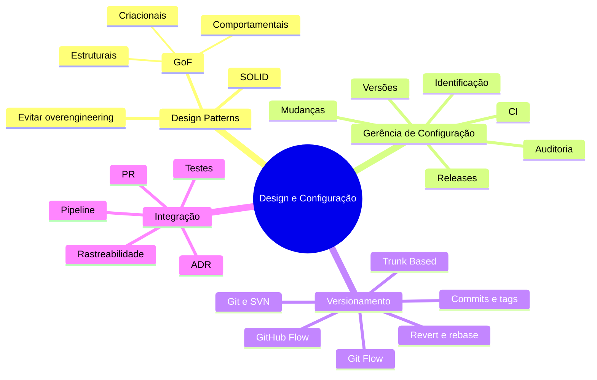

# Revisão para a Prova — Design Patterns e Gerência de Configuração

[← Início](../README.md)

> Revisão organizada a partir dos quatro e-books, slides e dois documentos de podcast/exercícios. As questões de simulado abaixo foram **redigidas para esta documentação**, preservando os conceitos centrais do material acadêmico.

## 1. Mapa mental dos quatro temas

## 2. Quadro de memorização rápida

| Pergunta de prova | Resposta direta |
|---|---|
| O que é um Design Pattern? | Solução reutilizável e contextual para problema recorrente de design. |
| Quem são os GoF? | Gamma, Helm, Johnson e Vlissides. |
| Quais as três categorias GoF? | Criacionais, estruturais e comportamentais. |
| Qual o objetivo de Singleton? | Controlar acesso a uma única instância no escopo definido. |
| Qual categoria de Factory Method? | Criacional. |
| Quem delega criação no Factory Method GoF? | Abstração criadora às subclasses especializadas. |
| Qual categoria de Adapter? | Estrutural. |
| Qual categoria de Observer? | Comportamental. |
| Qual objetivo de Strategy? | Encapsular algoritmos intercambiáveis. |
| O que significa SRP? | Um módulo deve ter uma razão principal para mudar. |
| O que significa OCP? | Possibilitar extensão com pouca alteração de partes estáveis. |
| O que significa LSP? | Subtipos respeitam o contrato e substituem o tipo base. |
| O que significa ISP? | Interfaces pequenas e adequadas aos clientes. |
| O que significa DIP? | Dependência de abstrações, não de detalhes concretos. |
| O que a GCS controla? | Itens, mudanças, versões, auditoria e liberações. |
| Controle de mudança = controle de versão? | Não: autorização/impacto ≠ histórico de estados. |
| Para que serve uma baseline? | Estado de referência identificado e controlado. |
| Para que serve CI? | Integrar e verificar alterações frequentemente. |
| Git ou SVN é distribuído? | Git. |
| Fluxo com feature/release/hotfix/develop? | Git Flow. |
| Fluxo de integração frequente ao trunk? | Trunk-Based Development. |
| O que `git cherry-pick` faz? | Reaplica mudança de commit selecionado. |
| O que `git revert` faz? | Cria commit que desfaz o efeito de outro. |
| O que `git rebase` faz? | Reaplica commits sobre outra base, mudando seus IDs. |
| Para que servem tags? | Identificar pontos específicos do histórico, como releases. |
| Por que PR é importante? | Revisão, discussão e registros antes do merge. |
| O que une Patterns e GCS? | Evolução arquitetural controlada e rastreável. |

## 3. Pegadinhas frequentes

1. **Singleton não é um gerenciador distribuído de instâncias.** Uma instância na JVM não significa uma no cluster.
2. **Factory Method não é sinônimo estrito de qualquer classe `Factory`.** Fábrica simples e método-fábrica GoF têm estruturas diferentes.
3. **SOLID não é catálogo de Design Patterns.** São princípios de design que orientam boas decisões.
4. **Controle de versão não é toda a GCS.** Faltam processos como identificação, análise de mudança, auditoria e release.
5. **CI não significa deploy automático.** Publicação depende de políticas, verificações e permissões adicionais.
6. **Revert e reset não são equivalentes.** Revert registra desfazimento; reset move referência e pode descartar dados locais.
7. **Rebase pode reescrever histórico.** Evitar operação unilateral em branches compartilhadas.
8. **Linters não comprovam SOLID.** Revisão de arquitetura e testes continuam necessários.
9. **Tag não garante rollback de banco de dados.** Implantação envolve outros componentes além do código.
10. **Mais patterns não significa melhor design.** Contexto e simplicidade continuam fundamentais.

## 4. Simulado de fixação

Marque uma alternativa por questão antes de conferir o gabarito.

**01.** Uma equipe precisa adaptar uma interface externa sem modificar os clientes internos. Qual padrão melhor representa a intenção?

A) Singleton · B) Adapter · C) Strategy · D) Observer

**02.** Em uma aplicação com diferentes regras de precificação substituíveis em tempo de execução, qual padrão é mais adequado?

A) Strategy · B) Facade · C) Singleton · D) Composite

**03.** No Factory Method formal do GoF, a decisão sobre o produto concreto é tipicamente transferida a:

A) Variáveis globais · B) Banco de dados · C) Subclasses criadoras · D) Observadores

**04.** Qual princípio afirma que o código cliente não deve depender de métodos de interface que não utiliza?

A) DIP · B) LSP · C) OCP · D) ISP

**05.** O registro de autor, revisão, ticket e resultado de testes é especialmente útil para:

A) Apagar todo histórico · B) Rastreabilidade e auditoria · C) Substituir todos os testes · D) Eliminar autorização de mudanças

**06.** O que é uma baseline no contexto da GCS?

A) Estado de referência identificado · B) Branch sempre em desenvolvimento · C) Usuário administrador · D) Algoritmo de merge

**07.** Qual combinação representa corretamente uma prática de integração contínua?

A) Merge anual e teste manual apenas no fim · B) Branch sem controle e build local opcional · C) Integrações frequentes com validação automatizada · D) Apenas nomear releases

**08.** Qual característica diferencia Git de sistemas de versão centralizados típicos?

A) Não suporta branches · B) Commits locais em repositório distribuído · C) Não guarda histórico · D) Exige conexão para cada commit

**09.** Qual estratégia enfatiza integração frequente na branch principal e branches curtas?

A) SVN Flow · B) Apenas Git Flow · C) Trunk-Based Development · D) Branches de release permanentes

**10.** Uma correção já publicada precisa ser desfeita mantendo a rastreabilidade no histórico compartilhado. Qual operação é normalmente preferível?

A) `git revert` · B) `git reset --hard` no remoto · C) Apagar o repositório · D) `git init`

**11.** É necessário transportar um commit específico entre branches de manutenção. Qual recurso é diretamente destinado a isso?

A) `git tag` · B) `git blame` · C) `git status` · D) `git cherry-pick`

**12.** Qual alternativa descreve corretamente a integração entre Design Patterns e GCS?

A) O versionamento elimina a necessidade de design · B) Patterns dispensam testes de regressão · C) Patterns organizam o desenho, e GCS controla sua evolução · D) A GCS impede refatorações

### Gabarito comentado

| Nº | Resposta | Justificativa |
|---|---|---|
| 01 | **B** | Adapter compatibiliza interfaces distintas. |
| 02 | **A** | Strategy encapsula algoritmos selecionáveis. |
| 03 | **C** | No modelo GoF, criadores concretos sobrescrevem a operação de criação. |
| 04 | **D** | ISP evita dependências de operações desnecessárias. |
| 05 | **B** | Rastreabilidade conecta necessidade, decisão, alteração e validação. |
| 06 | **A** | Baseline fixa um estado de referência para controle. |
| 07 | **C** | CI exige integração frequente e feedback automatizado. |
| 08 | **B** | Git permite commits locais com histórico do repositório distribuído. |
| 09 | **C** | Trunk-Based integra alterações pequenas e frequentes à linha principal. |
| 10 | **A** | Revert cria um novo registro preservando a sequência compartilhada. |
| 11 | **D** | Cherry-pick reaplica o efeito de um commit identificado. |
| 12 | **C** | Patterns e GCS atuam em dimensões complementares. |

## 5. Gabarito de referência do documento acadêmico de exercícios

O arquivo `podcast-tema-02.pdf` contém **seis exercícios com resolução**. Para facilitar a revisão junto ao PDF original:

| Exercício original | Gabarito do material | Assunto |
|---|---|---|
| 1 | **C** | SOLID + padrões criacionais; relação com OCP |
| 2 | **B** | Git Flow, release e hotfix |
| 3 | **A** | Correspondência entre categorias GoF e exemplos |
| 4 | **A** | Identificação de configuração e auditoria |
| 5 | **D** | Trunk-Based Development |
| 6 | **E** | SRP e eficácia de testes na CI |

> Consulte o arquivo original para os enunciados exatos e as justificativas completas disponibilizadas pela instituição.

## 6. Revisão de última hora (5 minutos)

**GoF:** criação, composição e comportamento. **SOLID:** coesão, extensão, substituição, interfaces adequadas e dependência de abstrações. **GCS:** identificar, autorizar, versionar, auditar, automatizar e liberar. **Git:** branch, commit, merge, tag, log, revert, rebase e cherry-pick. **Integração:** decisão arquitetural + issue + código + revisão + testes + versão.

[← Início](../README.md)
