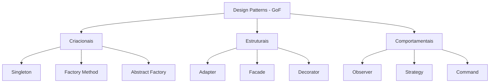
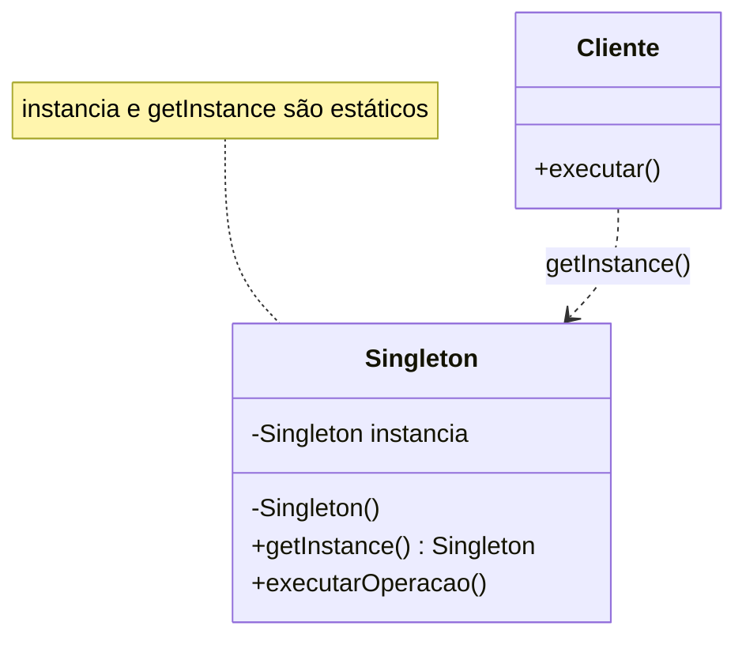
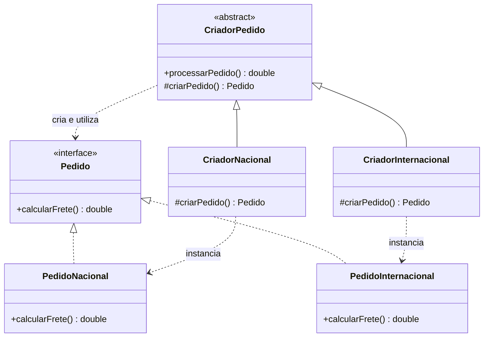
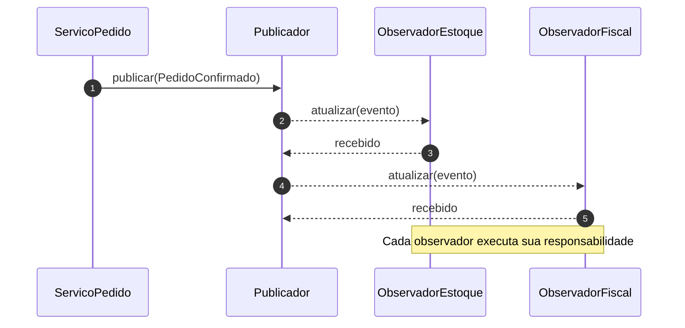
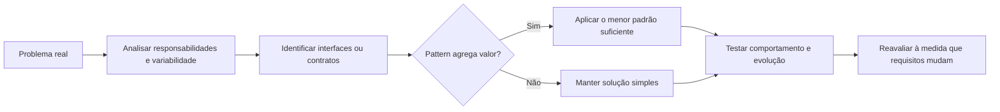

# Tema 01 — Fundamentos de Design Patterns

[← Início](../README.md) · [Tema 02 →](02-gerencia-configuracao-software.md)

## 1. Objetivos de aprendizagem

- Compreender **por que padrões de projeto existem** e o papel histórico do *Gang of Four* (GoF).
- Distinguir padrões **criacionais**, **estruturais** e **comportamentais**.
- Identificar responsabilidades de **Singleton**, **Factory Method** e **Observer**.
- Relacionar padrões aos princípios **SOLID**.
- Evitar abstrações prematuras (*overengineering*) e justificar tecnicamente a adoção de um padrão.

## 2. Conceito e origem [Conteúdo-base]

**Design Pattern (padrão de projeto)** é uma solução recorrente, nomeada e adaptável para um problema de design em determinado contexto. É diferente de um algoritmo pronto e não deve ser interpretado como código que se copia mecanicamente: é uma **estrutura de responsabilidades e colaborações** que pode ser concretizada em linguagens e arquiteturas diferentes.

A popularização desses padrões em software orientado a objetos está associada a **Erich Gamma, Richard Helm, Ralph Johnson e John Vlissides**, conhecidos como *Gang of Four* (GoF), autores de *Design Patterns: Elements of Reusable Object-Oriented Software*.

Benefícios esperados, quando existe um problema que justifique a aplicação:

- **Vocabulário compartilhado:** nomes como *Observer* e *Adapter* resumem decisões de design.
- **Maior separação de responsabilidades:** evita que o cliente conheça todos os detalhes de criação e integração.
- **Facilidade de evolução:** novos comportamentos podem ser introduzidos em pontos de extensão planejados.
- **Testabilidade e compreensão:** componentes coesos tendem a ser mais simples de isolar e testar.

**Limitação importante:** o nome de um pattern não garante qualidade. Padrões inadequados podem aumentar indireção, número de classes e custo de manutenção.

## 3. Classificação GoF [Conteúdo-base]

| Categoria | Pergunta respondida | Padrões ilustrativos | Exemplo de necessidade |
|---|---|---|---|
| **Criacional** | Como criar objetos e controlar dependências de instanciação? | Singleton, Factory Method, Abstract Factory | Selecionar um tipo de pedido sem acoplar o código cliente à implementação |
| **Estrutural** | Como combinar classes e objetos com interfaces coerentes? | Adapter, Facade, Composite, Decorator | Integrar uma API externa com formato diferente |
| **Comportamental** | Como distribuir responsabilidades e comunicação entre objetos? | Observer, Strategy, Command, State | Reagir à confirmação de um pedido sem acoplar todos os módulos |



## 4. Singleton: uma única instância por escopo [Conteúdo-base]

**Intenção:** restringir a instanciação e oferecer um acesso conhecido a uma única instância em determinado escopo. O material acadêmico apresenta uma classe com atributo estático `instancia`, construtor controlado e método `getInstance()`.

**Reconstrução Mermaid da Figura 1 do `ebook-01.pdf` e do diagrama dos slides:**



Funcionamento: se a instância ainda não existe, o método a cria; caso contrário, devolve a mesma referência. Uma implementação *lazy* exige cuidado com concorrência, especialmente em Java.

**[Complemento técnico] Exemplo Java idiomático e seguro para o caso simples:**

```java
public enum ConfiguracaoAplicacao {
    INSTANCE;

    public String nomeSistema() {
        return "Pedidos";
    }
}

// Uso
String nome = ConfiguracaoAplicacao.INSTANCE.nomeSistema();
```

Um `enum` Java facilita a obtenção de uma única instância por classe carregada, com segurança de inicialização e suporte de serialização apropriado. **Não** implica uma única instância entre processos, contêineres, JVMs ou serviços distribuídos. Em sistemas com injeção de dependência, frequentemente é preferível usar um *singleton gerenciado pelo contêiner* a inserir estado global manualmente.

**Quando evitar:** serviços que carregam estado mutável compartilhado sem controle de concorrência; objetos que precisam ser facilmente substituídos em testes; aplicações com múltiplas instâncias de execução.

## 5. Factory Method: delegar a criação [Conteúdo-base + complemento]

**Intenção formal do GoF:** definir uma operação de criação numa abstração e permitir que subclasses determinem o tipo concreto do objeto produzido.



**Exemplo Java compacto:**

```java
interface Pedido {
    double calcularFrete();
}

final class PedidoNacional implements Pedido {
    public double calcularFrete() { return 20.0; }
}

final class PedidoInternacional implements Pedido {
    public double calcularFrete() { return 80.0; }
}

abstract class CriadorPedido {
    protected abstract Pedido criarPedido();

    public double processarPedido() {
        Pedido pedido = criarPedido();
        return pedido.calcularFrete();
    }
}

final class CriadorNacional extends CriadorPedido {
    protected Pedido criarPedido() { return new PedidoNacional(); }
}

final class CriadorInternacional extends CriadorPedido {
    protected Pedido criarPedido() { return new PedidoInternacional(); }
}

// Uso: new CriadorInternacional().processarPedido();
```

**[Precisão terminológica]** O exemplo dos slides que utiliza `PedidoFactory.criarPedido(tipo)` para decidir por `if`/`switch` é comumente chamado de **Simple Factory (fábrica simples)**. É uma técnica útil, porém diferente do **Factory Method GoF**, que especializa a criação por herança ou sobrescrita do método de fábrica. A distinção importa em provas e revisões arquiteturais.

## 6. Observer: publicar mudanças sem conhecer assinantes [Conteúdo-base]

**Intenção:** estabelecer a relação *um-para-muitos* entre um sujeito/publicador e seus observadores. Quando ocorre uma mudança relevante, o publicador notifica interessados por uma interface, sem conhecer a lógica interna de cada um.



```java
import java.util.ArrayList;
import java.util.List;
import java.util.function.Consumer;

final class EventosPedido {
    private final List<Consumer<String>> observadores = new ArrayList<>();

    void assinar(Consumer<String> observador) {
        observadores.add(observador);
    }

    void confirmar(String pedidoId) {
        for (Consumer<String> observador : observadores) {
            observador.accept(pedidoId);
        }
    }
}

// Exemplo de uso (modelo síncrono e em memória):
// eventos.assinar(id -> System.out.println("Baixar estoque: " + id));
// eventos.assinar(id -> System.out.println("Emitir documento fiscal: " + id));
// eventos.confirmar("PED-123");
```

**[Complemento técnico]** O Observer clássico pode ser **síncrono e em memória**. Isso não o torna automaticamente equivalente a mensageria assíncrona, broker, eventos distribuídos ou entrega garantida. Se um observador falhar, o comportamento do publicador precisará ser explicitamente definido.

## 7. SOLID + Design Patterns [Conteúdo-base]

| Princípio | Significado operacional | Ligação frequente com patterns |
|---|---|---|
| **S — SRP** | Um componente deve ter **uma razão principal para mudar**. | Factory Method separa criação de uso; Observer separa reação de publicação. |
| **O — OCP** | Estender comportamento preservando partes estáveis do cliente. | Strategy e Factory Method fornecem pontos de extensão. |
| **L — LSP** | Implementações derivadas devem respeitar contratos de substituição. | As implementações de `Pedido` precisam cumprir a interface sem surpresas. |
| **I — ISP** | Clientes não devem depender de métodos que não utilizam. | Observadores podem receber interfaces pequenas e específicas. |
| **D — DIP** | Políticas de alto nível dependem de abstrações, não de detalhes concretos. | Estratégias e fábricas podem ser expostas por interfaces. |



## 8. Aplicação no estudo de caso [Conteúdo-base]

A disciplina utiliza um **e-commerce com pedidos nacionais e internacionais**. Os padrões ajudam a separar decisões diferentes:

1. **Fábrica:** quem decide o tipo concreto de `Pedido`?
2. **Estratégia (Strategy):** como alternar políticas de frete, impostos ou desconto?
3. **Observer:** quem precisa receber uma notificação de pedido confirmado?
4. **Adapter:** como traduzir uma API logística externa para a interface interna?

**[Complemento técnico]** Não é necessário aplicar os quatro patterns simultaneamente. Comece pelo comportamento que efetivamente muda ou dificulta a manutenção.

## 9. Erros comuns e pontos para prova

- Pattern não é framework, biblioteca nem implementação obrigatória.
- Singleton não significa estado global seguro nem instância única em um cluster.
- **Factory Method** é **criacional**; **Adapter** é **estrutural**; **Observer** e **Strategy** são **comportamentais**.
- SOLID são **princípios de design**, não cinco Design Patterns.
- OCP não significa “nunca modificar uma classe”; significa criar pontos de extensão coerentes para a variabilidade esperada.
- A melhor implementação é a mais simples que resolve um problema concreto sem prejudicar a evolução.

### Questões de fixação

1. Como distinguir Factory Method de uma classe utilitária com `switch` de tipos?
2. Por que Observer é classificado como comportamental?
3. Como DIP favorece a substituição de uma implementação de frete?
4. Em qual situação o Singleton pode produzir mais problemas do que benefícios?

**Respostas curtas:** (1) subclasses controlam a criação no Factory Method formal; (2) coordena a comunicação entre objetos; (3) o cliente utiliza uma abstração; (4) quando há estado mutável global, múltiplos processos ou dificuldade de testes.

## 10. Referências internas

- `ebook-01.pdf`: objetivos, classificação GoF, Singleton, SOLID, boas práticas e caso de pedidos (p. 2–5).
- `slides-01.pdf`: blocos 1–5; diagrama UML Singleton, caso de e-commerce e Factory Method (slides 3–26).
- `podcast-tema-01.pdf`: exemplos de Strategy, Observer, Adapter e relação com versionamento.

[← Início](../README.md) · [Tema 02 →](02-gerencia-configuracao-software.md)
