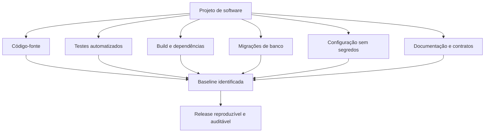
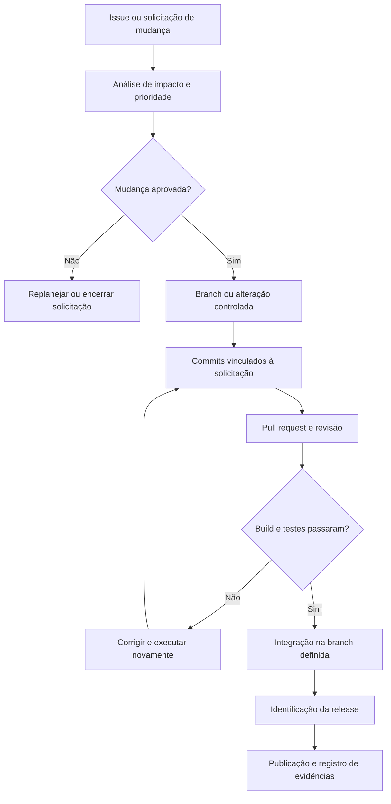
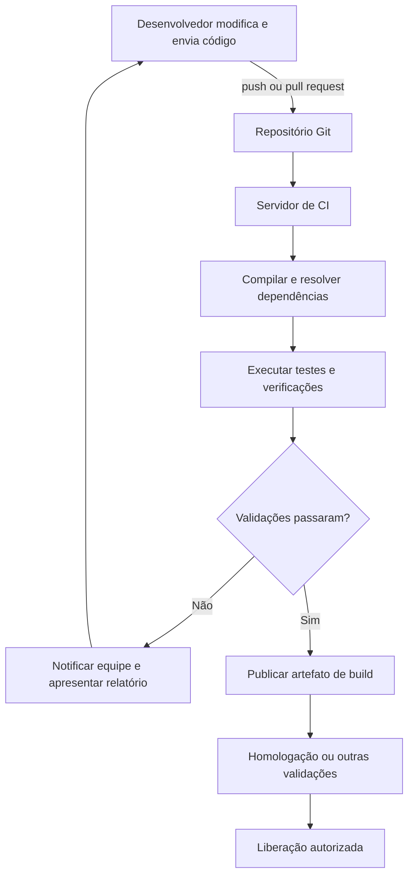
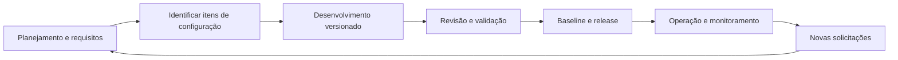

# Tema 02 — Gerência de Configuração de Software

[← Tema 01](01-fundamentos-design-patterns.md) · [Início](../README.md) · [Tema 03 →](03-controle-versao-versionamento.md)

## 1. Objetivos de aprendizagem

- Entender **o que deve ser controlado** durante o ciclo de vida de um software.
- Diferenciar identificação de itens, controle de mudanças, versionamento, auditoria e releases.
- Reconhecer o papel de **pull requests**, **Git Flow** e **integração contínua (CI)**.
- Explicar como a padronização favorece colaboração, rastreabilidade e previsibilidade.
- Planejar um fluxo de evolução de sistema que possa ser auditado e reproduzido.

## 2. Conceito [Conteúdo-base]

**Gerência de Configuração de Software (GCS)** é o conjunto de atividades responsável por identificar, registrar, acompanhar e controlar a evolução de **itens de configuração** do software ao longo do ciclo de vida.

Seu alcance é **mais amplo que o Git**. Abrange artefatos como código-fonte, documentação, testes, scripts de banco de dados, arquivos de configuração, definições de build e parâmetros necessários para construir e liberar o sistema.

**Perguntas que a GCS deve permitir responder:**

- Qual versão foi implementada, testada e publicada?
- Qual solicitação motivou a mudança e quem a aprovou?
- Quais artefatos compõem essa versão?
- Quais testes foram executados e com qual resultado?
- Como reconstruir a versão ou restabelecer uma entrega anterior?

## 3. Pilares da Gerência de Configuração [Conteúdo-base]

| Atividade | Propósito | Evidências típicas |
|---|---|---|
| **Identificação da configuração** | Determinar quais itens serão controlados e seu identificador. | Repositórios, caminhos, versões, hashes, inventário de artefatos. |
| **Controle de mudanças** | Avaliar impacto, autorizar, executar e acompanhar alterações. | Issue/ticket, aprovação, pull request, decisão técnica. |
| **Controle de versão** | Preservar históricos e estados sucessivos de artefatos. | Commits, branches, tags, comparações e histórico. |
| **Auditoria e relato de situação** | Verificar integridade, conformidade e situação atual dos itens. | Logs, relatórios de pipeline, aprovação, registro de publicação. |
| **Planejamento de releases** | Definir o conjunto que será entregue e identificar o marco. | Versão, tag, notas de release, artefato publicado. |
| **Automação/integração contínua** | Verificar continuamente os efeitos das mudanças. | Build, testes, análise estática, relatórios e *quality gates*. |

### 3.1 Item de configuração e baseline

**Item de configuração (IC)** é um artefato individual ou conjunto de artefatos formalmente controlado. Exemplos: `pom.xml`, especificação de API, script SQL, manifesto de implantação e código-fonte.

**[Complemento técnico] Baseline** é um estado de referência identificado, aprovado para determinado objetivo (por exemplo, homologação ou release). Em ambientes automatizados, pode ser representado pela combinação de **commit imutável, artefatos versionados e informações de build**. Uma branch móvel, isoladamente, não fixa uma baseline.



**Atenção:** arquivos de exemplo e definições de configuração podem ser versionados; **segredos reais**, tokens e senhas não devem ser gravados no Git. Segredos devem ser fornecidos por um gerenciador ou ambiente protegido.

## 4. Ciclo de controle de mudanças [Conteúdo-base]

O material apresenta o encadeamento **solicitação → análise/autorizações → trabalho em branch → revisão → automação → incorporação e release**.



**[Complemento técnico]** Nem todas as organizações precisam de um *Change Advisory Board* (CAB) formal. O nível de aprovação depende de risco, conformidade e criticidade. Uma mudança simples pode usar revisão por pares e verificações automáticas; uma alteração crítica pode exigir aprovação adicional e janela de implantação.

## 5. Integração contínua [Conteúdo-base]

**Integração contínua (CI)** é a prática de integrar mudanças frequentemente e submetê-las a verificações automatizadas. A pipeline é uma ferramenta que concretiza essa prática, mas **ter uma pipeline não significa, por si só, praticar CI**: integrações raras e branches longas prejudicam o feedback.

**Reinterpretação em Mermaid da Figura 1 do `ebook-02.pdf`, “Fluxo de integração contínua”:**



O desenho apresenta uma evolução possível até publicação, mas **CI não obriga deploy em produção**: entrega/implantação contínua são práticas relacionadas com condições adicionais.

### 5.1 Exemplo de pipeline GitHub Actions para Java/Maven [Complemento técnico]

O exemplo abaixo ilustra as etapas essenciais, executando testes em alterações para `main` e em pull requests. As versões de *actions* indicadas foram conferidas nos repositórios oficiais em **19/10/2026**. Em *runners* autogerenciados, confirme os requisitos mínimos de versão e a política interna de segurança; em ambientes de alta exigência de integridade, considere referenciar *actions* por SHA completo.

Arquivo: `.github/workflows/ci.yml`

```yaml
name: CI - Projeto Java

on:
  push:
    branches: [main]
  pull_request:
    branches: [main]

permissions:
  contents: read

jobs:
  testar:
    runs-on: ubuntu-latest
    steps:
      - name: Obter fontes
        uses: actions/checkout@v7

      - name: Preparar JDK
        uses: actions/setup-java@v6
        with:
          distribution: temurin
          java-version: '21'
          cache: maven

      - name: Compilar e testar
        run: mvn --batch-mode --no-transfer-progress verify
```

Referências das *actions*: [checkout (GitHub)](https://github.com/actions/checkout) e [setup-java (GitHub)](https://github.com/actions/setup-java).

O comando `mvn verify` executa as fases pertinentes do ciclo de vida Maven, incluindo testes se o projeto estiver configurado para isso. Testes de integração, cobertura, validação de arquitetura, verificações de dependências e segurança exigem **configurações e plugins adicionais**.

## 6. GCS ao longo do ciclo de vida [Conteúdo-base]



Um projeto organizado precisa ligar os **artefatos do código** aos **artefatos da decisão**. Exemplo de trilha auditável:

```text
Ticket: PED-142 - Atualizar cálculo de frete internacional
    ↓
Branch: feature/PED-142-frete-internacional
    ↓
Commit: feat(frete): adicionar regra internacional (PED-142)
    ↓
Pull request: revisão técnica + testes
    ↓
Pipeline: build 189, resultado aprovado
    ↓
Release: v2.3.0, commit abc1234
    ↓
Artefato: imagem identificada por digest imutável
```

**[Complemento técnico]** A combinação de *commit* e tag facilita localizar as fontes; para **reproduzir exatamente o executável**, também é necessário controlar dependências, ferramentas, parâmetros de build e, quando aplicável, imagens base, configuração e migrações.

## 7. Estudo de caso: múltiplos microsserviços [Conteúdo-base]

A turma considera o desafio de equipes que mantêm **vários microsserviços**, com ritmos de atualização próprios. A ausência de critérios de versionamento e testes de integração pode gerar incompatibilidade entre APIs.

Prática recomendada:

1. Definir quem é responsável por cada serviço e quais artefatos são controlados.
2. Criar processos consistentes de issue, branch, PR e aprovação.
3. Validar builds, contratos e testes críticos no pipeline.
4. Identificar a versão dos serviços implantados em cada ambiente.
5. Monitorar falhas e reverter/avançar a implantação a partir de um artefato conhecido.

**[Complemento técnico]** Versionar cada serviço separadamente pode ser apropriado, mas não é obrigatório: monorepo e multirepo são opções que devem ser avaliadas por autonomia, dependências, governança e infraestrutura de CI.

## 8. Armadilhas e pontos de atenção

- **Git não substitui a GCS completa:** não implementa, sozinho, aprovação, auditoria de processos ou controle de implantação.
- **Rollback de código não é rollback completo de produção:** banco de dados, filas, compatibilidade e migrações exigem estratégias próprias.
- **Tag identifica o estado do repositório**, não prova, por si só, que houve aprovação ou que certo binário foi publicado.
- **Auditoria não é sinônimo de vigiar colaboradores:** seu objetivo principal é estabelecer rastreabilidade técnica e responsabilidade de processo.
- **Qualidade exige verificações configuradas:** publicar um arquivo de pipeline vazio não agrega segurança.
- **Não versionar credenciais:** garanta gestão apropriada de segredos e evite armazená-los no histórico do Git.

## 9. Revisão para prova

**Essência do tema:** Gerência de Configuração transforma modificações em um processo **identificável, controlado, rastreável, verificável e recuperável**.

**Perguntas de fixação:**

1. Qual a diferença entre controle de mudança e controle de versão?
2. Por que um `pom.xml` ou uma migration SQL pode ser item de configuração?
3. Qual é a relação entre commit, CI e liberação de uma versão?
4. O que comprova que uma mudança foi revisada e passou nos testes?

**Respostas curtas:** (1) mudança governa autorização e impacto, versão registra estados e evolução; (2) ambos afetam o produto gerado; (3) commit dispara verificações, mas release requer seleção e governança; (4) registros de revisão e execuções da pipeline vinculados ao commit.

## 10. Referências internas

- `ebook-02.pdf`: fundamentos da GCS, controle de mudança, versão, CI e auditoria (p. 2–5).
- `slides-02.pdf`: padronização, fluxos, estudo de caso em microsserviços, GitHub Actions e SonarQube (slides 3–26).
- `podcast-tema-01.pdf`: aplicação conjunta em serviços e integrações.
- `podcast-tema-02.pdf`: exercícios sobre GCS, SOLID e rastreabilidade.

[← Tema 01](01-fundamentos-design-patterns.md) · [Início](../README.md) · [Tema 03 →](03-controle-versao-versionamento.md)
