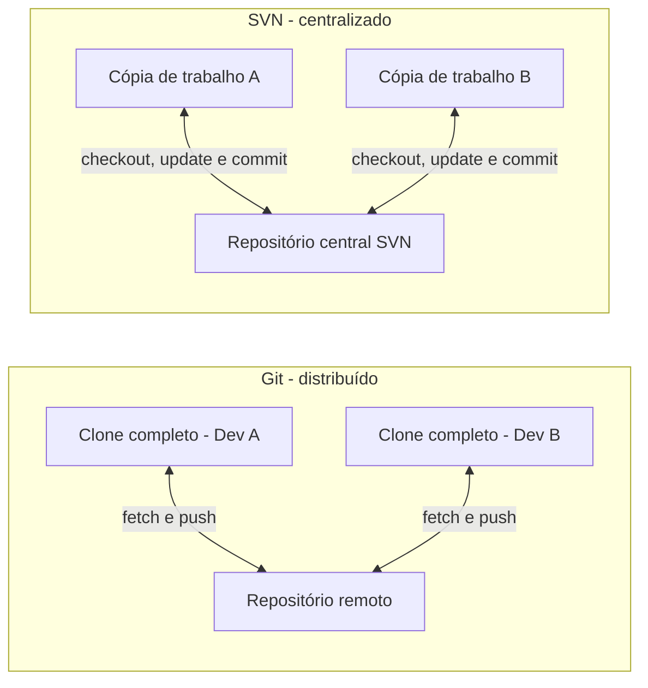
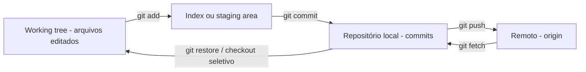
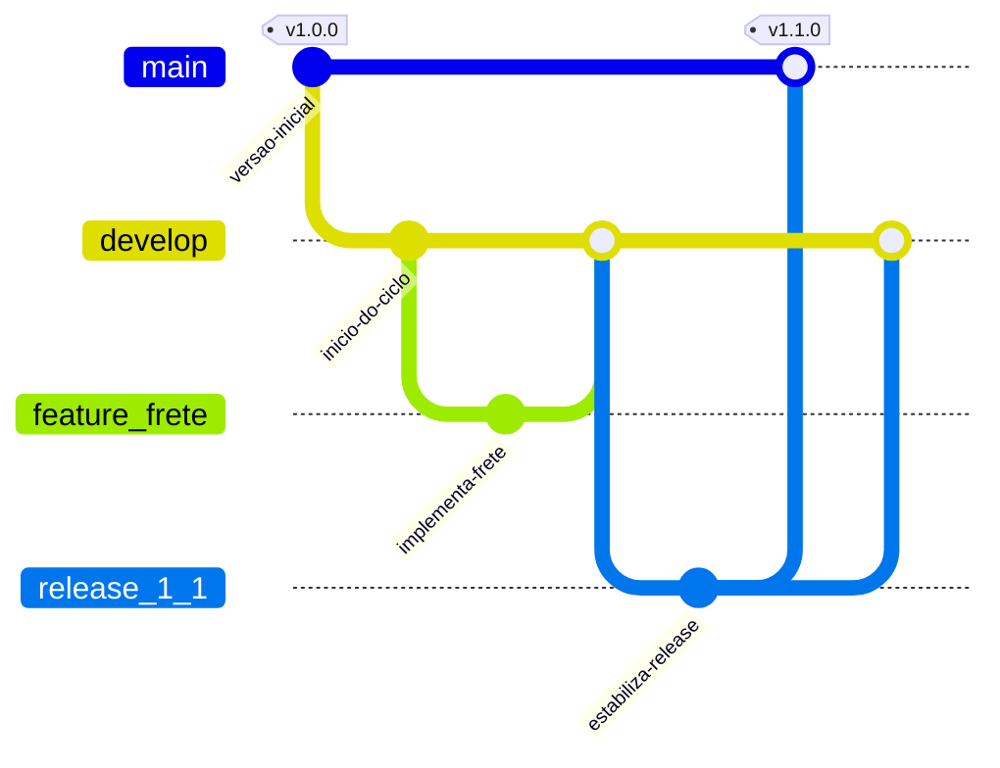
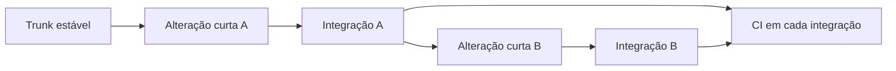
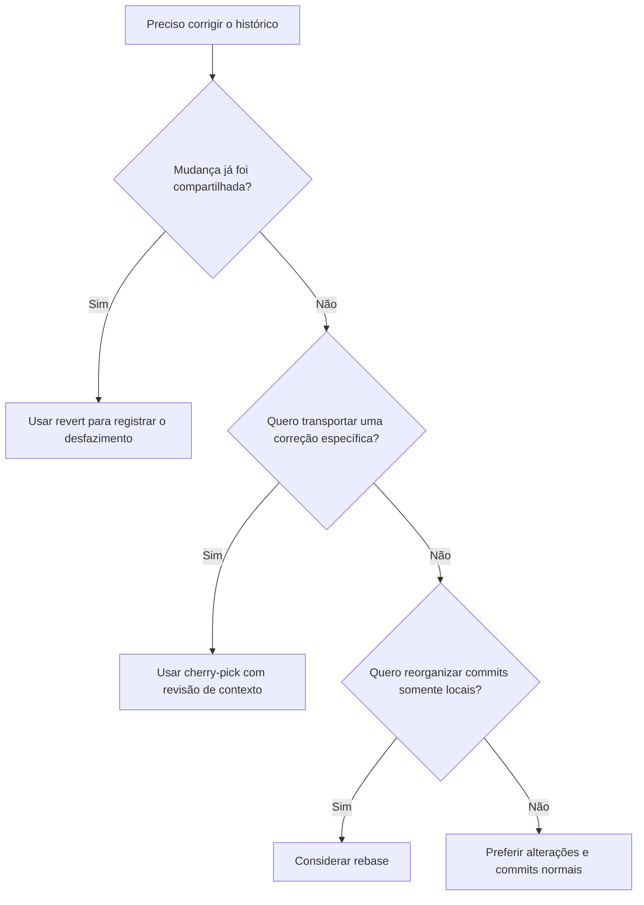
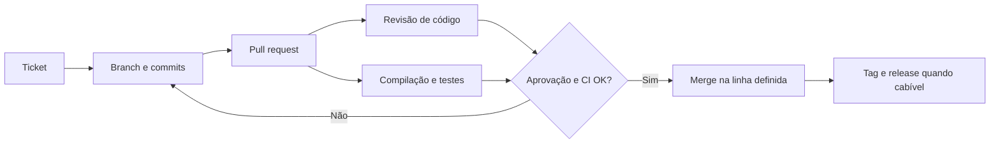

# Tema 03 — Ferramentas de Controle de Versão e Práticas de Versionamento

[← Tema 02](02-gerencia-configuracao-software.md) · [Início](../README.md) · [Tema 04 →](04-integracao-patterns-configuracao.md)

## 1. Objetivos de aprendizagem

- Comparar sistemas de versão **distribuídos (Git)** e **centralizados (SVN)**.
- Entender `commit`, `branch`, `merge`, `tag`, `fetch`, `pull` e `push`.
- Diferenciar **Git Flow**, **GitHub Flow** e **Trunk-Based Development**.
- Utilizar mecanismos de rastreabilidade: `git log`, `git diff`, `git blame`, issues e pull requests.
- Reconhecer casos apropriados de `cherry-pick`, `revert` e `rebase`.

## 2. Por que versionar? [Conteúdo-base]

Um sistema de controle de versão registra estados de arquivos ao longo do tempo, identificando **o que mudou, quando, por quem e em qual sequência**. Em associação com tickets e revisões, o histórico também ajuda a registrar **por que a alteração foi necessária**.

Controle de versão permite trabalho paralelo, identificação de regressões, recuperação de versões anteriores, auditoria e colaboração em equipes distribuídas.

### 2.1 Git x Subversion

| Critério | Git | SVN (Subversion) |
|---|---|---|
| Modelo principal | Distribuído | Centralizado |
| Histórico | Em clones completos locais | Histórico mantido principalmente no servidor |
| Commit | Normalmente local | Normalmente exige servidor |
| Trabalho offline | Grande parte das operações funciona offline | Mais restrito para histórico e commits |
| Branching/merging | Operações comuns e relativamente baratas | Disponível, com dinâmica diferente |
| Adoção típica | Projetos colaborativos e pipelines modernos | Projetos legados ou contextos com governança específica |

**[Complemento técnico]** Git não dispensa servidor remoto em trabalho coletivo; plataformas como GitHub/GitLab organizam colaboração, permissões, PRs e automação. Também existem clones Git **rasos**, sem histórico completo. No SVN, o histórico não é necessariamente linear sem branches — a diferença fundamental está no **modelo de armazenamento e colaboração**, não na impossibilidade de ramificar.



## 3. As três áreas fundamentais do Git [Complemento técnico]



**Interpretação:** `git add` prepara conteúdo para o próximo commit; `git commit` registra o *snapshot* no repositório local; `git push` envia commits para o remoto. `git fetch` traz referências e objetos remotos sem aplicar automaticamente essas alterações ao diretório de trabalho.

### 3.1 Comandos essenciais

```bash
# Verificar onde se está antes de modificar o repositório
git status
git branch --show-current

git log --oneline --decorate --graph -10

# Criar uma branch local a partir da branch atual
git switch -c feature/PED-142-frete

# Examinar alterações
git diff
git diff --staged

# Preparar arquivos e registrar a mudança
git add src/ test/
git commit -m "feat(frete): incluir regra internacional (PED-142)"

# Sincronizar com o remoto (após revisar os nomes reais)
git fetch origin

git push -u origin feature/PED-142-frete

# Visualizar um arquivo e sua evolução
git log --oneline -- caminho/do/arquivo
git blame caminho/do/arquivo
```

**[Complemento técnico]** O nome `origin` é uma convenção frequente, não uma exigência. Antes do primeiro `git push`, confirme a URL e as permissões com `git remote -v`. Não copie os comandos de criação se o projeto já possui branches oficiais definidas.

## 4. Estratégias de branching [Conteúdo-base]

### 4.1 Git Flow

Modelo com branches para **produção estável** (`main` ou `master`), **integração de desenvolvimento** (`develop`), funcionalidades (`feature/*`), preparação de release (`release/*`) e correções urgentes (`hotfix/*`).



> **Nota:** A figura usa o nome `main` para a linha inicial e `develop` para integração. A convenção tradicional frequentemente chama a linha estável de `master`. Os nomes são configuráveis.

**Pontos fortes:** separação clara dos ciclos de desenvolvimento e manutenção, útil quando existem releases agendadas e versões sustentadas paralelamente.

**Custos:** maior número de branches e merges, necessidade de sincronização e possibilidade de conflitos por divergência prolongada.

### 4.2 GitHub Flow

Modelo mais enxuto: `main` como base, branches curtas por alteração, pull request, verificação automática e integração frequente. A publicação pode ocorrer a partir da branch principal após as validações adequadas.

### 4.3 Trunk-Based Development

Desenvolvedores integram **alterações pequenas e frequentes** à linha principal (*trunk*), diretamente ou por branches muito curtas, evitando divergências prolongadas.



Para liberar incrementos incompletos com segurança, é comum usar **feature flags**, testes confiáveis e disciplina de integração.

### 4.4 Quando escolher qual?

| Situação | Fluxo que pode fazer sentido | Condições |
|---|---|---|
| Releases com estabilização formal e versões paralelas | Git Flow | Equipe gerencia branches e backports consistentemente |
| Implantação frequente de uma aplicação com revisão por PR | GitHub Flow | Branch principal protegida, testes e releases automatizadas |
| Integração muito frequente em equipe madura | Trunk-Based | Branches curtas, CI rápida, flags e disciplina de pequenos incrementos |

**[Complemento técnico]** Não há fluxo universalmente melhor; frequência de entrega, exigências regulatórias, arquitetura, manutenção de versões e maturidade de automação determinam a escolha.

## 5. Branch, merge, tag e releases [Conteúdo-base]

**Branch:** nome que acompanha uma linha de commits; útil para isolar mudanças. **Merge:** operação que incorpora históricos. **Tag:** referência nominativa para um ponto identificado no histórico, utilizada frequentemente em releases.

```bash
# Identificar uma versão específica com tag anotada
git tag -a v1.2.0 -m "Release 1.2.0"

git show v1.2.0

git push origin v1.2.0
```

**[Complemento técnico]** Use convenção de versão explícita (por exemplo, SemVer quando adequada), tags protegidas e artefatos de publicação vinculados ao commit. **Tag não substitui teste, aprovação ou inventário do binário implantado.**

## 6. Investigação e rastreabilidade [Conteúdo-base]

| Necessidade | Ferramenta/comando | Observação |
|---|---|---|
| Ler mudanças recentes | `git log --oneline` | Expõe commits e mensagens. |
| Investigar diferenças | `git diff A..B` | Compara conteúdo de duas referências. |
| Ver detalhes de commit | `git show <hash>` | Apresenta metadados e alterações. |
| Identificar origem de linha | `git blame arquivo` | É evidência técnica, não prova de responsabilidade causal. |
| Acompanhar motivo | Issue/ticket + PR | Conecta requisito, implementação e validação. |
| Selecionar mudança específica | `git cherry-pick <hash>` | Cria novo commit equivalente em outro contexto. |

### 6.1 Cherry-pick, revert, rebase e reset: diferenças essenciais

| Operação | O que faz | Quando considerar | Cuidado |
|---|---|---|---|
| `git cherry-pick <hash>` | Reaplica a mudança de um commit selecionado na branch atual. | Transportar correção pontual para outra linha suportada. | Pode duplicar mudanças ou conflitar. |
| `git revert <hash>` | Registra novo commit que **desfaz o efeito** de outro. | Corrigir histórico já compartilhado sem reescrevê-lo. | Reversões de *merge commits* exigem atenção ao pai principal. |
| `git rebase <base>` | Reaplica commits sobre outra base, reescrevendo sua identidade. | Atualizar branches locais e organizar histórico próprio. | Evitar rebase de branches públicas sem coordenação. |
| `git reset --hard <ref>` | Move a referência local e descarta alterações de index e working tree. | Recuperação local intencional após backup/verificação. | **Destrutivo** para trabalho não salvo; não é substituto seguro de revert. |



### 6.2 Resolução de conflito

```bash
# Antes de tentar integração, verifique a situação
git status

# Depois de iniciar um merge e corrigir manualmente os arquivos:
git add caminho/do/arquivo

git commit

# Se preferir cancelar o merge em andamento:
git merge --abort

# Se estiver em um rebase, o tratamento será diferente:
# git rebase --continue (depois de corrigir e git add)
# git rebase --abort (para cancelar)
```

**Boa prática:** conflitos exigem **entender o comportamento final**, e não apenas escolher automaticamente “ours” ou “theirs”. Após resolvê-los, reexecute testes pertinentes.

## 7. Integração com ferramentas e CI [Conteúdo-base]

O material relaciona repositórios Git a **GitHub, GitLab e Bitbucket**, rastreadores de issues como **Jira, GitHub Issues e Redmine** e pipelines de **Jenkins, GitHub Actions e GitLab CI**.

O processo recomendado conecta:



Commits com mensagens claras e referências a tickets ajudam a reconstituir decisões. Recomenda-se registrar **o que mudou e por quê**, sem depender exclusivamente da leitura do diff.

## 8. Estudo de caso [Conteúdo-base]

Um projeto mantém **aplicações web e mobile**, com múltiplas equipes e releases simultâneas. O material propõe Git Flow, PRs, testes automatizados e sincronização recorrente. Correções emergenciais podem ser levadas às linhas necessárias usando *hotfix* ou *cherry-pick* cuidadosamente, conforme o fluxo estabelecido.

**[Complemento técnico]** Evite sincronizações apenas no fim de um ciclo longo. Testes de contrato e compatibilidade são especialmente importantes quando vários clientes dependem de uma API compartilhada.

## 9. Revisão para prova

**Memorize:**

- **Git:** distribuído; **SVN:** centralizado.
- **Git Flow:** `main/master`, `develop`, `feature`, `release`, `hotfix`.
- **GitHub Flow:** `main` + branches curtas + pull requests.
- **Trunk-Based:** integração frequente na branch principal.
- **Cherry-pick:** reaplicar commit selecionado; **revert:** desfazer criando novo commit; **rebase:** reaplicar commits sobre nova base.
- **Tag:** identifica ponto no histórico; **PR:** espaço de revisão e governança.

**Perguntas de fixação:**

1. Por que rebase em branch compartilhada pode prejudicar colegas?
2. Qual comando é preferível para desfazer um commit já publicado preservando o histórico?
3. Qual fluxo enfatiza integração muito frequente ao trunk?
4. Como vincular uma falha de produção ao requisito que motivou a mudança?

**Respostas curtas:** (1) reescreve identificadores de commits; (2) `git revert`; (3) Trunk-Based; (4) rastrear versão/commit, PR, issue e logs da pipeline.

## 10. Referências internas

- `ebook-03.pdf`: Git/SVN, branching, fluxos, rastreabilidade e automação (p. 2–5).
- `slides-03.pdf`: Git Flow, Trunk-Based, Git log, rebase, revert, cherry-pick e casos de uso (slides 3–26).
- `podcast-tema-02.pdf`: exercícios resolvidos sobre fluxos de versionamento.

[← Tema 02](02-gerencia-configuracao-software.md) · [Início](../README.md) · [Tema 04 →](04-integracao-patterns-configuracao.md)
