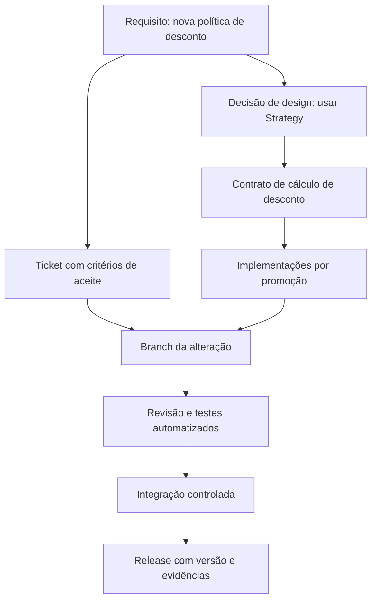
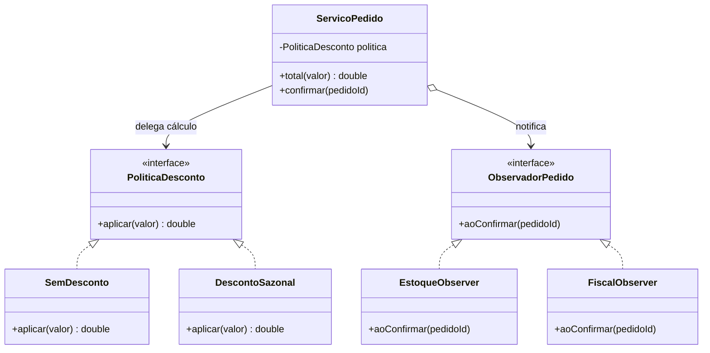
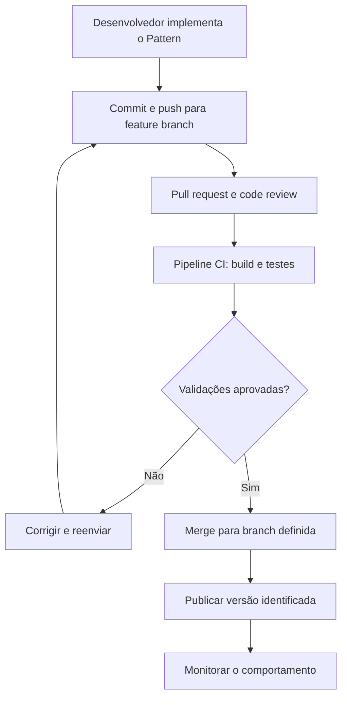
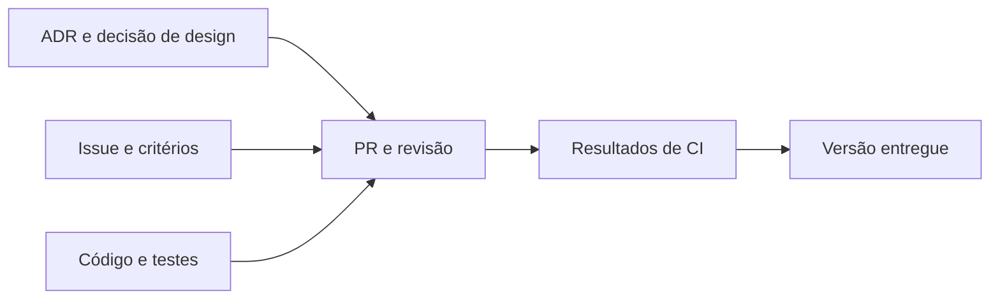
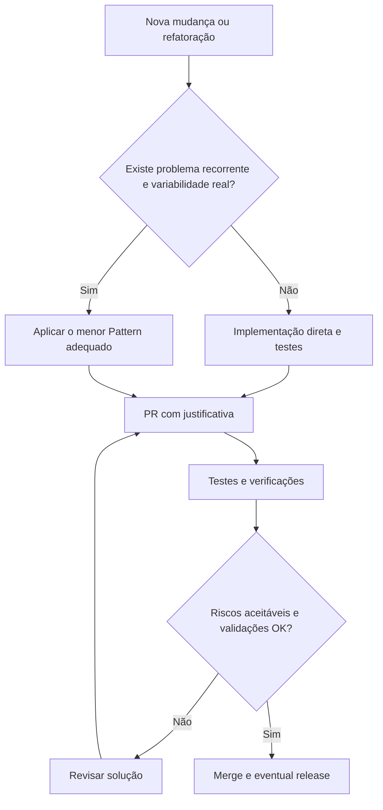

# Tema 04 — Integração entre Design Patterns e Gerência de Configuração

[← Tema 03](03-controle-versao-versionamento.md) · [Início](../README.md) · [Revisão para prova →](../apoio/revisao-prova.md)

## 1. Objetivos de aprendizagem

- Compreender a contribuição conjunta de **design modular** e **mudanças rastreáveis**.
- Planejar aplicação de patterns associada a issues, commits, revisões e validações automatizadas.
- Examinar um caso de e-commerce com **Strategy**, **Observer** e integração contínua.
- Avaliar o equilíbrio entre flexibilidade arquitetural e controle de mudanças.
- Documentar decisões de design e preparar releases seguras.

## 2. A conexão central [Conteúdo-base]

**Design Patterns** oferecem soluções para organizar criação, composição e colaboração de objetos. **Gerência de Configuração** estabelece a disciplina para que alterações nessas soluções sejam identificadas, revisadas, validadas e liberadas de maneira controlada.

Essa combinação permite relacionar duas perguntas importantes:

- **Por que o software foi desenhado assim?** Contexto do problema, padrão escolhido, decisão arquitetural e alternativas.
- **Como e quando esse desenho mudou?** Ticket, commits, revisão, build, teste e release que entregou a mudança.



**[Complemento técnico]** Ter componentes separados **pode** reduzir conflitos, mas não garante merges livres de colisão. Contratos de API, configuração, migrations e dependências compartilhadas podem concentrar mudanças de muitas equipes.

## 3. Patterns como suporte à evolução [Conteúdo-base]

| Padrão | Papel na aplicação | Como rastrear sua evolução |
|---|---|---|
| **Factory Method** | Especializar mecanismos de criação de objetos. | Registrar novos produtos/criadores e testes contratuais em PRs. |
| **Strategy** | Permitir trocar algoritmos sem alterar clientes. | Registrar nova política de desconto, critérios e testes de negócio. |
| **Observer** | Notificar observadores sobre evento ou mudança. | Registrar mudanças de assinantes e contratos de evento. |
| **Adapter** | Isolar diferenças entre interfaces internas e externas. | Versionar compatibilidade de integrações e testes de contrato. |
| **Singleton** | Controlar instância em escopo definido. | Justificar escopo, estado e impacto de concorrência. |

Padrões não precisam ser adicionados no início do projeto. Um caminho frequente é **refatorar após identificar variabilidade real**, preservar testes existentes e evoluir sem interrupções de comportamento.

## 4. Estudo de caso: e-commerce com Strategy e Observer

O material descreve sistemas de vendas com **novas regras de desconto e frete**, confirmação de pedidos e notificações. Vamos organizar um caso coerente, mostrando a ligação entre design e versionamento.

### 4.1 Contexto

Uma aplicação possui descontos para campanhas e precisa, após confirmação do pedido, atualizar estoque e comunicar o módulo fiscal. Regras evoluem em releases frequentes.

**Problema sem separação:** um serviço concentraria seleção de descontos, cálculo, baixa de estoque e notificação fiscal, criando razões de mudança concorrentes.

**Solução proposta:** usar `Strategy` para a variabilidade do cálculo e `Observer` para desacoplar reações à confirmação, com testes que garantam contratos.

### 4.2 Estrutura Mermaid



### 4.3 Exemplo mínimo do Strategy em Java [Complemento técnico]

```java
interface PoliticaDesconto {
    double aplicar(double valor);
}

final class SemDesconto implements PoliticaDesconto {
    public double aplicar(double valor) { return valor; }
}

final class DescontoSazonal implements PoliticaDesconto {
    public double aplicar(double valor) { return valor * 0.90; }
}

final class CalculadoraPedido {
    private final PoliticaDesconto politica;

    CalculadoraPedido(PoliticaDesconto politica) {
        this.politica = politica;
    }

    double total(double valor) {
        if (valor < 0) throw new IllegalArgumentException("Valor negativo");
        return politica.aplicar(valor);
    }
}

// Teste de comportamento ilustrativo:
// var calc = new CalculadoraPedido(new DescontoSazonal());
// assert Math.abs(calc.total(100.0) - 90.0) < 0.00001;
```

**[Nota de produção]** Para valores monetários, prefira `BigDecimal` com regras explícitas de arredondamento em vez de `double`. O exemplo usa `double` apenas para simplificar a apresentação do padrão.

### 4.4 Do requisito ao release: reprodução do fluxo acadêmico

**Diagrama Mermaid correspondente ao fluxo principal apresentado na Figura 1 de `ebook-04.pdf`:**



O conceito essencial é que a mudança arquitetural chegue ao usuário **passando por versionamento, revisão, testes e registro de release**, não apenas por uma alteração direta de código.

## 5. Fluxo de trabalho com commits granulares [Conteúdo-base + complemento]

O material recomenda que a implementação do pattern seja registrada em **pequenos commits coerentes**, com revisão via pull request.

```text
PED-142 — Incluir campanha de desconto sazonal

1. docs(adr): justificar adocao de Strategy (PED-142)
2. refactor(desconto): extrair interface PoliticaDesconto (PED-142)
3. feat(desconto): adicionar DescontoSazonal (PED-142)
4. test(desconto): cobrir campanhas e arredondamento (PED-142)
5. docs: atualizar diagrama e instrucoes (PED-142)

PR: Desconto sazonal com Strategy
- problema e critérios de aceite
- motivação da decisão de design
- alternativas consideradas
- riscos de comportamento e compatibilidade
- evidência de testes
- impacto em configuração e deploy
```

A granularidade útil não é “um commit por classe”, mas **um commit por intenção compreensível**. Evite misturar refatoração mecânica e alteração de regra de negócio se elas puderem ser revisadas separadamente.

## 6. Arquitetura documentada e estrutura de diretórios

Uma organização possível, sem caráter obrigatório:

```text
pedido-service/
├── docs/
│   ├── adr/
│   │   └── 0001-estrategia-de-descontos.md
│   └── diagramas.md
├── src/
│   ├── main/java/br/exemplo/pedidos/
│   │   ├── application/
│   │   ├── domain/desconto/
│   │   └── infrastructure/
│   └── test/java/br/exemplo/pedidos/
├── .github/workflows/ci.yml
├── pom.xml
└── README.md
```

**[Complemento técnico]** Agrupar por domínio ou responsabilidade costuma ser mais útil do que impor uma pasta por nome de pattern em toda a aplicação. Onde as interfaces, serviços e implementações estão localizados deve refletir o contexto do projeto, não uma taxonomia rígida.

### 6.1 ADR — Architecture Decision Record [Complemento técnico]

Uma **ADR** descreve o motivo de uma decisão de arquitetura. Complementa mensagens de commit, pois estas tendem a ser curtas e orientadas à execução.

```markdown
# ADR 0001 — Strategy para políticas de desconto

- Status: Aceita
- Contexto: novas campanhas exigem mudanças frequentes nas regras de desconto.
- Decisão: extrair `PoliticaDesconto` e implementar regras por estratégia.
- Alternativas: condicionais no serviço, tabela de regras ou motor de regras.
- Consequências positivas: testes isolados e extensibilidade.
- Custos/riscos: mais objetos e necessidade de governar seleção de estratégia.
- Evidências: ticket PED-142, PR correspondente, testes de regressão.
```



## 7. CI, qualidade e governança [Conteúdo-base]

Para verificar uma alteração arquitetural, a pipeline pode combinar:

1. **Compilação:** garante consistência sintática e resolução de dependências.
2. **Testes unitários:** conferem contratos de Strategy, Observer e outros componentes.
3. **Testes de integração/contrato:** detectam incompatibilidades com módulos ou parceiros.
4. **Análise estática e lint:** identificam problemas de estilo, possíveis bugs e regras configuradas.
5. **Análise de segurança e dependências:** quando integrada às ferramentas apropriadas.
6. **Verificação de aprovação e publicação:** bloqueia integração de mudanças que não cumprem os critérios do projeto.

**[Precisão técnica]** Lint **não prova automaticamente o cumprimento de SOLID**, e métricas como cobertura de testes não garantem correção do comportamento. Algumas regras arquiteturais podem ser verificadas com ferramentas e testes específicos, mas a coerência do pattern ainda exige revisão e raciocínio de design.

## 8. Equilíbrio entre flexibilidade e controle [Conteúdo-base]

A disciplina ressalta duas formas de excesso:

- **Overengineering arquitetural:** padrões demais, sem evidência de necessidade, criam indireção e aumentam a manutenção.
- **Burocracia processual:** aprovações redundantes, branches longas e tarefas manuais atrasam feedback e releases.

**Resposta equilibrada:** manter padrões de projeto justificados, commits pequenos, validações automatizadas, revisões focadas no risco e documentação do que realmente precisa ser lembrado no futuro.



## 9. Exercício integrado sugerido

**Objetivo:** exercitar um padrão e um fluxo de configuração no mesmo miniprojeto.

1. Crie uma issue para permitir descontos sazonais.
2. Registre a decisão de usar Strategy e seus critérios de aceite.
3. Crie uma branch curta e implemente o contrato da estratégia.
4. Adicione uma implementação concreta e testes automatizados.
5. Faça commits por intenção e abra um PR com links para issue e ADR.
6. Execute a pipeline e registre eventuais correções.
7. Após aprovação, integre e identifique a versão ou o artefato entregue.
8. Explique como diagnosticar e reverter uma regressão preservando o histórico.

**Critérios de avaliação:** comportamento correto, teste de contrato, ausência de abstração desnecessária, rastreabilidade dos commits, PR verificável e versão identificada.

## 10. Revisão para prova

- Padrões de projeto definem **soluções de design**; GCS estabelece **governança da evolução**.
- Um repositório bem mantido é parte da **documentação viva**, mas não substitui toda a arquitetura documentada.
- Observer ajuda a desacoplar notificações; Strategy isola algoritmos intercambiáveis.
- Branches, PRs, pipelines e tags suportam rastreabilidade, testes e releases.
- **Modularidade reduz a área potencial de impacto**, mas não elimina conflitos, regressões ou incompatibilidades.
- Regras automáticas complementam — não substituem — revisão de design e critérios de negócio.

**Perguntas de fixação:**

1. Qual evidência conecta uma decisão de design à versão entregue?
2. Como Strategy e SRP ajudam na criação de testes mais focados?
3. Por que a evolução de um Observer deve incluir testes de integração?
4. Qual o problema de adotar patterns apenas para “seguir boas práticas”?

**Respostas curtas:** (1) ADR/ticket → PR/commits → CI → tag/artefato; (2) isolam a política variável; (3) consumidores e contratos podem ser afetados; (4) abstração sem benefício real e maior custo de manutenção.

## 11. Referências internas

- `ebook-04.pdf`: integração entre patterns e GCS, estudo de caso de releases e desafios de governança (p. 2–5).
- `slides-04.pdf`: documentação viva, microsserviços, pipeline, miniprojeto e commits (slides 3–26).
- `podcast-tema-01.pdf`: estudo de e-commerce e uso combinado de Strategy, Observer, Adapter, Git e CI.
- `podcast-tema-02.pdf`: exercícios resolvidos envolvendo SOLID, GoF, GCS e fluxos Git.

[← Tema 03](03-controle-versao-versionamento.md) · [Início](../README.md) · [Revisão para prova →](../apoio/revisao-prova.md)
