# DevOps & Automation

> Documentação de estudo baseada no material da disciplina **DevOps: Automação e Orquestração**, **DevOps: Cultura e Colaboração** e **SRE: Fundamentos e Confiabilidade**, do professor Felipe Guerra de Oliveira.

---

## Sumário

1. [Visão geral](#1-visão-geral)
2. [O que é DevOps](#2-o-que-é-devops)
3. [Automação](#3-automação)
4. [Contexto histórico](#4-contexto-histórico)
5. [CI, Continuous Delivery e Continuous Deployment](#5-ci-continuous-delivery-e-continuous-deployment)
6. [DevSecOps](#6-devsecops)
7. [Infrastructure as Code](#7-infrastructure-as-code)
8. [Containers e Docker](#8-containers-e-docker)
9. [Kubernetes e orquestração](#9-kubernetes-e-orquestração)
10. [Cloud e modelos de serviço](#10-cloud-e-modelos-de-serviço)
11. [GitHub Actions](#11-github-actions)
12. [GitOps, AIOps e o futuro](#12-gitops-aiops-e-o-futuro)
13. [SRE — Site Reliability Engineering](#13-sre--site-reliability-engineering)
14. [SLA, SLI e SLO](#14-sla-sli-e-slo)
15. [Error Budget](#15-error-budget)
16. [Confiabilidade e alta disponibilidade](#16-confiabilidade-e-alta-disponibilidade)
17. [Canary Deployment](#17-canary-deployment)
18. [O profissional SRE](#18-o-profissional-sre)
19. [Mapa mental](#19-mapa-mental)
20. [Resumo para a prova](#20-resumo-para-a-prova)
21. [Questões de revisão](#21-questões-de-revisão)

---

# 1. Visão geral

DevOps não deve ser entendido apenas como um conjunto de ferramentas.

O material o apresenta principalmente como uma **cultura composta por pessoas, processos e práticas**, criada para aumentar a colaboração entre Desenvolvimento (**Dev**) e Operações (**Ops**) e acelerar a entrega de software de qualidade em produção. 

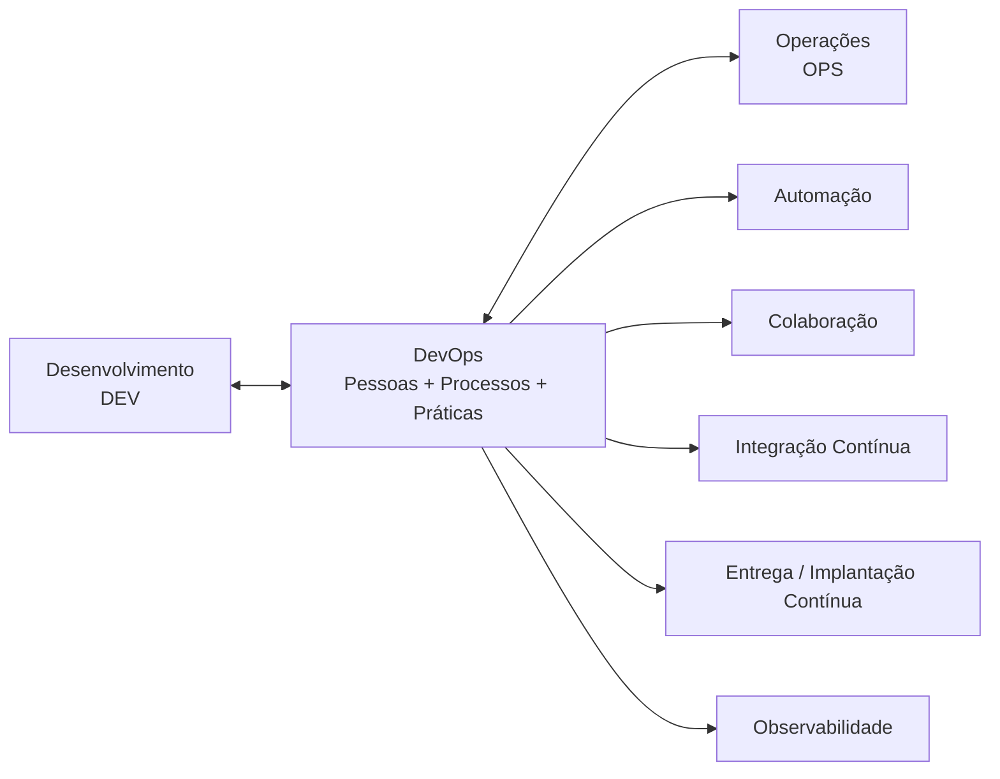

A ideia central da disciplina pode ser sintetizada como:

> **DevOps = cultura + colaboração + automação + feedback contínuo.**

A automação é tratada como elemento central porque permite reduzir trabalho manual, aumentar a reprodutibilidade e tornar a entrega mais rápida, confiável e segura. 

---

# 2. O que é DevOps

Antes de DevOps, Desenvolvimento e Operações normalmente funcionavam como áreas separadas.

Isso provocava:

- pouca comunicação;
- processos manuais;
- implantações demoradas;
- releases arriscados;
- dificuldade para diagnosticar problemas;
- ciclos de desenvolvimento longos.

O material relaciona o surgimento do DevOps justamente à necessidade de superar essa separação organizacional. 

### Modelo tradicional

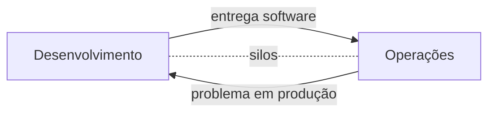

### Cultura DevOps

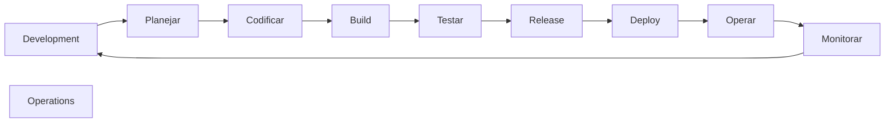

O ciclo é contínuo. Operação não representa o término do desenvolvimento: os dados produzidos em produção retornam ao processo como **feedback**.

---

# 3. Automação

## 3.1 Por que automatizar?

No material, automação é apresentada como o **coração da cultura DevOps**. Sem ela, objetivos como CI, entrega contínua, escalabilidade e observabilidade tornam-se muito mais difíceis de atingir. 

Automatizar permite principalmente:

| Problema manual | Com automação |
|---|---|
| Tarefas repetitivas | Execução automática |
| Inconsistência | Reprodutibilidade |
| Erros humanos | Redução da intervenção manual |
| Deploy demorado | Pipeline automatizado |
| Feedback tardio | Feedback rápido |
| Ambientes diferentes | Padronização |

O objetivo não é simplesmente substituir pessoas. O material enfatiza a liberação dos profissionais das tarefas repetitivas para atividades que agreguem maior valor. 

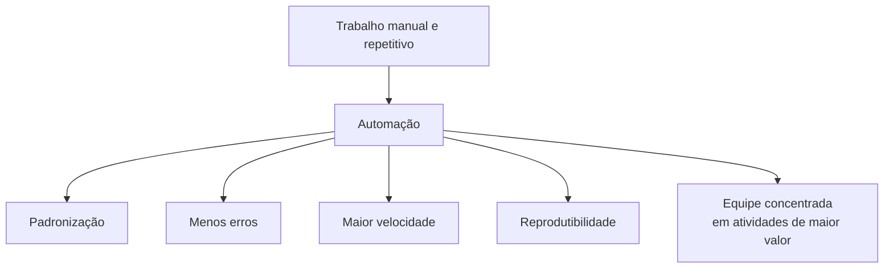

---

# 4. Contexto histórico

O material associa a origem do DevOps ao movimento Agile e ao crescimento de práticas de Continuous Integration e Continuous Deployment no final dos anos 2000. 

Uma linha do tempo apresentada na disciplina destaca:

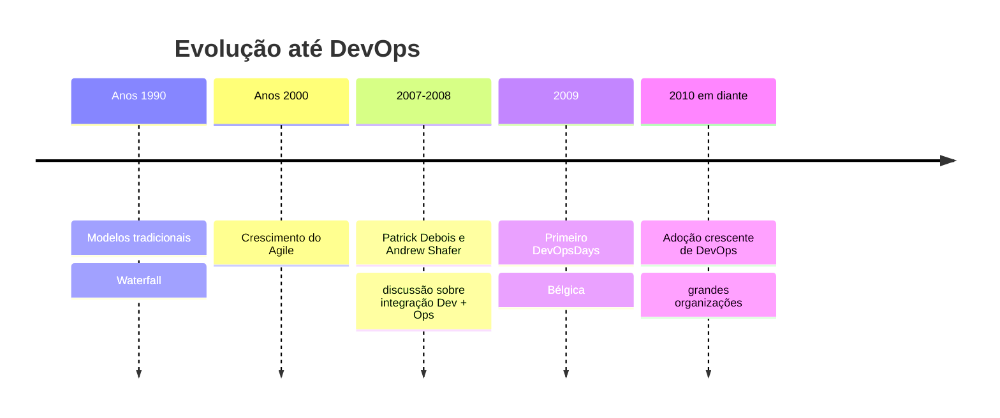

Esses marcos são explicitamente apresentados pelo material. 

## Waterfall

No modelo Waterfall:

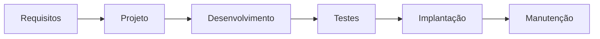

As fases são sequenciais e uma etapa normalmente precisa terminar antes da próxima. Isso favorece ciclos longos quando comparado às práticas iterativas abordadas pela disciplina. 

---

# 5. CI, Continuous Delivery e Continuous Deployment

Esses conceitos são fundamentais e possuem significados diferentes.

## Continuous Integration — CI

**Integração Contínua** é a prática de integrar frequentemente as alterações em um repositório central e executar verificações automatizadas sobre essas alterações. 

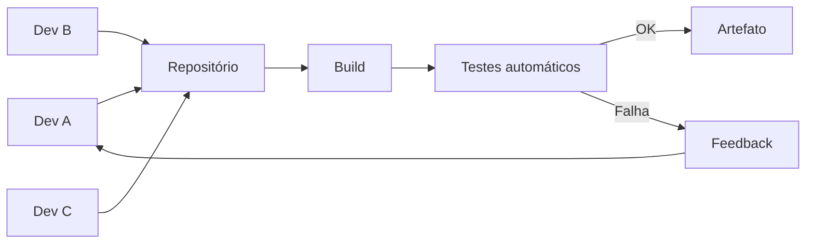

## Continuous Delivery

O software permanece constantemente em condição de ser implantado, mas a entrada em produção pode depender de uma decisão/autorização.

## Continuous Deployment

O material diferencia Continuous Deployment de Continuous Delivery: no Deployment, alterações aprovadas pelos testes seguem automaticamente para produção; no Delivery, ficam preparadas para implantação, mas ainda existe autorização adicional. 

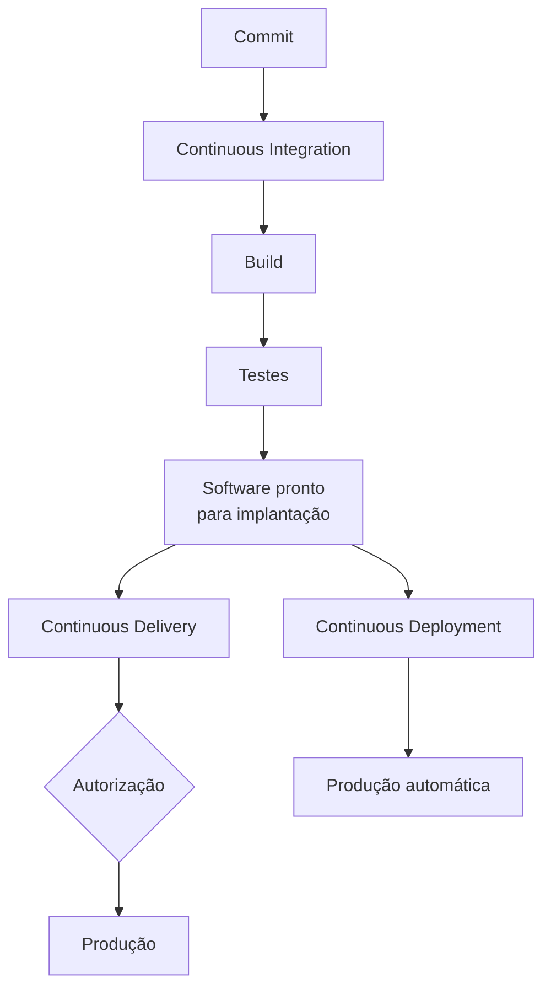

### Para memorizar

> **CI integra e testa.**  
> **Delivery deixa pronto para produção.**  
> **Deployment coloca automaticamente em produção.**

---

# 6. DevSecOps

DevSecOps enfatiza que **segurança deve participar de todo o ciclo de desenvolvimento**, e não ser uma etapa adicionada apenas no final.

O material destaca três princípios. 

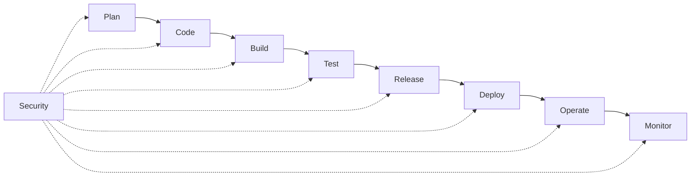

### Shift Left Security

Segurança é introduzida o mais cedo possível.

### Automação de segurança

Testes de segurança são incorporados ao processo automatizado.

### Monitoramento contínuo

Vulnerabilidades precisam continuar sendo observadas durante a operação.

O material cita como exemplos:

| Objetivo | Ferramentas apresentadas |
|---|---|
| Análise de código | SonarQube, Snyk, Checkmarx |
| Dependências | OWASP Dependency-Check, WhiteSource |
| Containers | Aqua Security, Trivy, Falco |


Outro conceito enfatizado é a **rastreabilidade**: é importante identificar o que aconteceu no sistema e quem criou ou modificou algo. 

---

# 7. Infrastructure as Code

Infrastructure as Code (**IaC**) aplica princípios de desenvolvimento de software à infraestrutura.

Em vez de configurar manualmente servidores e ambientes repetidas vezes, a infraestrutura passa a ser definida por código.

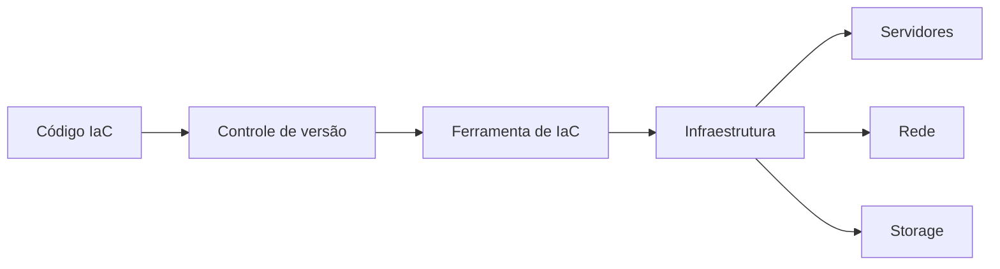

O material utiliza **Terraform** como exemplo prático de IaC e contrapõe essa abordagem ao processo tradicional de instalar manualmente sistema operacional, servidor de aplicação, banco de dados e demais componentes. 

### Benefícios conceituais

- repetibilidade;
- automação;
- versionamento;
- padronização;
- rastreabilidade;
- menor dependência de configuração manual.

---

# 8. Containers e Docker

Docker é apresentado como plataforma para criar, distribuir e executar aplicações em **containers**.

O material ressalta uma distinção importante:

> **Container Docker não é máquina virtual.**

Docker oferece isolamento e portabilidade, permitindo maior consistência entre ambientes. 

## 8.1 Arquitetura Docker

Os elementos apresentados são: 

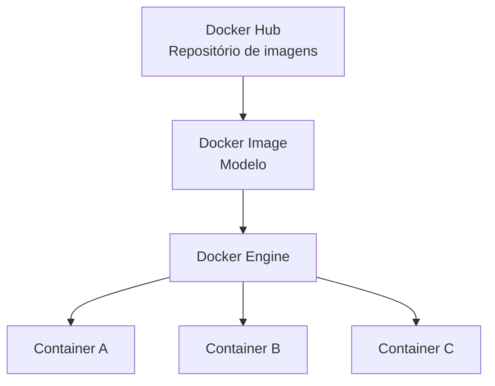

### Docker Engine

Cria e gerencia containers.

### Docker Image

Modelo utilizado para criar containers.

### Docker Container

Instância isolada da aplicação.

### Docker Hub

Repositório de imagens.

O principal ganho discutido é a consistência:

```text
Desenvolvimento ≈ Teste ≈ Produção
```

A padronização também torna pipelines CI/CD mais eficientes. 

---

# 9. Kubernetes e orquestração

Quando existem poucos containers, administrá-los individualmente ainda pode ser possível.

Com centenas ou milhares, surge outro problema:

> **quem gerencia os containers?**

É aí que entra a **orquestração**.

Segundo o material, Kubernetes auxilia em: 

- implantação automática;
- autoescalabilidade;
- alta disponibilidade;
- gerenciamento de configuração;
- descoberta de serviços;
- tolerância a falhas.

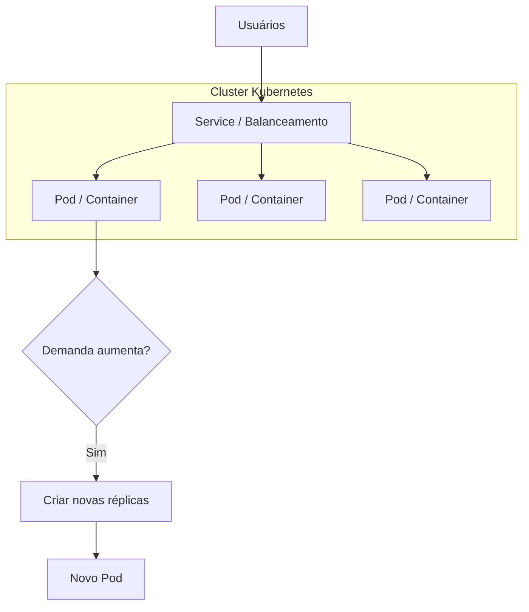

## 9.1 Arquitetura Kubernetes

O material divide o cluster em **Control Plane** e **Worker Nodes**. 

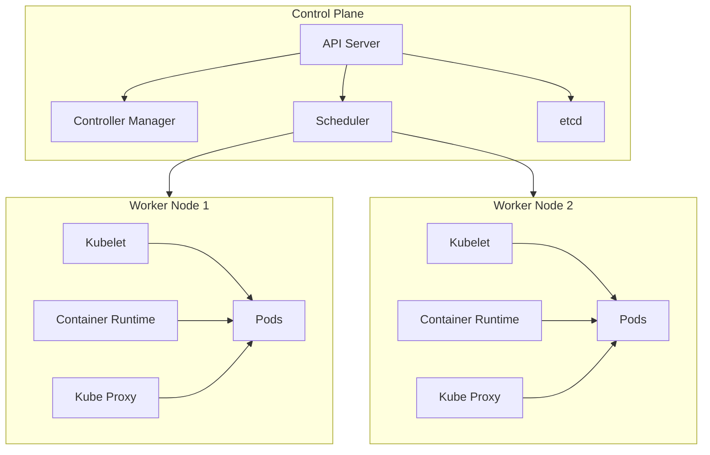

### Control Plane

| Componente | Responsabilidade |
|---|---|
| API Server | Interface principal |
| Controller Manager | Mantém o estado desejado |
| Scheduler | Distribui cargas |
| etcd | Armazena o estado do cluster |

### Worker Node

| Componente | Responsabilidade |
|---|---|
| Kubelet | Gerencia containers no nó |
| Container Runtime | Executa containers |
| Kube Proxy | Rede e balanceamento |

---

# 10. Cloud e modelos de serviço

O material relaciona a evolução do DevOps com a computação em nuvem.

## IaaS

**Infrastructure as a Service** disponibiliza infraestrutura computacional sob demanda.

Exemplos conceituais:

- processamento;
- storage;
- rede;
- servidores.

## PaaS

**Platform as a Service** desloca o foco da infraestrutura para uma plataforma pronta sobre a qual aplicações podem ser desenvolvidas/executadas.

O material faz essa progressão IaaS → PaaS ao introduzir GitHub Actions e plataformas capazes de integrar etapas do processo de produção de software.  

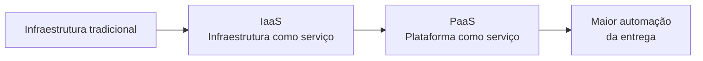

---

# 11. GitHub Actions

GitHub Actions permite automatizar workflows de desenvolvimento diretamente no repositório.

O material cita tarefas como:

- build;
- teste;
- empacotamento;
- release;
- deployment;
- gerenciamento de projetos.


## 11.1 Workflow

Um **workflow** é definido em YAML no diretório:

```text
.github/workflows/
```

Pode ser disparado por eventos como:

```text
push
pull_request
issues
```

## 11.2 Hierarquia

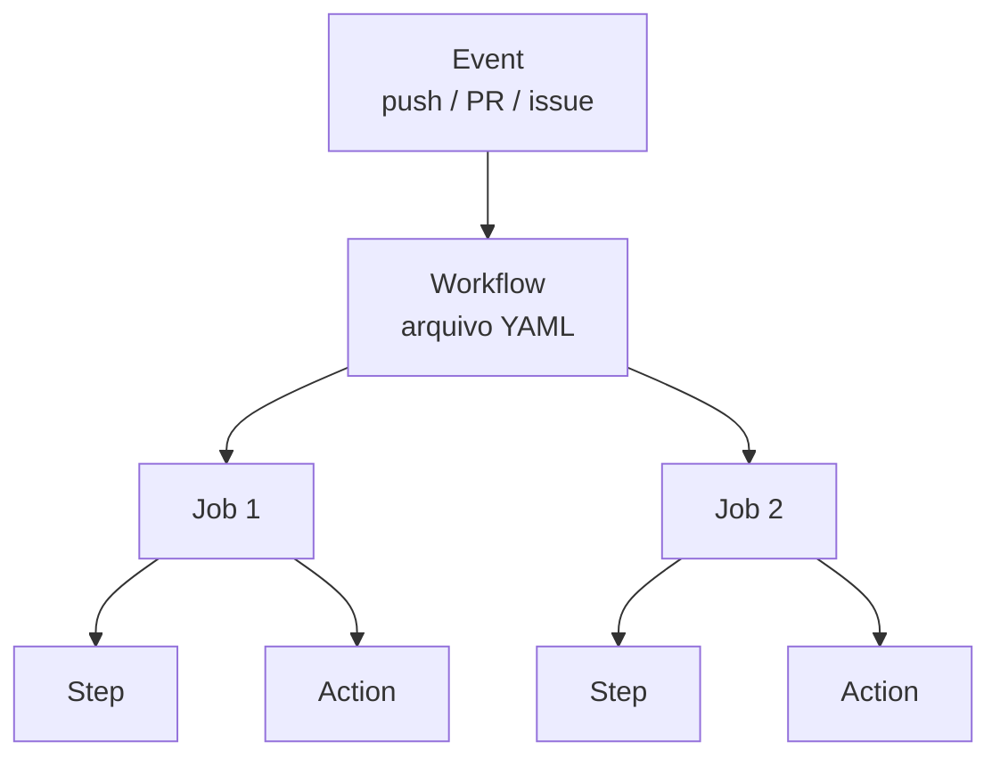

A estrutura apresentada no material é: 

| Elemento | Significado |
|---|---|
| Workflow | Processo automatizado |
| Event | Evento que dispara o workflow |
| Job | Unidade de trabalho |
| Step | Comando/ação dentro do job |
| Action | Componente reutilizável |

Jobs podem executar em sequência ou paralelamente.

## 11.3 Exemplo conceitual

```yaml
name: CI

on:
  push:
  pull_request:

jobs:
  build:
    runs-on: ubuntu-latest

    steps:
      - name: Checkout
        uses: actions/checkout@v4

      - name: Build
        run: echo "Compilando aplicação"

      - name: Test
        run: echo "Executando testes"
```

> Este YAML é um **exemplo didático elaborado para esta documentação**; não é código reproduzido do material.

O fluxo correspondente é:

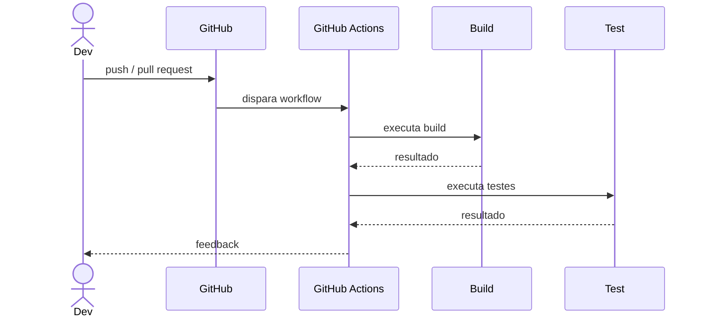

O material ressalta ainda que GitHub Actions não se restringe à CI: pode suportar também a entrega contínua. 

---

# 12. GitOps, AIOps e o futuro

O material apresenta uma convergência:

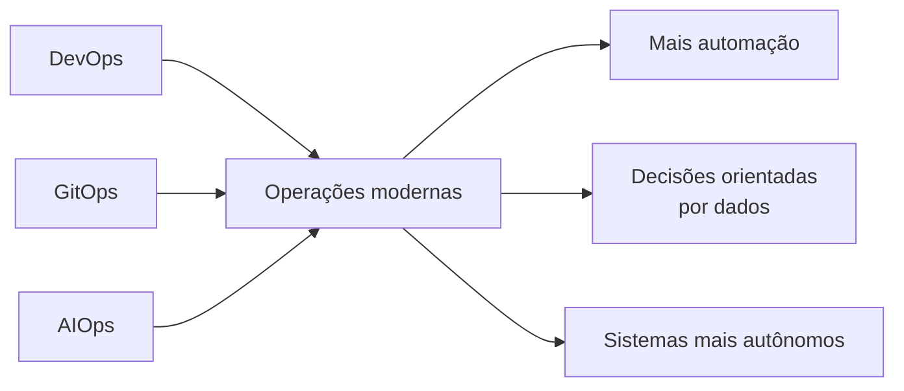

## GitOps

É descrito no material como **gestão de infraestrutura via Git**, de maneira semelhante ao gerenciamento do código-fonte.

## AIOps

Utiliza inteligência artificial como suporte às operações.

O material também menciona IA generativa e Machine Learning, especialmente em análise de dados. 

### IA em CI/CD

São apontadas possibilidades como:

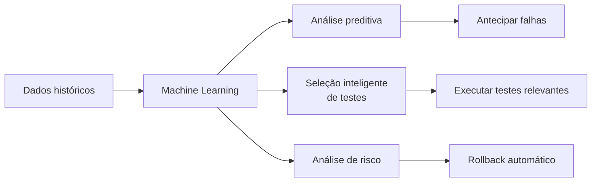

O material relaciona análises preditivas a dados históricos, seleção de testes relevantes e rollback automático baseado em risco. 

Mas há uma ideia ainda mais importante:

> **ferramentas não substituem cultura.**

A colaboração continua sendo tratada como o aspecto mais importante. 

---

# 13. SRE — Site Reliability Engineering

**Site Reliability Engineering (SRE)** aplica os princípios de DevOps através de práticas concretas e mensuráveis.

O material utiliza a conhecida analogia:

```text
class SRE implements interface DevOps
```

Isto representa a ideia de que:

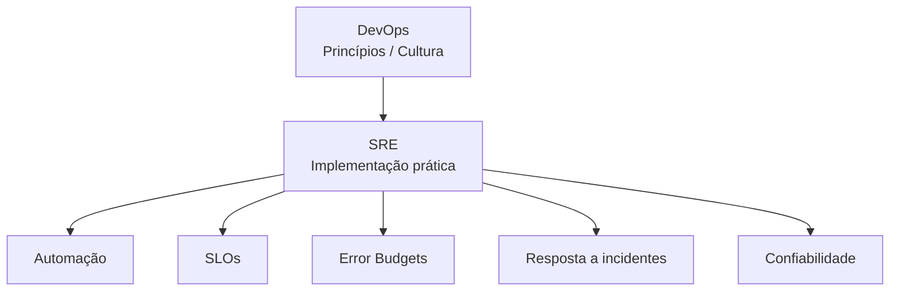

Enquanto DevOps enfatiza colaboração e automação, SRE transforma esses princípios em mecanismos mensuráveis. 

## 13.1 Objetivos de SRE

O material destaca quatro frentes: 

1. automatizar tarefas operacionais;
2. definir e monitorar SLOs;
3. gerenciar Error Budgets;
4. responder eficientemente a incidentes.

E existe uma premissa importante:

> **Sistemas falham.**

A confiabilidade não parte da ideia de impedir absolutamente toda falha, mas de **planejar e administrar a confiabilidade**. 

---

# 14. SLA, SLI e SLO

Esta é uma das partes **mais importantes para a prova**.

## 14.1 SLI — Service Level Indicator

É aquilo que **medimos**.

O material define SLI como uma métrica que mede determinado aspecto do desempenho do serviço do ponto de vista do usuário.

Exemplos:

- latência;
- taxa de erros.


## 14.2 SLO — Service Level Objective

É a **meta** definida sobre um SLI.

Exemplo didático:

```text
SLI = percentual de requisições bem-sucedidas
SLO = 99,9% das requisições devem ser bem-sucedidas
```

## 14.3 SLA — Service Level Agreement

É o **acordo de nível de serviço**.

O SLA estabelece parâmetros como:

- qualidade;
- disponibilidade;
- responsabilidades;
- indicadores;
- procedimentos de incidentes;
- consequências pelo descumprimento.


### Relação

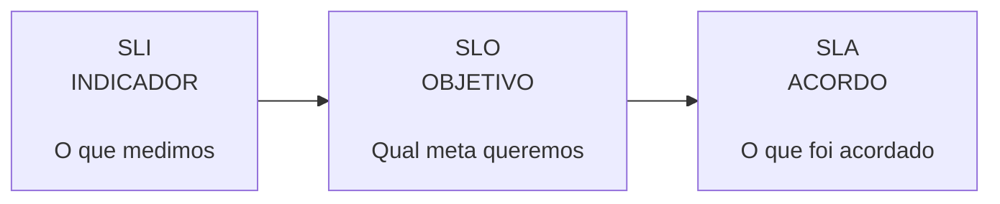

### Regra para memorizar

| Conceito | Pergunta |
|---|---|
| **SLI** | O que estou medindo? |
| **SLO** | Qual meta quero atingir? |
| **SLA** | Qual compromisso foi acordado? |

---

# 15. Error Budget

O **Error Budget — orçamento de erro** representa a quantidade de falha considerada aceitável durante determinado período sem comprometer a experiência do usuário. 

A premissa é:

> nenhum sistema consegue ser 100% confiável durante todo o tempo.

## 15.1 Exemplo matemático

Suponha:

```text
SLO = 99,9% de disponibilidade
```

Então, conceitualmente:

```text
Error Budget = 100% - SLO
Error Budget = 100% - 99,9%
Error Budget = 0,1%
```

Esse orçamento representa a margem disponível para falhas dentro do período considerado.

## 15.2 Tomada de decisão

```mermaid
flowchart TD
    SLO["Definir SLO"]
    SLI["Coletar SLI"]
    MON["Monitorar serviço"]
    EB{"Error Budget<br/>disponível?"}

    FEATURE["Continuar evolução<br/>e novas features"]
    REL["Priorizar correções,<br/>confiabilidade e estabilidade"]

    SLO --> SLI
    SLI --> MON
    MON --> EB

    EB -->|"Há orçamento"| FEATURE
    EB -->|"Orçamento se esgotando"| REL

    FEATURE --> MON
    REL --> MON
```

O Error Budget, portanto, não é apenas uma métrica.

Ele é uma **ferramenta de gestão e decisão** para equilibrar:

```text
INOVAÇÃO <---------- equilíbrio ----------> CONFIABILIDADE
```

Se há orçamento disponível, existe espaço para mudanças e experimentação.

Se está se esgotando, o material orienta priorizar estabilidade, correções e confiabilidade. 

---

# 16. Confiabilidade e alta disponibilidade

O material utiliza uma arquitetura em AWS para discutir disponibilidade, load balancing, replicação e custo. 

Uma representação equivalente é:

```mermaid
flowchart LR
    USER["Usuário<br/>Mobile"]

    USER --> LB["Load Balancer"]

    subgraph REGION["Região AWS"]
        LB --> APP1["Aplicação X<br/>Instância 1"]
        LB --> APP2["Aplicação X<br/>Instância 2"]

        APP1 --> DB[("Banco de Dados<br/>Clusterizado")]
        APP2 --> DB
    end
```

Se uma instância falhar, o balanceador pode direcionar tráfego para outra.

## 16.1 Disponibilidade tem custo

O material mostra um ponto essencial de arquitetura:

> aumentar disponibilidade normalmente aumenta também o custo.

No exemplo da aula, aumentar a disponibilidade exige avaliar:

- réplicas da aplicação;
- banco replicado;
- outra região;
- outro load balancer;
- roteamento;
- localização dos usuários;
- latência;
- recuperação de desastre.


```mermaid
flowchart TD
    SLA["SLA desejado"]

    SLA --> APP["Aplicação redundante"]
    SLA --> DB["Banco replicado"]
    SLA --> LB["Load Balancing"]
    SLA --> REGION["Múltiplas regiões"]
    SLA --> OBS["Observabilidade"]
    SLA --> DR["Disaster Recovery"]

    APP --> COST["Custo"]
    DB --> COST
    LB --> COST
    REGION --> COST

    COST --> DEC["Decisão técnica + negócio"]
```

Esse é um ponto conceitual muito importante:

**não se busca disponibilidade máxima a qualquer custo; busca-se a disponibilidade adequada às necessidades do negócio.**

O material conclui que uma aplicação não precisa permanecer disponível 100% do tempo; deve-se estabelecer uma meta e alocar recursos para alcançá-la. 

## 16.2 Ativo-Ativo

No modelo ativo-ativo, dois ou mais ambientes processam tráfego simultaneamente.

```mermaid
flowchart TD
    USERS["Usuários"] --> ROUTER["Roteamento / DNS"]

    ROUTER --> R1["Região A<br/>ATIVA"]
    ROUTER --> R2["Região B<br/>ATIVA"]

    R1 --> DB1[("DB A")]
    R2 --> DB2[("DB B")]

    DB1 <--> DB2
```

Caso um ambiente falhe, outro continua atendendo.

O objetivo é reduzir indisponibilidade e manter continuidade do negócio. 

---

# 17. Canary Deployment

Canary Deployment reduz o risco de implantação liberando inicialmente uma nova versão apenas para uma parcela limitada dos usuários ou servidores.


```mermaid
flowchart TD
    VERSION["Nova versão"]

    VERSION --> CANARY["Pequeno grupo<br/>Canary"]
    CANARY --> MON["Monitorar"]

    MON --> DEC{"Comportamento<br/>adequado?"}

    DEC -->|"Sim"| EXPAND["Expandir gradualmente"]
    EXPAND --> PROD["Todos os usuários"]

    DEC -->|"Não"| ROLLBACK["Rollback"]
```

### Objetivo

Descobrir problemas afetando uma população reduzida antes de expor todos os usuários à nova versão.

---

# 18. O profissional SRE

SRE não é apenas operação.

O profissional precisa compreender desenvolvimento, infraestrutura, confiabilidade e negócio.

O exemplo de mercado apresentado na disciplina relaciona conhecimentos como:

- ciclo de desenvolvimento;
- boas práticas de software;
- AWS;
- padrões de projeto;
- microsserviços;
- troubleshooting;
- causa raiz;
- performance;
- segurança;
- métodos ágeis;
- decisões orientadas por dados;
- Linux.


```mermaid
mindmap
  root((SRE))
    Desenvolvimento
      Ciclo de software
      Boas práticas
      Padrões
      Microsserviços
    Operações
      Linux
      Cloud
      Troubleshooting
    Confiabilidade
      SLI
      SLO
      SLA
      Error Budget
    Cultura
      Agile
      Colaboração
      Comunicação
    Análise
      Dados
      Performance
      Segurança
      Causa raiz
```

---

# 19. Mapa mental

```mermaid
mindmap
  root((DevOps & Automation))
    Cultura
      Colaboração
      Dev
      Ops
      Comunicação
      Responsabilidade compartilhada
    Automação
      CI
      Delivery
      Deployment
      IaC
      Testes
      Rollback
    DevSecOps
      Shift Left
      Testes de segurança
      Monitoramento
      Rastreabilidade
    Containers
      Docker
        Images
        Containers
        Engine
        Hub
      Kubernetes
        Control Plane
        Worker Nodes
        Escalabilidade
        Resiliência
    GitHub Actions
      Workflow
      Events
      Jobs
      Steps
      Actions
    Evolução
      GitOps
      AIOps
      Machine Learning
    SRE
      Confiabilidade
      Observabilidade
      SLI
      SLO
      SLA
      Error Budget
      Toil
      Incidentes
      Canary
```

---

# 20. Resumo para a prova

## Conceitos que precisam estar claros

| Conceito | Resumo |
|---|---|
| **DevOps** | Cultura de integração e colaboração entre desenvolvimento e operações |
| **Automação** | Reduz trabalho manual e aumenta velocidade e reprodutibilidade |
| **CI** | Integra alterações e executa verificações continuamente |
| **Continuous Delivery** | Mantém software pronto para implantação |
| **Continuous Deployment** | Implanta automaticamente após validação |
| **DevSecOps** | Integra segurança ao ciclo DevOps |
| **Shift Left** | Antecipar segurança para fases iniciais |
| **IaC** | Infraestrutura definida e gerenciada por código |
| **Docker Image** | Modelo usado para criar containers |
| **Container** | Instância isolada da aplicação |
| **Kubernetes** | Orquestrador de containers |
| **GitHub Actions** | Automação baseada em workflows |
| **Workflow** | Processo automatizado em YAML |
| **Event** | Dispara workflow |
| **Job** | Unidade de trabalho |
| **Step** | Etapa de um job |
| **Action** | Componente reutilizável |
| **GitOps** | Gestão de infraestrutura via Git |
| **AIOps** | IA aplicada como suporte às operações |
| **SRE** | Implementação prática e mensurável de princípios DevOps |
| **SLI** | Indicador medido |
| **SLO** | Meta para o indicador |
| **SLA** | Acordo sobre o serviço |
| **Error Budget** | Margem aceitável de falhas |
| **Toil** | Trabalho operacional manual/repetitivo que SRE procura reduzir |
| **Canary** | Implantação inicial para grupo reduzido |
| **Ativo-Ativo** | Vários ambientes ativos simultaneamente |

### Relação que merece ser decorada

```mermaid
flowchart LR
    DEVOPS["DEVOPS<br/>Cultura"]
    AUTO["AUTOMAÇÃO"]
    CICD["CI/CD"]
    SRE["SRE<br/>Confiabilidade"]
    SLI["SLI<br/>Medir"]
    SLO["SLO<br/>Definir meta"]
    EB["Error Budget<br/>Gerenciar risco"]
    SLA["SLA<br/>Compromisso"]

    DEVOPS --> AUTO
    AUTO --> CICD
    DEVOPS --> SRE
    SRE --> SLI
    SLI --> SLO
    SLO --> EB
    SLO --> SLA
```

### Pegadinhas prováveis

**1. DevOps é uma ferramenta?**  
Não. No material, é fundamentalmente uma **cultura**.

**2. Automação substitui DevOps?**  
Não. É um elemento central para viabilizar suas práticas.

**3. GitHub Actions serve apenas para CI?**  
Não. Essa afirmação aparece explicitamente como falsa no quiz da disciplina; a ferramenta também pode participar da entrega contínua. 

**4. Docker Container é máquina virtual?**  
Não. O material ressalta explicitamente essa diferença. 

**5. SLI e SLO são iguais?**  
Não. **SLI mede; SLO define uma meta baseada no indicador.**

**6. Error Budget significa aceitar software ruim?**  
Não. É uma forma controlada de administrar a margem de falhas e equilibrar confiabilidade e inovação.

**7. SRE tenta garantir 100% de disponibilidade?**  
Não necessariamente. O material destaca que a meta adequada deve ser definida e os recursos alocados de acordo com ela. 

---

# 21. Questões de revisão

### 1. O que melhor caracteriza DevOps?

**Resposta:** uma cultura baseada na colaboração entre Desenvolvimento e Operações, apoiada por processos, práticas e automação.

### 2. Por que a automação é tão importante?

**Resposta:** porque reduz trabalho manual e repetitivo, aumenta a reprodutibilidade e permite práticas como CI/CD, escalabilidade e observabilidade.

### 3. Qual a diferença entre Continuous Delivery e Continuous Deployment?

**Resposta:** Delivery mantém o software pronto para implantação; Deployment automatiza também sua entrada em produção.

### 4. O que significa Shift Left Security?

**Resposta:** introduzir atividades de segurança nas fases iniciais do ciclo de desenvolvimento.

### 5. Qual a finalidade da IaC?

**Resposta:** definir e provisionar infraestrutura de maneira automatizada e reproduzível através de código.

### 6. Docker e Kubernetes possuem a mesma função?

**Resposta:** não. Docker está relacionado à criação e execução de containers; Kubernetes à sua orquestração em escala.

### 7. O que dispara um workflow no GitHub Actions?

**Resposta:** um evento, como push, pull request ou outro evento configurado.

### 8. Qual a relação entre Workflow, Job e Step?

```text
Workflow
└── Job
    ├── Step
    ├── Step
    └── Step
```

### 9. O que significa a expressão `class SRE implements interface DevOps`?

**Resposta:** representa a ideia de SRE como implementação prática de princípios de DevOps por meio de mecanismos concretos e mensuráveis. 

### 10. Qual a diferença entre SLI, SLO e SLA?

**Resposta:**

```text
SLI → indicador
SLO → objetivo/meta
SLA → acordo
```

### 11. O que é Error Budget?

**Resposta:** quantidade de falha aceitável em determinado período sem comprometer a experiência esperada.

### 12. O que fazer quando o Error Budget está se esgotando?

**Resposta:** reduzir o foco em novas features e priorizar correções, estabilidade e confiabilidade, conforme o modelo apresentado na disciplina. 

### 13. O que é Canary Deployment?

**Resposta:** liberação de uma nova versão inicialmente para um grupo limitado, permitindo identificar problemas antes da expansão geral.

### 14. Qual a relação entre disponibilidade e custo?

**Resposta:** aumentar a disponibilidade pode exigir redundância, replicação, múltiplas regiões e outros recursos, elevando os custos. A decisão precisa equilibrar requisito técnico e necessidade do negócio.

### 15. Qual é a ideia central que conecta toda a disciplina?

```text
CULTURA
   ↓
COLABORAÇÃO
   ↓
AUTOMAÇÃO
   ↓
CI/CD
   ↓
OBSERVABILIDADE
   ↓
CONFIABILIDADE
   ↓
FEEDBACK
   ↓
MELHORIA CONTÍNUA
```

O material fecha essa evolução reforçando que, mesmo com GitOps, AIOps, IA e níveis crescentes de automação, **colaboração e cultura continuam fundamentais**, especialmente em equipes híbridas e remotas. 

---

## Revisão de 1 minuto

> **DevOps é cultura, não ferramenta.**  
> Automação reduz tarefas manuais e sustenta CI/CD.  
> DevSecOps desloca segurança para todo o ciclo.  
> IaC transforma infraestrutura em código.  
> Docker padroniza aplicações em containers.  
> Kubernetes orquestra containers.  
> GitHub Actions automatiza workflows.  
> GitOps gerencia infraestrutura por Git.  
> AIOps aplica IA às operações.  
> SRE transforma princípios DevOps em práticas mensuráveis de confiabilidade.  
> **SLI mede, SLO define a meta e SLA estabelece o acordo.**  
> Error Budget equilibra inovação e confiabilidade.  
> Observabilidade fornece informações para decidir.  
> Canary Deployment reduz o risco de releases.  
> **Automação é central, mas cultura e colaboração continuam sendo a base.**