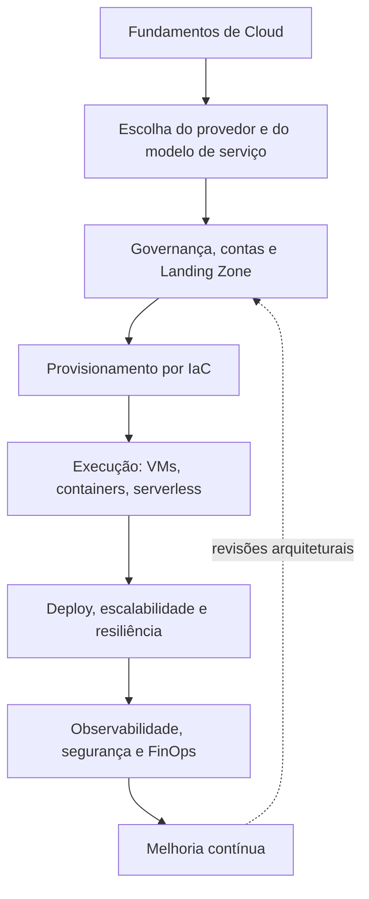

# Cloud Computing — Pós-Graduação em Frontend Engineering | IMPACTA

> Material de estudo em português, fundamentado nos seis PDFs (e-books e slides) das três aulas ministradas por João Henrique Victorino da Silva. Estruturado para consulta no GitHub e revisão para a prova. Os diagramas Mermaid são reconstruções didáticas das ideias e figuras da disciplina — não transcrições pixel a pixel. 

## Roteiro de leitura

| Etapa | Documento | Principais conteúdos |
|---|---|---|
| 1 | [Aula 01 — Provedores de Nuvem](./aula-01-provedores-de-nuvem.md) | Fundamentos, AWS/Azure/GCP, modelos de serviço, 7 Rs, topologias, IaC e Terraform |
| 2 | [Aula 02 — Preparação de Ambiente](./aula-02-preparacao-de-ambiente.md) | Azure com Terraform, serverless, bancos, armazenamento, mensageria, Docker e Kubernetes |
| 3 | [Aula 03 — Estratégias e Implementação](./aula-03-estrategias-implementacao.md) | 12 fatores, implantação, adoção de cloud, Landing Zone, Well-Architected, FinOps, ECS e GKE |
| 4 | [Revisão para a prova](./revisao-para-prova.md) | Quadros comparativos, conceitos essenciais, questões e gabarito comentado |

## Visão integrada da disciplina

### Objetivos de aprendizagem

Ao final da leitura, o estudante deverá conseguir:

1. Explicar IaaS, PaaS, SaaS e responsabilidade compartilhada.
2. Escolher entre single-cloud, híbrida e multicloud e justificar o trade-off.
3. Identificar as sete estratégias de migração e seus impactos.
4. Descrever o fluxo declarativo do Terraform e a função do estado (`.tfstate`).
5. Diferenciar máquina virtual, contêiner, Kubernetes e serverless.
6. Escolher modelos de banco de dados, armazenamento e comunicação.
7. Aplicar os 12 fatores e as estratégias de rollout/testes.
8. Planejar uma Landing Zone, usar CAF, Well-Architected e FinOps.

## Padrão editorial

- **Base da aula:** preserva a terminologia, estrutura conceitual e exemplos do material fornecido.
- **Diagrama Mermaid:** interpretação didática dos esquemas e figuras presentes nos slides.
- **Exemplo ilustrativo:** comandos e configurações complementares escritos para estudo; não são cópias integrais de código-fonte demonstrado.
- **Atualização técnica:** informação moderna separada explicitamente da explicação original.
- **Boas práticas e riscos:** precauções para distinguir exercícios acadêmicos de implantação real.
- **Revisão:** perguntas alinhadas aos conceitos encontrados nos PDFs.

## Fontes de aula

- Aula 01: *Ebook — Provedores de Nuvem* (19 páginas de conteúdo, PDF de 20 páginas); *Slides — Cloud Computing* (45 páginas).
- Aula 02: *Ebook — Preparação de Ambiente* (20 páginas de conteúdo, PDF de 21 páginas); *Slides — Cloud Computing* (36 páginas).
- Aula 03: *Ebook — Estratégias e Implementação* (25 páginas de conteúdo, PDF de 26 páginas); *Slides — Cloud Computing* (60 páginas).

**Observação:** a paginação depende da versão exportada do PDF. Ao longo das notas, referências usam o número de página indicado no próprio material, quando disponível.

## Fontes oficiais complementares

- [The Twelve-Factor App](https://12factor.net/)
- [Terraform](https://developer.hashicorp.com/terraform/docs)
- [Kubernetes](https://kubernetes.io/docs/home/)
- [Docker](https://docs.docker.com/)
- [Azure Cloud Adoption Framework](https://learn.microsoft.com/en-us/azure/cloud-adoption-framework/)
- [AWS Cloud Adoption Framework](https://aws.amazon.com/cloud-adoption-framework/)
- [Google Cloud Adoption Framework](https://cloud.google.com/adoption-framework)
- [AWS Well-Architected Framework](https://aws.amazon.com/architecture/well-architected/)
- [Azure Well-Architected Framework](https://learn.microsoft.com/en-us/azure/well-architected/)
- [Google Cloud Architecture Framework](https://cloud.google.com/architecture/framework)
- [FinOps Foundation](https://www.finops.org/framework/)

> **Segurança e custos:** não execute os exemplos em contas reais sem verificar permissões, credenciais, preços, quotas e configuração da rede. Exclua recursos de laboratório ao término dos testes e confirme se há componentes de cobrança persistentes.
