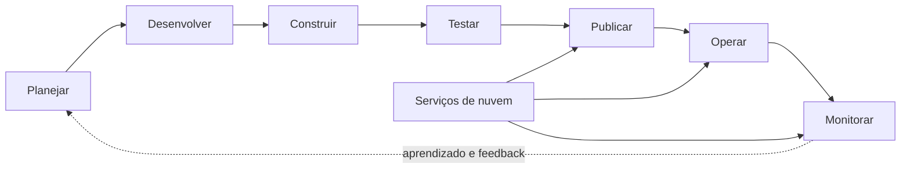
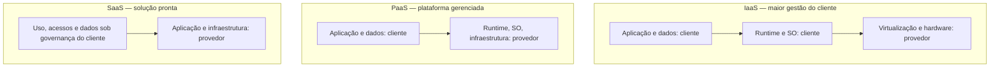
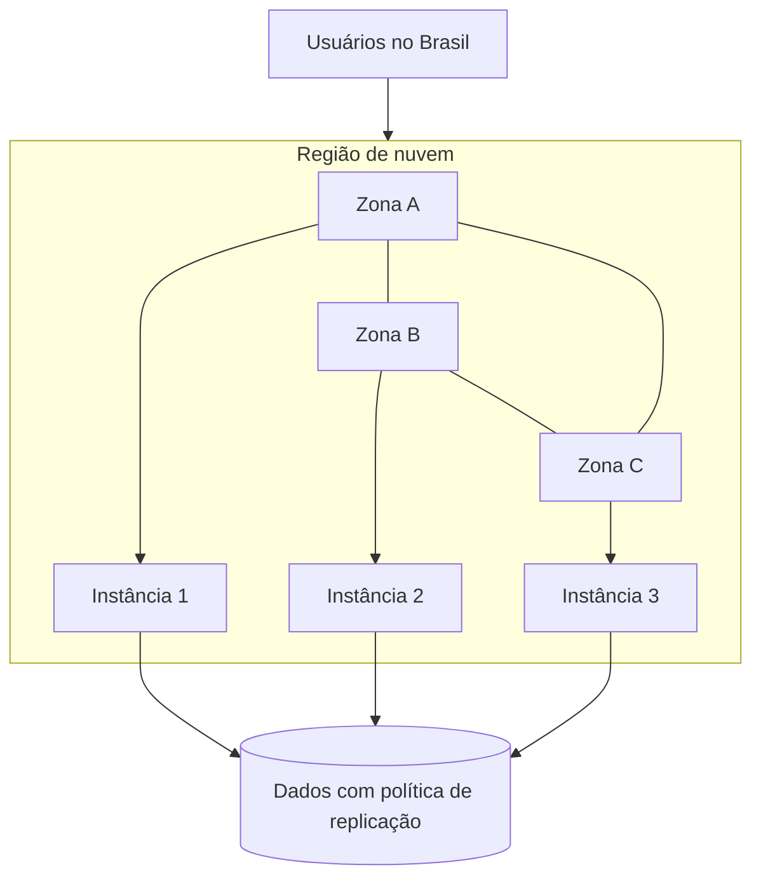
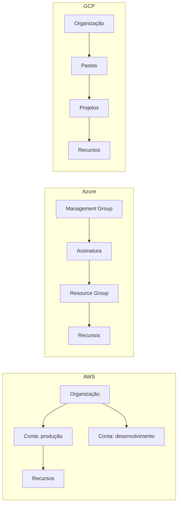
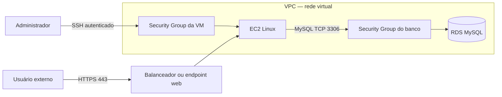
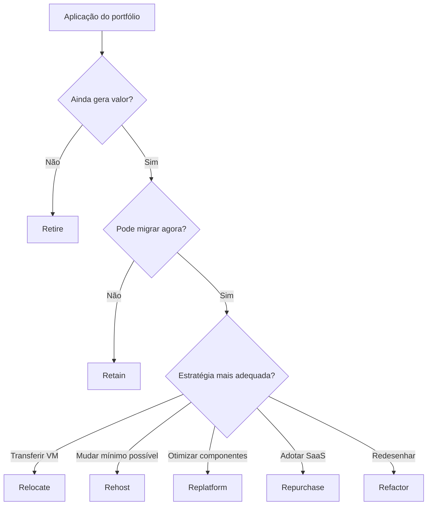
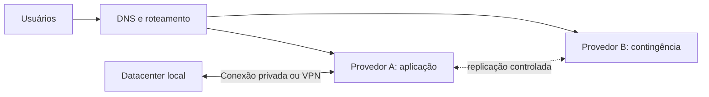
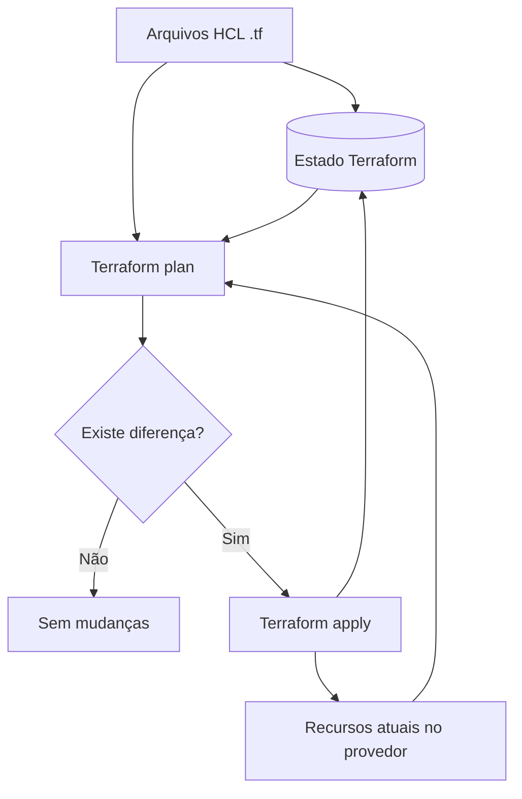

# Aula 01 — Provedores de Nuvem

[← Índice](./README.md) · [Próxima aula →](./aula-02-preparacao-de-ambiente.md)

**Fontes primárias:** e-book *Provedores de Nuvem* (p. 2–19) e slides da Aula 01 (p. 3–45).

## 1. Objetivos e conceito de Cloud Computing

Cloud computing disponibiliza capacidade de processamento, armazenamento, rede e serviços de software por meio de infraestrutura administrada por um provedor. Para a engenharia de software, isso influencia planejamento, desenvolvimento, deploy e operação — pontos centrais da cultura **DevOps**.

**Benefícios expostos na aula:** agilidade no provisionamento, abstração física, escalabilidade conforme demanda, disponibilidade, confiabilidade e tolerância a falhas. **Limitação importante:** migrar uma arquitetura inadequada pode aumentar custos e prejudicar o desempenho; a nuvem não corrige automaticamente erros de projeto.



> **Distinção para a prova:** escalabilidade é a capacidade de aumentar/reduzir a capacidade; elasticidade é o ajuste efetivo dessa capacidade em função da demanda. Alta disponibilidade não é sinônimo de desempenho ou ausência absoluta de falhas.

## 2. Principais provedores

A disciplina compara **Amazon Web Services (AWS)**, **Microsoft Azure** e **Google Cloud (GCP)**. Todos oferecem infraestrutura, plataforma e serviços gerenciados, mas com nomenclaturas, modelos organizacionais e catálogos próprios. A atividade foi demonstrada em Linux, embora a lógica se aplique também a outros sistemas operacionais.

| Aspecto | AWS | Azure | Google Cloud |
|---|---|---|---|
| Portal | AWS Management Console | Azure Portal | Google Cloud Console |
| CLI | `aws` | `az` | `gcloud` |
| Unidade administrativa comum | Conta | Assinatura e Resource Group | Projeto |
| Rede virtual | VPC | VNet | VPC |
| Máquina virtual | EC2 | Azure Virtual Machines | Compute Engine |
| Banco relacional gerenciado | RDS | Azure Database/SQL | Cloud SQL |
| Objetos | S3 | Blob Storage | Cloud Storage |

> A tabela é uma correspondência funcional para estudo, não uma afirmação de equivalência integral de funcionalidades, SLAs ou preços.

## 3. Modelos de serviço: IaaS, PaaS e SaaS

| Modelo | Entrega do provedor | Responsabilidade típica do consumidor | Exemplos de cenário |
|---|---|---|---|
| **IaaS** | Compute, rede, armazenamento, virtualização | Sistema operacional, aplicações, dados e boa parte das configurações | Máquina virtual hospedando aplicação Java |
| **PaaS** | Ambiente gerenciado de execução ou banco de dados | Código, dados, identidade e parâmetros permitidos | Banco relacional gerenciado, aplicação em plataforma gerenciada |
| **SaaS** | Aplicação final pronta | Uso, identidade, permissões, configurações contratuais e governança dos dados | CRM, ERP, e-mail corporativo |

O slide da p. 7 compara modelos a meios de transporte: veículo próprio (on-premises), veículo alugado (IaaS), táxi (PaaS) e ônibus (SaaS). A analogia enfatiza a troca entre **controle** e **responsabilidade operacional**.



### 3.1 Responsabilidade compartilhada

No modelo on-premises, o cliente administra praticamente toda a pilha. Na IaaS, o provedor entrega recursos virtualizados, enquanto o cliente geralmente administra o SO, as aplicações e o conteúdo. Na PaaS, a gestão do ambiente de execução passa em grande parte ao provedor. Na SaaS, o provedor mantém a solução, mas **segurança dos acessos, classificação dos dados e uso correto continuam sob responsabilidade do cliente**.

| Camada | On-premises | IaaS | PaaS | SaaS |
|---|---|---|---|---|
| Aplicação utilizada pelo negócio | Cliente | Cliente | Cliente | Provedor |
| Dados, direitos de acesso e conformidade | Cliente | Compartilhada | Compartilhada | Compartilhada |
| Runtime/middleware | Cliente | Cliente | Provedor | Provedor |
| Sistema operacional | Cliente | Cliente | Provedor | Provedor |
| Virtualização, máquinas físicas e rede física | Cliente | Provedor | Provedor | Provedor |

**Base visual:** slide 11, matriz de cores sobre responsabilidades. **Atenção:** responsabilidades exatas variam conforme contrato e produto.

## 4. Regiões, zonas e datacenters

- **Região:** agrupamento geográfico de infraestrutura.
- **Zona de disponibilidade (AZ):** segmento de infraestrutura com isolamento de falhas em uma região, conforme a arquitetura do provedor.
- **Datacenter:** instalação física; uma zona pode abranger mais de um datacenter.



A escolha de região considera **latência**, **preço**, **requisitos regulatórios** e **estratégia de continuidade**. Preço baixo em determinada região não garante melhor decisão de arquitetura. A distribuição entre zonas ajuda a reduzir risco de falhas locais (slides 12–13).

## 5. Portal, CLI, custos e organização

### 5.1 Portal versus linha de comando

**Portal:** interface visual para configurar serviços e segurança. **CLI:** interface automatizável, útil para repetição de tarefas e integração a scripts. Exemplos ilustrativos de reconhecimento:

```bash
aws --version
az version
gcloud version
```

### 5.2 Controle financeiro

Os provedores disponibilizam calculadoras de custo. Estimativas incluem CPU, memória, tipo de máquina, SO/licenças, armazenamento, tempo ligado, tráfego e região. **Orçamentos e alertas normalmente não interrompem automaticamente a execução dos recursos**: esse ponto aparece expressamente no e-book (p. 6 e 9).

### 5.3 Hierarquia e nomenclatura



Usar **nomenclatura padronizada** e **tags/labels** (chave-valor) permite identificar responsável, sistema, ambiente e centro de custo. O slide 26 exemplifica um padrão de nome `tipo-aplicacao-ambiente-regiao-instancia`.

## 6. Exemplo AWS: rede, VM e banco

A prática da aula (e-book p. 9–11) parte de uma **VPC**, cria uma **EC2**, ajusta regras de **Security Group** e usa uma chave para acesso remoto via SSH. Na sequência, apresenta o **RDS** com MySQL como banco relacional gerenciado.



**Para produção:** evitar SSH público irrestrito e banco exposto à internet. Dar preferência a acesso administrativo restrito, sub-redes privadas para dados, autenticação adequada, TLS e menor privilégio. A demonstração da aula incluiu recursos públicos para facilitar o teste; isso não significa que seja a configuração recomendada para ambientes reais.

## 7. Sete estratégias de migração — os 7 Rs

| Estratégia | Essência | Mudança necessária | Situação ilustrativa |
|---|---|---|---|
| **Relocate** | Transferir infraestrutura virtualizada | Pouca | Mover VMs entre plataformas compatíveis |
| **Rehost** | Lift and shift: instalar/executar quase sem alterar o sistema | Baixa | Mover um servidor existente para VM em cloud |
| **Replatform** | Pequena modernização com serviços gerenciados | Moderada | Trocar MySQL autogerenciado por RDS |
| **Repurchase** | Substituir sistema por produto SaaS | Mudança de produto | Trocar CRM próprio por SaaS |
| **Refactor** | Redesenhar/refatorar para explorar a nuvem | Alta | Microsserviços, automação e elasticidade |
| **Retain** | Manter localmente | Nenhuma migração agora | Sistema com impedimento jurídico/técnico |
| **Retire** | Desativar | Eliminar | Aplicação obsoleta e sem uso |



**Memorização:** o melhor caminho depende de custo, dependências, riscos, objetivos de negócio e maturidade. Nem toda aplicação deve migrar.

## 8. Aplicações e modelos de implantação

**Cloud-enabled:** aplicação tradicional adaptada para execução na nuvem, ainda com limitações da arquitetura original. **Cloud-based:** passa a consumir serviços específicos da nuvem, mantendo alguma portabilidade. **Cloud-native:** projetada para elasticidade, automação e alta disponibilidade, podendo usar serviços fortemente associados a um provedor.

| Topologia | Composição | Vantagem | Principal desafio |
|---|---|---|---|
| Single-cloud | Um provedor | Operação menos complexa | Dependência do provedor |
| Híbrida | On-premises + nuvem | Migração progressiva e integração com legado | Rede, identidade e segurança entre ambientes |
| Multicloud ativa/ativa | Dois ou mais provedores atendendo tráfego | Resiliência a falhas amplas | Consistência, dados, custos e operações |
| Multicloud ativa/passiva | Principal e contingência | Alternativa de recuperação | Replicação e testes de failover |
| Multicloud seletiva | Serviços distintos por provedor | Escolha especializada | Integrações, observabilidade e lock-in por serviço |



**Base visual:** slides 30–33 (um provedor, híbrido, multicloud e multicloud seletivo). **Vendor lock-in** é a dependência técnica/econômica que dificulta troca de fornecedor. Contêineres, Kubernetes, IaC, padrões abertos e contratos de integração podem mitigar — sem eliminar — essa dependência.

## 9. Infraestrutura como Código (IaC)

IaC define recursos por arquivos versionáveis em vez de intervenções manuais. Benefícios centrais do material: **reprodutibilidade, automação, auditoria, consistência e recuperação**.

### 9.1 Pets vs. Cattle

| Pets — animais de estimação | Cattle — rebanho |
|---|---|
| Servidores individuais e duradouros | Instâncias padronizadas e substituíveis |
| Reparos manuais diretamente na máquina | Alterações em código e criação de novos recursos |
| Alta dependência de histórico operacional | Reconstrução por automação |
| Recuperação complexa | Operação mais elástica |

### 9.2 Imperativo, declarativo e idempotência

**Imperativo:** descreve passo a passo da execução. **Declarativo:** descreve o estado desejado. **Idempotência:** aplicar repetidamente uma operação para o mesmo estado desejado não deve criar duplicações ou alterações desnecessárias.



O Terraform utiliza **providers**, recursos declarados em arquivos `.tf` e um estado (`terraform.tfstate`) para correlacionar declarações e recursos reais. Outras ferramentas citadas: AWS CloudFormation, Azure Bicep/ARM, Ansible e Docker. **Provisionar** capacidade e **configurar** software são preocupações relacionadas, mas distintas.

**Observação prática adicionada:** arquivos de estado podem conter informações sensíveis. Em equipes, devem ficar em backend remoto com acesso restrito, bloqueio e criptografia; nunca publicar `terraform.tfstate` nem segredos no Git.

### 9.3 Comandos centrais

```bash
terraform init       # Inicializa providers e backend
terraform fmt        # Formata os arquivos de configuração
terraform validate   # Valida a configuração
terraform plan       # Mostra mudanças propostas
terraform apply      # Aplica as mudanças após revisão
terraform destroy    # Planeja remoção dos recursos gerenciados
```

**Cuidado:** `terraform destroy` destrói recursos sob gestão do estado configurado; não use em ambiente de produção sem aprovação e revisão do plano.

## 10. Pontos de prova e aplicação

- Diferencie controle do consumidor em IaaS/PaaS/SaaS de responsabilidades que são sempre compartilhadas (identidades e dados).
- Compare escala/elasticidade com disponibilidade e redundância multi-AZ.
- Memorize os **7 Rs**, sobretudo Rehost × Relocate e Replatform × Refactor.
- Relacione `plan`, `apply`, `tfstate`, declaração de recursos e idempotência.
- Compreenda o motivo de separar custos, acessos, ambientes e contas.
- Reconheça que multicloud **não é automaticamente mais barata nem mais resiliente**: requer desenho e operação adequados.

**Referências visuais reconstituídas:** slides 5 (ciclo DevOps), 7–11 (modelos de serviço), 13 (zonas), 23–25 (organização), 27–28 (7 Rs), 30–33 (implantações) e 34–45 (IaC/Terraform).
