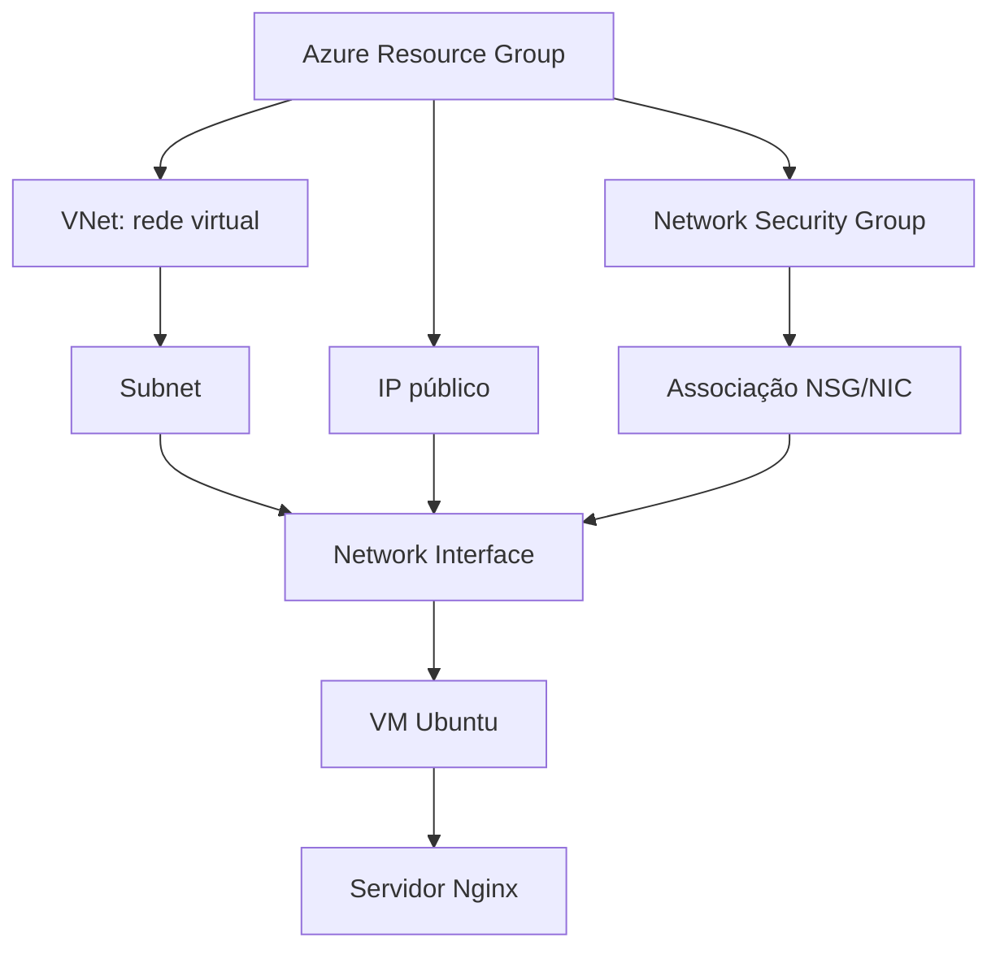
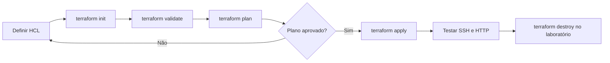
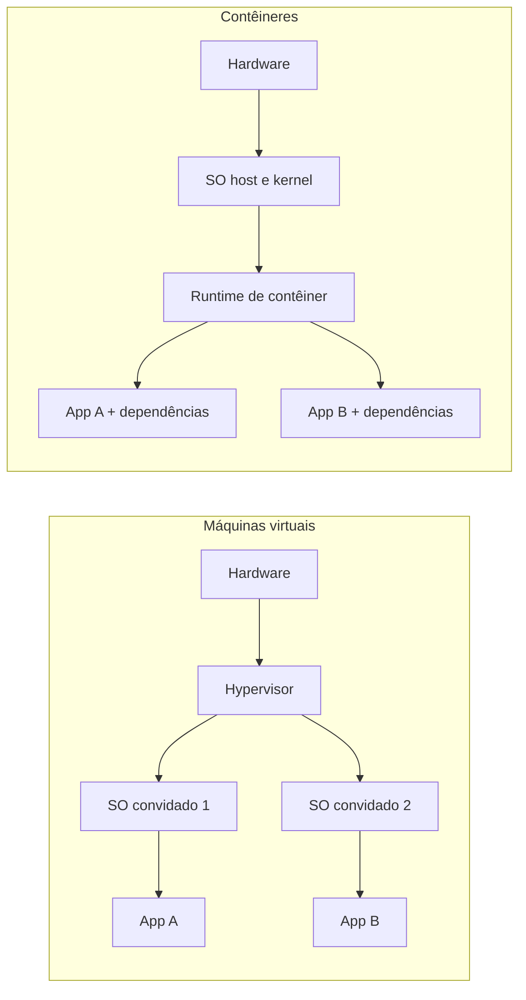
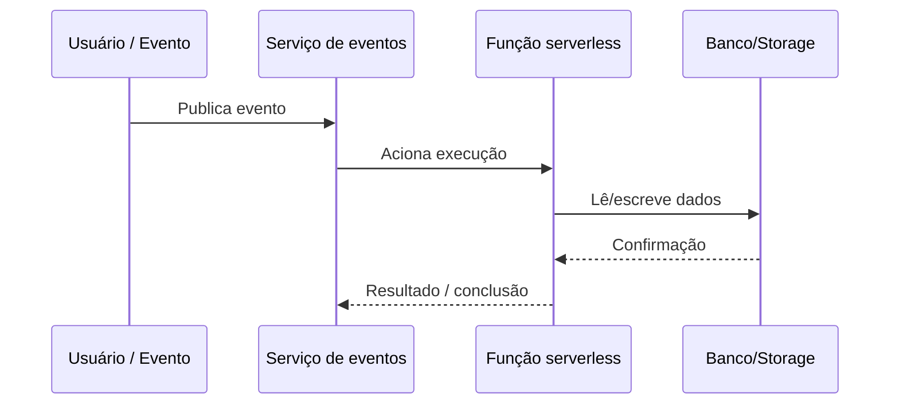
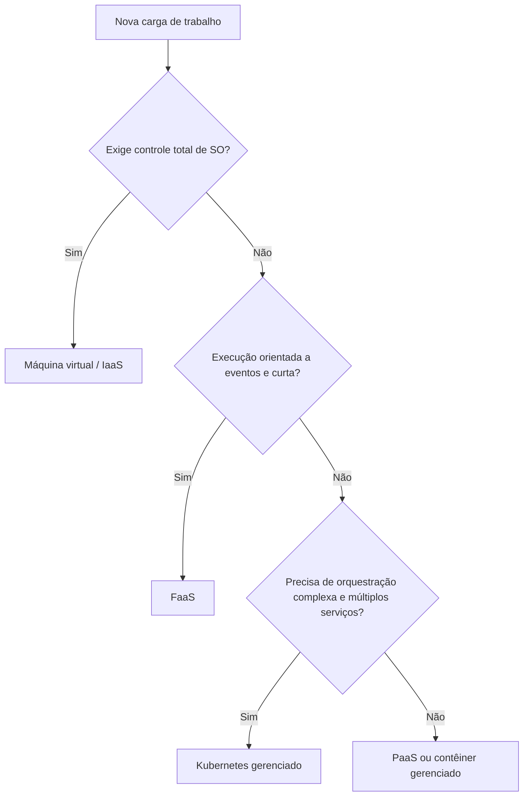
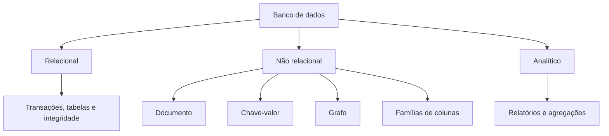
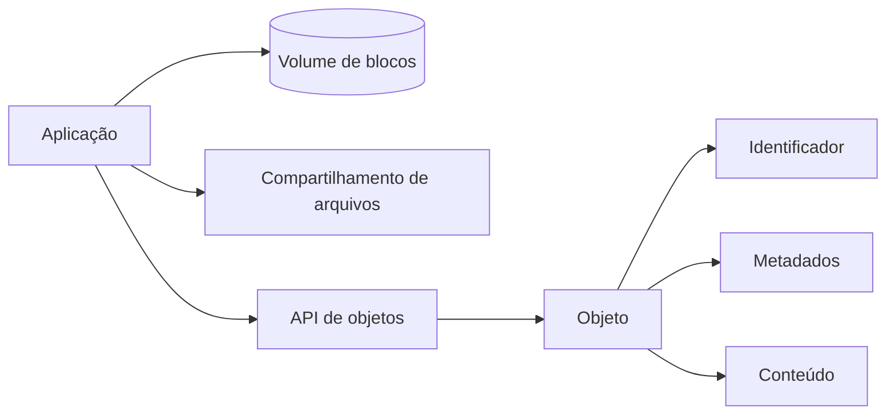
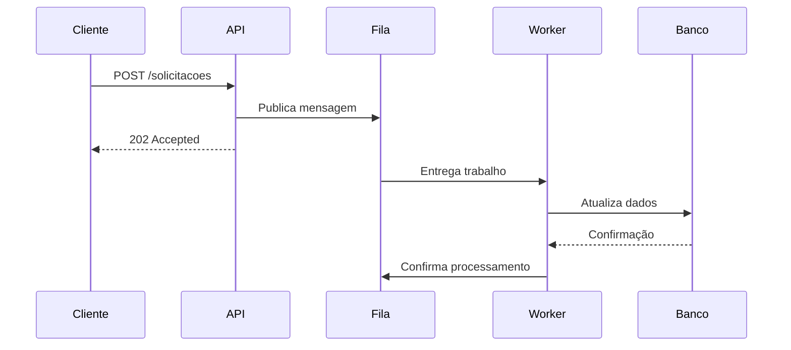
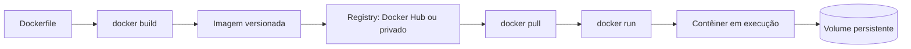
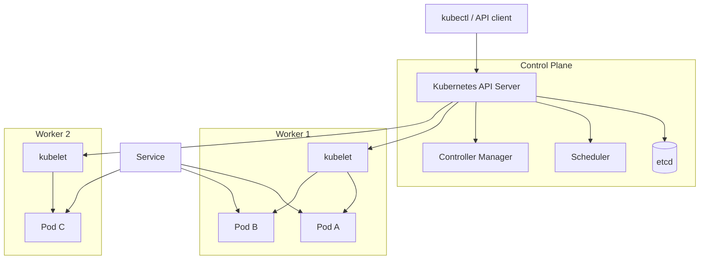

# Aula 02 — Preparação de Ambiente

[← Índice](./README.md) · [← Aula anterior](./aula-01-provedores-de-nuvem.md) · [Próxima aula →](./aula-03-estrategias-implementacao.md)

**Fontes primárias:** e-book *Preparação de Ambiente* (p. 2–20); slides da Aula 02 (p. 2–36). A estrutura acompanha os cinco blocos da aula, separando teoria e laboratório.

## 1. Preparando infraestrutura no Azure com Terraform

A demonstração provisiona recursos de forma declarativa, organizados em um **Resource Group** associado a uma **assinatura Azure**. São apresentados Azure CLI, Terraform, HCL (HashiCorp Configuration Language), provider, rede virtual (VNet), sub-rede, IP público, Network Security Group (NSG), interface de rede (NIC) e máquina virtual Ubuntu.

### 1.1 Componentes e dependências



O Terraform entende dependências quando um recurso utiliza atributos de outro, por exemplo, `azurerm_subnet.app.id` ao configurar uma interface. Isso tende a reduzir a necessidade de informar `depends_on` explicitamente em cada elemento.

### 1.2 Fluxo de execução



- `init`: prepara diretório de trabalho e providers.
- `validate`: verifica a consistência das declarações.
- `plan`: compara o código ao estado atual e gera plano de alterações.
- `apply`: executa alterações necessárias.
- `destroy`: planeja e executa a exclusão dos recursos gerenciados.

**Idempotência no laboratório:** ao adicionar a regra de porta 80, o Terraform pode alterar apenas o NSG, mantendo os demais recursos, conforme o plano. Recriações podem ocorrer em situações específicas — não se deve presumir que toda alteração será feita sem substituição.

### 1.3 Exemplo didático de configuração (não é transcrição do laboratório)

**Objetivo:** demonstrar a sintaxe HCL e a criação de rede, mantendo por segurança a máquina virtual fora do exemplo de código. Para construir o laboratório integral são necessários outros recursos: NIC, VM, autenticação e configuração de acesso.

```hcl
terraform {
  required_providers {
    azurerm = {
      source  = "hashicorp/azurerm"
      version = "~> 4.0"
    }
  }
}

provider "azurerm" {
  features {}
  subscription_id = var.subscription_id
}

variable "subscription_id" {
  type = string
}

resource "azurerm_resource_group" "lab" {
  name     = "rg-cloud-lab"
  location = "eastus"
}

resource "azurerm_virtual_network" "lab" {
  name                = "vnet-cloud-lab"
  location            = azurerm_resource_group.lab.location
  resource_group_name = azurerm_resource_group.lab.name
  address_space       = ["10.10.0.0/16"]
}

resource "azurerm_subnet" "app" {
  name                 = "subnet-app"
  resource_group_name  = azurerm_resource_group.lab.name
  virtual_network_name = azurerm_virtual_network.lab.name
  address_prefixes     = ["10.10.1.0/24"]
}
```

```bash
# Exemplo de autenticação interativa no Azure
az login
# A assinatura deve ser informada via variável segura ou configuração do ambiente
terraform init
terraform fmt
terraform validate
terraform plan -var="subscription_id=SEU-ID-DE-ASSINATURA"
```

**Segurança:** a senha fixa ilustrada na aula não deve ser repetida em projetos reais. Prefira chave SSH e/ou identidades gerenciadas, regras de acesso restritivas, variáveis protegidas e armazenamento seguro do estado. Não exponha a porta 22 a `0.0.0.0/0` para simplesmente facilitar testes.

### 1.4 Rede e testes

No roteiro da aula, após a VM Ubuntu ser criada, instala-se Nginx e verifica-se o acesso HTTP. Se somente a porta 22 estiver liberada, o teste em navegador falha até que seja permitida também a porta 80. Em produção, servir HTTPS na porta 443 normalmente é preferível ao acesso HTTP aberto, com TLS corretamente configurado.

## 2. Camadas de computação: bare metal, VM, contêiner e serverless

| Opção | Unidade principal | Controle | Observação da aula |
|---|---|---|---|
| Bare metal | Servidor físico dedicado | Alto | Cenários específicos que precisam de infraestrutura dedicada |
| VM / IaaS | Máquina com SO convidado | Alto sobre SO e aplicações | Caminho familiar para migrar servidores |
| Contêiner | Processo isolado + dependências | Controle da imagem e da aplicação | Inicialização rápida e reaproveitamento de recursos |
| Kubernetes | Pods em cluster | Controle declarativo de cargas | Orquestração, replicação e recuperação |
| PaaS/containers gerenciados | Aplicação ou contêiner | Controle reduzido de infraestrutura | Simplifica a operação |
| Serverless/FaaS | Funções ou serviços sob demanda | Foco na lógica e nos eventos | Escala gerenciada conforme o produto |

### 2.1 Virtualização versus contêineres



Diferentemente de uma VM, um contêiner Linux utiliza o kernel do host, mantendo isolamento por mecanismos do sistema operacional. O e-book enfatiza que isso diminui a sobrecarga e melhora a densidade. **Nota de precisão:** tempos de inicialização e percentuais de overhead variam conforme a aplicação, imagem, hipervisor, hardware e condições; não são garantias universais.

### 2.2 Serverless e Function as a Service (FaaS)

Funções serverless são ativadas por eventos (API, fila, upload, mudança em banco de dados) e normalmente escalam automaticamente. A disciplina diferencia execuções rápidas/efêmeras de serviços e processos mais duradouros gerenciados em nuvem.



**Trade-offs:** elasticidade e menor trabalho operacional versus limites de execução, latência inicial em alguns cenários e risco de acoplamento a APIs/SDKs do provedor. **Atenção:** serverless não significa necessariamente tempo de execução ilimitado, gratuidade nem ausência de custos quando há capacidade mínima provisionada.

### 2.3 Como escolher



## 3. Bancos de dados, armazenamento e integração

### 3.1 Tipos de banco de dados

**Relacional/OLTP:** tabelas, integridade referencial e transações, como cadastro e pedidos. **Analítico/OLAP:** consultas e agregações de grandes conjuntos para BI e decisão. **Não relacional:** soluções específicas para documentos, chave-valor, grafos e famílias de colunas (slides 11).



| Categoria | Característica | Uso didático |
|---|---|---|
| Documento | Estruturas semirrígidas, frequentemente JSON | Catálogo heterogêneo |
| Chave-valor | Acesso por chave | Sessões e cache |
| Grafo | Relações por nós e arestas | Redes e relacionamentos complexos |
| Famílias de colunas | Organização por famílias de atributos | Cargas distribuídas de alto volume |
| Séries temporais | Indexação por tempo | Telemetria e sensores |
| In-memory | Baixa latência de acesso | Cache e dados transitórios |
| Geoespacial | Coordenadas e operadores espaciais | Roteirização |
| Busca textual | Índice de texto e consultas | Logs e pesquisa |
| Imutável / append-only | Histórico verificável | Auditoria |

**Nota:** bancos analíticos também podem ter estruturas relacionais; "relacional" e "analítico" não são categorias mutuamente exclusivas do mesmo eixo. Na aula, aparecem como divisões didáticas de finalidades.

### 3.2 Tipos de armazenamento

| Tipo | Unidade | Interface usual | Uso típico |
|---|---|---|---|
| **Block Storage** | Blocos / volume | Disco conectado à VM | Discos de SO e banco de dados |
| **File Storage** | Pastas e arquivos | NFS, SMB | Compartilhamento de arquivos |
| **Object Storage** | Objeto + metadados + ID | API HTTP | Imagens, backups, documentos, data lakes |
| **Archive** | Objetos com classe de arquivamento | API conforme produto | Retenção de dados raramente acessados |



Exemplos mencionados nas aulas: **S3, EBS, EFS/Glacier (AWS)**; **Blob, Azure Disks, Azure Files (Azure)**; **Cloud Storage, Persistent Disk, Filestore (GCP)**. Categorias e classes de armazenamento diferem em desempenho, disponibilidade, preço por operação e latência de recuperação.

### 3.3 Integração síncrona e assíncrona

| Aspecto | Síncrona | Assíncrona |
|---|---|---|
| Fluxo | Solicitação e resposta no mesmo diálogo | Mensagem/evento processado posteriormente |
| Acoplamento temporal | Em geral, maior | Em geral, menor |
| Exemplo | API REST por HTTP | Fila ou evento |
| Risco principal | Timeout e indisponibilidade propagada | Retries, duplicidade e processamento eventual |



**Serviços citados nos slides 16–18:**

| Função | AWS | Azure | Google Cloud |
|---|---|---|---|
| Gerenciamento de APIs | API Gateway | API Management | Apigee |
| Filas | SQS | Queue Storage, Service Bus | Pub/Sub (modelo de mensageria próprio) |
| Eventos | EventBridge, SNS | Event Grid | Eventarc, Pub/Sub |
| Streaming | Kinesis, MSK (Kafka) | Event Hubs | Serviços de streaming da plataforma, conforme necessidade |
| Brokers compatíveis | Amazon MQ (ActiveMQ/RabbitMQ) | Service Bus (sem equivalência total de protocolo) | Soluções especializadas conforme caso |

**Importante:** a tabela agrupa *funções aproximadas*, não produtos idênticos. Mensagens podem exigir deduplicação, controle de ordenação, DLQ e tratamento de reentrega.

## 4. Docker: imagens, contêineres e persistência

### 4.1 Arquitetura do Docker

A imagem é uma composição de camadas e instruções que definem aplicação e dependências; o **contêiner** é a instância executada a partir dessa imagem. O **Docker daemon/Engine** gerencia imagens e contêineres; um **registry** armazena e distribui imagens.



### 4.2 Comandos fundamentais

```bash
docker --version
docker images
docker ps -a
docker pull nginx:stable
docker run --name web-lab -d -p 8080:80 nginx:stable
docker logs web-lab
docker stop web-lab
docker rm web-lab
```

**Persistência:** remover um contêiner não deve apagar os dados importantes. Configure volumes explicitamente para diretórios de dados, como os de um banco relacional.

### 4.3 Exemplo ilustrativo de Dockerfile

```dockerfile
FROM nginx:stable-alpine
COPY ./site/ /usr/share/nginx/html/
EXPOSE 80
```

```bash
docker build -t site-exemplo:1.0 .
docker run --rm -p 8080:80 site-exemplo:1.0
```

Os conceitos de `FROM`, `COPY`, `ENTRYPOINT`, `EXPOSE`, camadas, construção e imutabilidade são tratados no e-book p. 18–19 e slides 26–28. **Atualização por imutabilidade:** ao mudar o código, gere outra imagem; não altere manualmente o contêiner que está em produção.

### 4.4 Exemplo didático de Docker Compose

```yaml
services:
  database:
    image: postgres:16
    environment:
      POSTGRES_DB: estudo
      POSTGRES_USER: estudante
      POSTGRES_PASSWORD: "${DB_PASSWORD:?Defina DB_PASSWORD}"
    volumes:
      - pgdata:/var/lib/postgresql/data
    networks:
      - interna

  web:
    image: nginx:stable-alpine
    ports:
      - "127.0.0.1:8080:80"
    depends_on:
      - database
    networks:
      - interna

volumes:
  pgdata:

networks:
  interna:
```

```bash
# Defina DB_PASSWORD no ambiente antes de executar
# Compose para laboratório local, não arquitetura produtiva completa
docker compose up -d
docker compose ps
docker compose down
```

**O que a aula ensina:** o Compose descreve vários serviços, portas, redes, variáveis e volumes em um arquivo YAML. `depends_on` expressa dependência de partida e **não garante automaticamente que o banco esteja pronto para receber conexões**, sem health checks adicionais. O exemplo da aula reúne um servidor web e um banco.

## 5. Kubernetes: control plane, workers, Pods, Deployments e Services

O Kubernetes administra cargas conteinerizadas declarativamente. Um **cluster** possui um plano de controle (*control plane*) e nós de execução (*workers*). Os objetos centrais apresentados são **Pod**, **Deployment** e **Service**.



- **Pod:** menor unidade implantável; pode conter um ou mais contêineres que compartilham rede e volumes conforme configuração.
- **Deployment:** especifica e mantém réplicas e atualizações declarativas de Pods, por meio de ReplicaSets.
- **Service:** cria uma forma estável de acessar um conjunto de Pods selecionados por labels.
- **Control Plane:** decide agendamento e reconcilia o estado desejado.
- **Worker:** hospeda os Pods e o runtime de contêiner.

### 5.1 Exemplo introdutório de Deployment e Service

```yaml
apiVersion: apps/v1
kind: Deployment
metadata:
  name: web
spec:
  replicas: 3
  selector:
    matchLabels:
      app: web
  template:
    metadata:
      labels:
        app: web
    spec:
      containers:
        - name: nginx
          image: nginx:stable-alpine
          ports:
            - containerPort: 80
          resources:
            requests:
              cpu: "50m"
              memory: "64Mi"
            limits:
              cpu: "250m"
              memory: "128Mi"
---
apiVersion: v1
kind: Service
metadata:
  name: web
spec:
  type: ClusterIP
  selector:
    app: web
  ports:
    - port: 80
      targetPort: 80
```

```bash
kubectl apply -f web.yaml
kubectl get deployments,pods,services
kubectl describe deployment web
kubectl delete -f web.yaml
```

O exemplo acima usa `ClusterIP`, não abre IP público e é **complementar** ao material da Aula 02. A exposição pública com `LoadBalancer` aparece na Aula 03.

### 5.2 Atualização técnica relevante (2026)

Os slides de arquitetura Kubernetes (Aula 02, p. 32) apresentam o **Docker** dentro dos nós como runtime. Esta é uma representação histórica: o componente embutido **dockershim** foi removido do Kubernetes na versão **1.24**. Atualmente, os nós utilizam runtimes compatíveis com a **Container Runtime Interface (CRI)**, como `containerd` e `CRI-O`, ou adaptadores específicos. Continuar criando imagens com Docker não é incompatível com Kubernetes.

Fonte oficial: [Kubernetes — Container Runtimes](https://kubernetes.io/docs/setup/production-environment/container-runtimes/).

## 6. Roteiro seguro de revisão e laboratório

1. Explicar, desenhando, a dependência **Resource Group → VNet → Subnet → NIC → VM**.
2. Diferenciar mudança de infraestrutura (`terraform apply`) de configuração de aplicação.
3. Comparar duas cargas: API HTTP contínua versus função acionada por upload.
4. Selecionar banco de dados e modelo de armazenamento para um sistema de pedidos.
5. Criar uma imagem Docker e iniciá-la como contêiner.
6. Definir um Compose com dois serviços e um volume persistente.
7. Identificar funções de Pod, Deployment e Service em um cluster.
8. Encerrar contêineres e apagar recursos pagos de laboratório que não serão mais utilizados.

**Atenção para a prova:** máquinas virtuais têm SO convidado; contêineres compartilham kernel; Dockerfile constrói imagem, `docker run` instancia contêiner, Compose coordena serviços e Kubernetes orquestra execução em cluster.

**Referências visuais reconstituídas:** slides 5–10 (opções de computação), 11–18 (dados e integração), 20 (hospedagem), 24–30 (arquitetura Docker e Compose), 32–35 (Kubernetes).
