# Aula 03 — Estratégias e Implementação

[← Índice](./README.md) · [← Aula anterior](./aula-02-preparacao-de-ambiente.md) · [Revisão →](./revisao-para-prova.md)

**Fontes primárias:** e-book *Estratégias e Implementação* (p. 2–25) e slides da Aula 03 (p. 2–60). A documentação acompanha seis partes do e-book, da arquitetura de aplicações ao laboratório Kubernetes.

## 1. The Twelve-Factor App: doze fatores para aplicações em nuvem

O **The Twelve-Factor App** é uma metodologia descrita originalmente pela Heroku que fornece princípios para construir sistemas **portáteis, escaláveis, previsíveis e fáceis de operar**. A disciplina enfatiza que se aplicam a diferentes linguagens e tecnologias de persistência. Fonte primária externa citada nos slides: [12factor.net](https://12factor.net/).

| Nº | Fator | Princípio | Aplicação prática |
|---|---|---|---|
| I | **Base de código** (*Codebase*) | Uma base versionada, vários deploys | Mesma origem de código para desenvolvimento, homologação e produção |
| II | **Dependências** | Declarar e isolar dependências | `pom.xml`, `package.json`, lockfiles |
| III | **Configurações** | Separar configuração do código | URLs e credenciais vindas do ambiente |
| IV | **Serviços de apoio** | Tratar banco, fila, cache etc. como recursos anexados | Alterar endpoint/configuração sem reescrever aplicação |
| V | **Construir, publicar, executar** | Etapas de build, release e run separadas | Artefato imutável + configuração específica |
| VI | **Processos** | Processos sem estado e independentes | Estado persistente fora da instância |
| VII | **Ligação de porta** | Exportar serviços via porta | Aplicação HTTP escutando em porta configurada |
| VIII | **Concorrência** | Escalar por modelo de processos | Várias réplicas web e workers |
| IX | **Descartabilidade** | Inicialização rápida e desligamento gracioso | Finalizar requisições e encerrar conexões |
| X | **Paridade dev/prod** | Minimizar divergências de tempo, ferramentas e equipe | Ambiente similar, testes e entrega automatizados |
| XI | **Logs** | Tratar logs como fluxo de eventos | Gerar saída em stdout/stderr e coletar centralmente |
| XII | **Processos administrativos** | Executar tarefas pontuais no ambiente da aplicação | Migrações de esquema como jobs temporários |

### 1.1 Diagrama síntese dos doze fatores

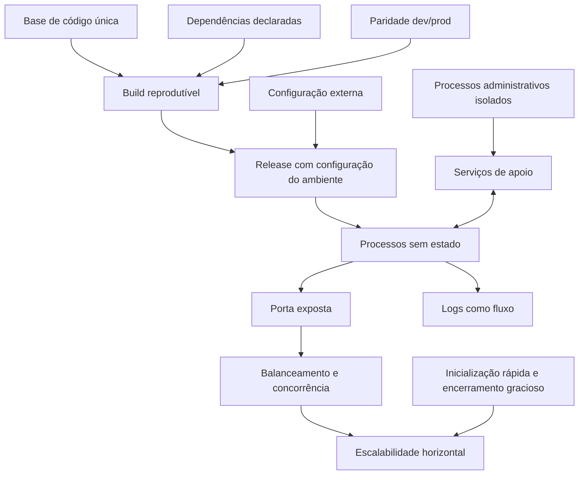

### 1.2 Aplicação prática: API com persistência externa

O exemplo arquitetural abaixo representa a associação entre **processos sem estado** (fator VI), **concorrência** (VIII), **serviços de apoio** (IV) e **logs** (XI).

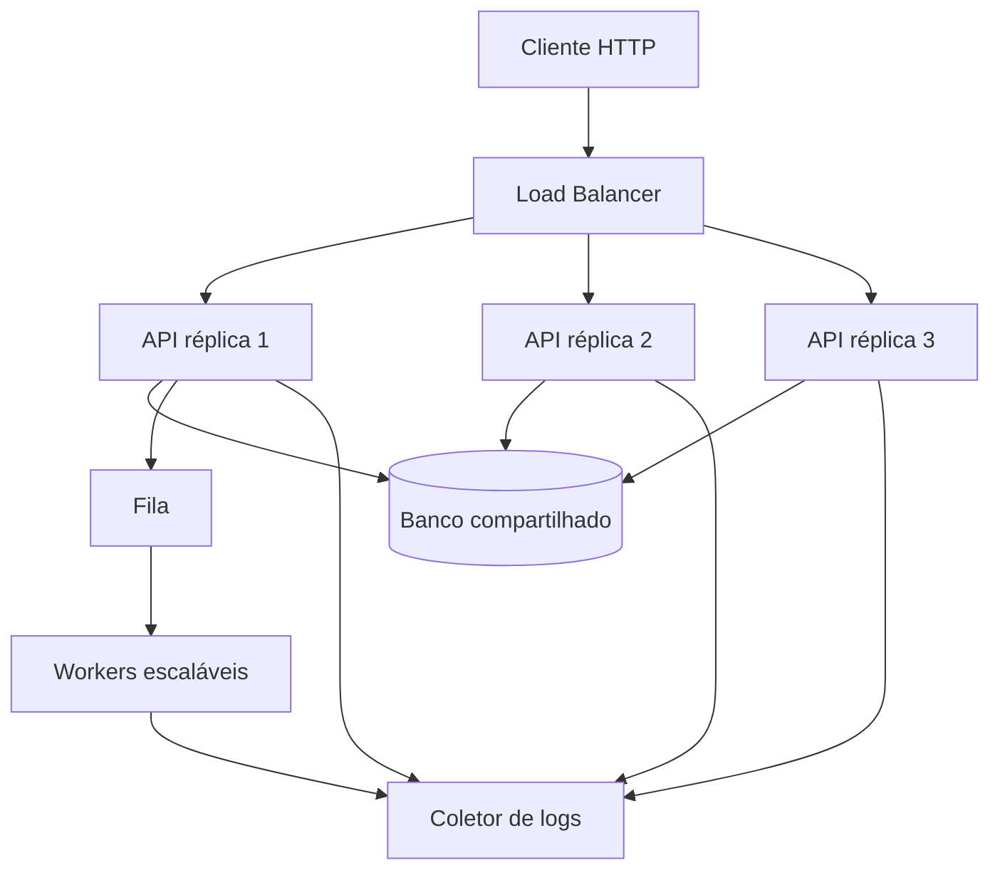

**Ponto crítico:** “stateless” não significa que o sistema não possa persistir informações; significa que os processos não dependem de estado de sessão/local não compartilhado para continuar atendendo requisições depois de serem substituídos.

### 1.3 Processos administrativos

Uma migração de banco é exemplo de tarefa **executada separadamente da inicialização do serviço principal** e no mesmo contexto de versão/configuração da aplicação. Nos slides (p. 15) aparece o exemplo `docker run ... manage.py migrate`. Em sistemas modernos, pode ser executado como job do pipeline, Job do Kubernetes ou outro mecanismo controlado, com atenção a concorrência e rollback de esquema.

## 2. Infraestrutura imutável e publicação de versões

A **infraestrutura imutável** evita manter máquinas de longa duração que recebem sucessivas alterações manuais. Em vez disso, produz novas imagens/versões, valida e substitui os recursos anteriores. A ideia conecta IaC, contêineres e o paradigma **cattle**, vistos nas aulas anteriores.

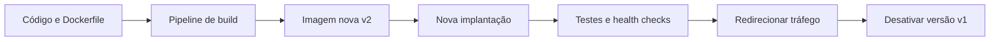

### 2.1 Estratégias de implantação

| Estratégia | Funcionamento | Benefício | Risco/observação |
|---|---|---|---|
| **Recriação** (*Recreate*) | Desliga versão antiga e liga a nova | Simples | Pode haver indisponibilidade |
| **Blue/Green** | Mantém ambientes A e B; após validar B, alterna o tráfego | Retorno rápido ao ambiente anterior | Consome capacidade paralela; dados devem ser compatíveis |
| **Rolling** | Substitui instâncias aos poucos | Continuidade sem duplicar todo ambiente | Versões podem coexistir; exige compatibilidade |

#### Blue/Green em Mermaid

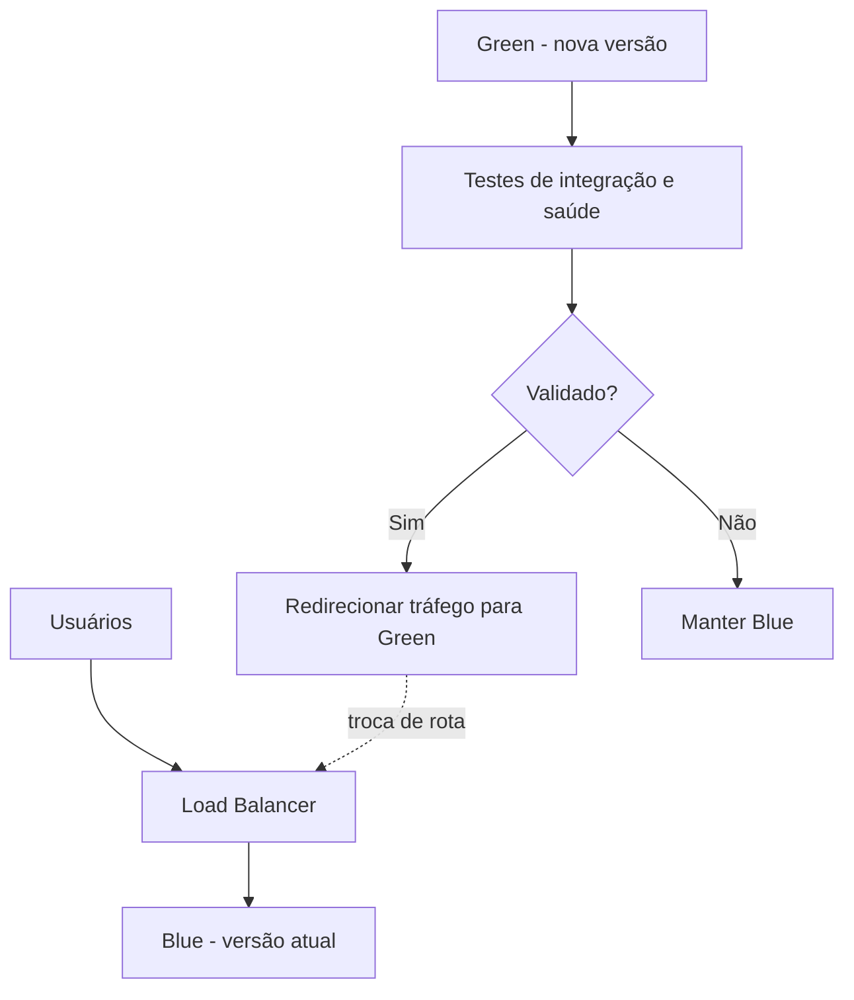

#### Rolling update

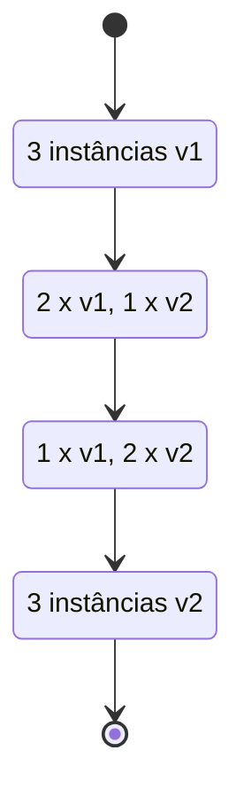

> **Nota operacional:** ausência de downtime não é garantida por uma estratégia sozinha. Depende de capacidade suficiente, checagens de saúde, arquitetura sem estado e compatibilidade entre versões (inclusive de banco de dados).

### 2.2 Estratégias de teste em produção

| Estratégia | Para que serve | Quem recebe a resposta |
|---|---|---|
| **Canary** | Direcionar pequeno percentual do tráfego à versão nova e verificar estabilidade | Parte dos usuários recebe a nova versão |
| **A/B** | Medir diferença de comportamento/resultado entre variantes | Grupos distintos veem versões distintas |
| **Shadow** | Espelhar tráfego real à nova versão para avaliar comportamento | Usuário continua recebendo a resposta da versão estável |

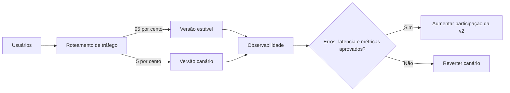

**Os percentuais do desenho são apenas exemplo pedagógico**, não regra recomendada pela aula. Para *shadow testing*, o componente de roteamento envia uma cópia da solicitação para a versão sob teste, mas só retorna a resposta da produção — requer cuidado para evitar efeitos colaterais duplicados, como cobrança e gravação de dados.

## 3. Cloud Adoption Framework (CAF)

A **adoção de cloud** é uma mudança organizacional, não apenas um conjunto de migrações técnicas. O e-book compara o foco da Microsoft Azure (jornada processual), AWS (perspectivas organizacionais) e Google Cloud (maturidade cultural).

### 3.1 Microsoft Azure — etapas

1. **Strategy:** motivadores e objetivos de negócio.
2. **Plan:** inventário, priorização e plano de adoção.
3. **Ready:** preparar ambiente, identidade, redes e segurança.
4. **Adopt:** migrar (*Migrate*) ou modernizar (*Innovate*).
5. **Govern:** políticas, custos e conformidade.
6. **Manage:** operação, monitoramento e incidentes.

Os slides também tratam **Secure** como atividade transversal da jornada.

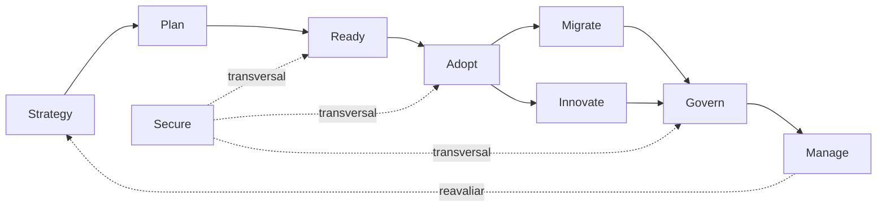

### 3.2 AWS — seis perspectivas

| Perspectiva | Questão principal |
|---|---|
| **Business** | Como a nuvem gera valor ao negócio? |
| **People** | Quem precisa de capacitação e novos papéis? |
| **Governance** | Quais são as políticas, investimentos e critérios de risco? |
| **Platform** | Como projetar e implementar a infraestrutura? |
| **Security** | Como assegurar proteção e conformidade? |
| **Operations** | Como monitorar, operar e melhorar continuamente? |

### 3.3 Google Cloud — dimensões e maturidade

O material destaca **Learn, Lead, Scale e Secure**. A evolução organizacional é classificada em **tático** (uso pontual), **estratégico** (adoção coordenada) e **transformacional** (cloud como parte da estratégia empresarial).

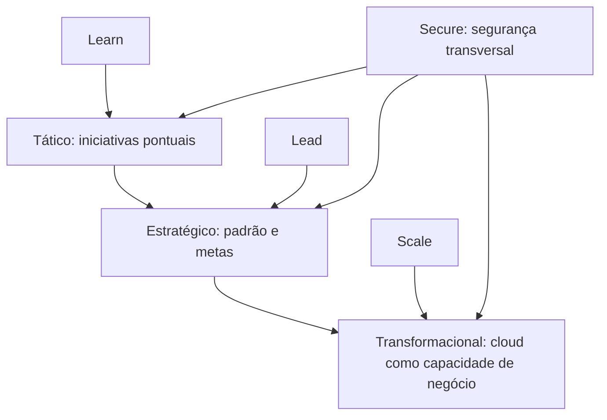

## 4. Landing Zone e jornada corporativa

Uma **Landing Zone** é a fundação técnica e administrativa preparada **antes** das migrações. Deve contemplar identidade, rede, organização de contas/projetos/assinaturas, políticas, observabilidade, custos e segurança.

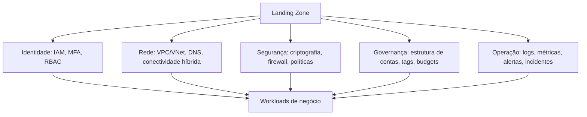

A disciplina apresenta a jornada em sete fases: **(1) Estratégia e patrocínio → (2) Avaliação e planejamento → (3) Preparação da Landing Zone → (4) Migração → (5) Modernização e inovação → (6) Governança contínua → (7) Operação e otimização**.

### 4.1 O que planejar em cada fase

| Fase | Produto de trabalho |
|---|---|
| Estratégia e patrocínio | Business case, ROI/TCO, critérios de sucesso, apoio executivo |
| Avaliação e planejamento | Inventário e mapa de dependências, prioridades, escolha dos 7 Rs |
| Landing Zone | Contas/projetos, IAM, rede, DNS, políticas, logs, orçamento |
| Migração | Pilotos, ondas, validação funcional e de desempenho |
| Modernização | Contêineres, PaaS, IaC, CI/CD, DevSecOps, observabilidade |
| Governança | Controles, auditorias, compliance e revisão de custos |
| Operação | Resposta a incidentes, SLOs, elasticidade e otimização contínua |

A principal ideia para a prova é que migração deve ser **progressiva e observável**, validando os resultados antes de escalar a iniciativa.

## 5. Well-Architected: qualidade arquitetural e requisitos não funcionais

Os frameworks de arquiteturas bem projetadas orientam decisões por características de qualidade. O e-book reúne seis pilares recorrentes entre os provedores: **excelência operacional, segurança, confiabilidade, eficiência de desempenho, otimização de custos e sustentabilidade**. A nomenclatura e a composição exatas podem variar entre frameworks e versões oficiais.

| Pilar | Objetivo | Técnicas e exemplos citados |
|---|---|---|
| Excelência operacional | Operar e melhorar de forma previsível | IaC, monitoramento, automação, gestão de incidentes |
| Segurança | Proteger identidades, recursos e dados | IAM, MFA, menor privilégio, KMS, logs, rede privada |
| Confiabilidade | Recuperar de falhas e manter o serviço | Múltiplas zonas, health checks, backups, retry, circuit breaker |
| Eficiência de desempenho | Cumprir latência e vazão requeridas | Auto scaling, cache, CDN, testes de carga, particionamento |
| Custos | Maximizar valor e evitar desperdício | Estimativas, desligamento, dimensionamento, descontos |
| Sustentabilidade | Diminuir desperdício energético | Recursos elásticos, escolha de serviços/regiões e gestão de consumo |

### 5.1 Métricas essenciais

- **Latency (latência):** duração de uma requisição.
- **Throughput (vazão):** quantidade de operações concluídas por unidade de tempo.
- **SLA:** compromisso contratual com nível mínimo de serviço.
- **SLO:** meta operacional de nível de serviço (conceito complementar).
- **Health check:** verificação da saúde de uma instância.
- **RTO/RPO:** objetivos de tempo de recuperação e perda máxima de dados tolerável (complemento de arquitetura de continuidade).

### 5.2 Resiliência com retry, circuit breaker e fallback

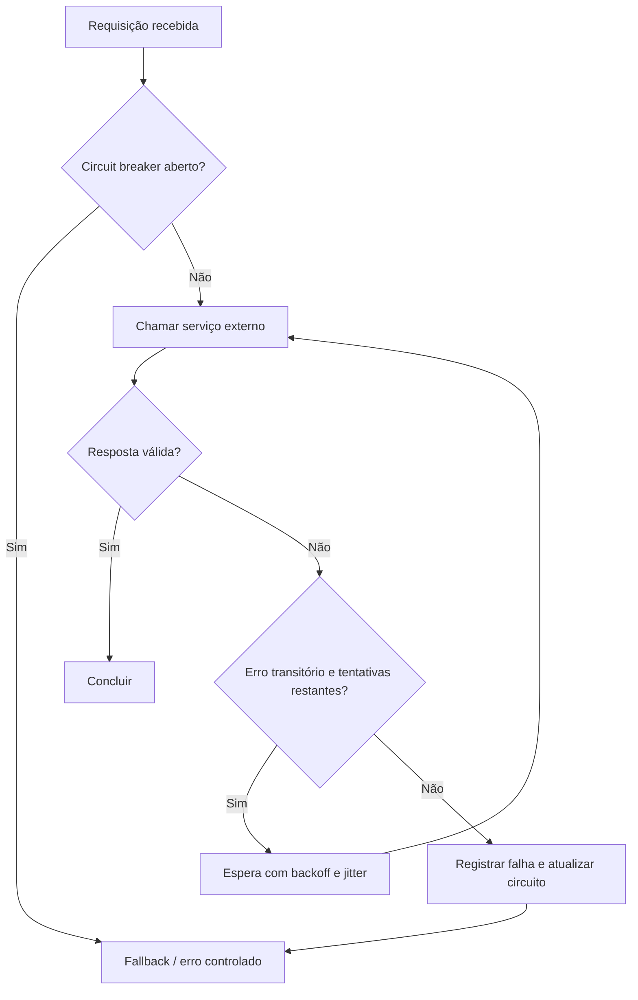

O retry deve ser limitado e cuidadoso: repetir operações não idempotentes sem mecanismos de proteção pode gerar duplicidade. Outros padrões abordados nos slides (p. 53–54): **throttling, queue-based load leveling, sharding, CQRS, event sourcing, CDN, cache, Saga, pub/sub, API Gateway, federação de identidade e gerenciamento de segredos**.

### 5.3 Padrões complementares

- **Saga:** coordena uma operação distribuída por etapas locais e mecanismos de compensação.
- **Sharding:** particiona dados em subconjuntos para distribuir carga.
- **CQRS:** separa modelos de escrita e leitura quando a complexidade justifica.
- **Event sourcing:** representa mudanças por eventos persistidos.
- **Lentes do Well-Architected:** orientações específicas para domínios como IoT, serverless e SaaS.

**Cuidado:** padrões são ferramentas, não uma checklist de adoção indiscriminada.

## 6. FinOps: operação financeira em nuvem

FinOps combina **finanças, engenharia, operações e gestão de produtos** para alinhar o gasto variável de nuvem ao valor produzido. O material aborda dois modelos complementares: atividades **Informar, Otimizar e Operacionalizar**; maturidade **Engatinhar, Andar, Correr**.

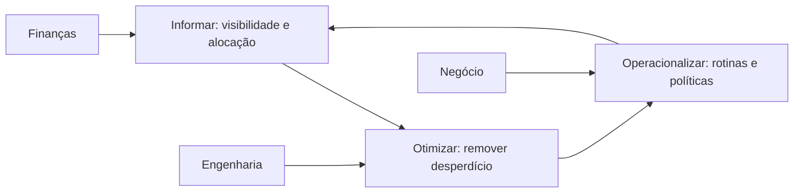

| Maturidade | Comportamento |
|---|---|
| **Engatinhar (Crawl)** | Mapear gastos, iniciar tags, identificar responsáveis |
| **Andar (Walk)** | Painéis, orçamentos por produto, políticas e eficiência |
| **Correr (Run)** | Decisões de custo integradas a métricas de negócio e automação contínua |

### 6.1 Boas práticas do material

1. Tornar custos visíveis por time, produto e ambiente.
2. Dimensionar corretamente CPU, memória e armazenamento.
3. Desligar ou eliminar ambientes temporários e recursos ociosos.
4. Usar compromissos/descontos quando a utilização for previsível.
5. Definir métricas financeiras que refletem valor: custo por transação, por cliente ou por produto.
6. Incentivar responsabilidade compartilhada entre equipes.

**Diferença importante:** cortar recursos de forma indiscriminada pode prejudicar SLA e produtividade. O objetivo do FinOps é **otimizar o valor**, não simplesmente minimizar a fatura.

## 7. Prática de implantação: Java, contêineres e AWS

O e-book p. 21 descreve uma aplicação **Java/Spring Boot** empacotada com **Docker multi-stage**. A demonstração local utiliza Docker Compose para subir aplicação e banco. Em nuvem, o Terraform cria recursos de rede, banco e execução de contêineres no **Amazon ECS**, com controle mínimo de permissões, balanceamento de carga e logs centralizados.

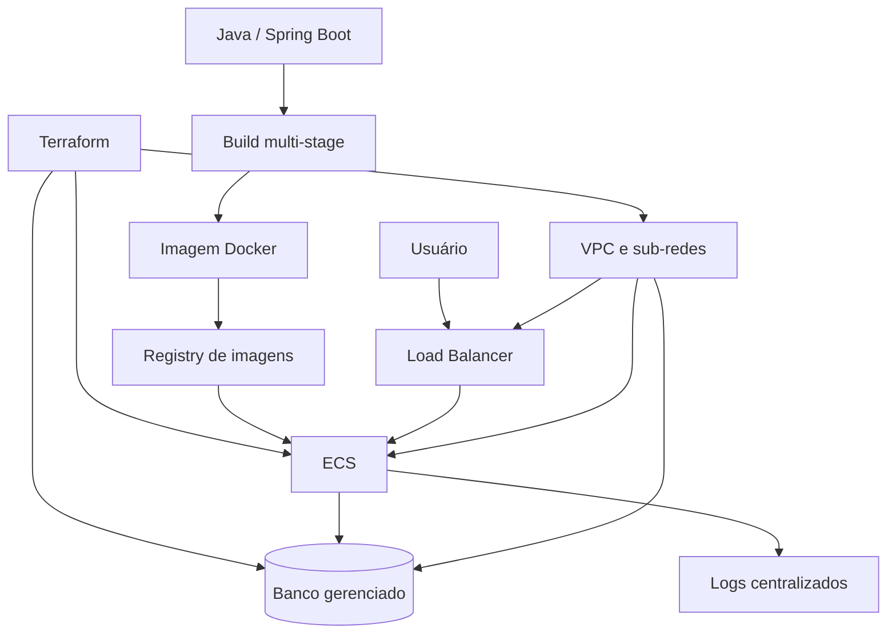

**Portabilidade conceitual descrita na aula:** AWS ECS + banco gerenciado + registry; no Google Cloud, alternativas como Cloud Run/Cloud SQL/Artifact Registry; na Azure, Container Apps/Azure SQL ou outros bancos gerenciados/Container Registry. Isso não garante migração sem adaptações de configurações e serviços.

### 7.1 Etapas do laboratório, em alto nível

1. Criar e testar aplicação localmente.
2. Criar imagem Docker em múltiplos estágios.
3. Executar com dependências via Compose.
4. Declarar infraestrutura e controles de acesso em Terraform.
5. Implantar contêineres e banco de dados em cloud.
6. Verificar balanceamento, logs e conectividade.
7. Destruir os recursos não necessários ao final do experimento.

## 8. Prática de implantação: GKE com Terraform e Kubernetes

Na aula (e-book p. 22–25), o **Google Kubernetes Engine (GKE)** é provisionado declarativamente. A configuração de demonstração apresenta **três nós**, cada um com **2 vCPUs e 8 GiB de RAM** (capacidade nominal combinada: 6 vCPUs e 24 GiB, antes de reservas do sistema). O acesso local ao cluster é validado com `kubectl get nodes`.

### 8.1 Operação com objetos Kubernetes

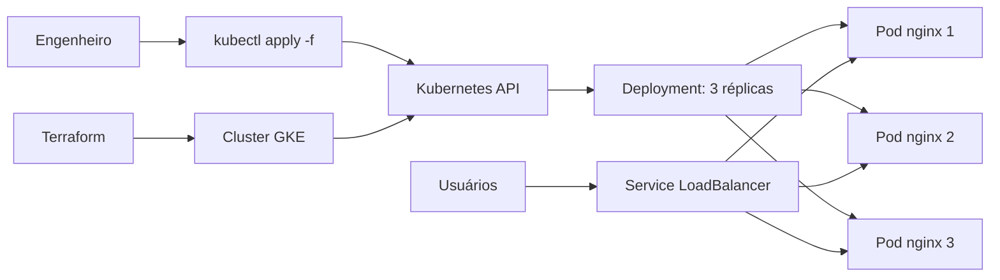

O material demonstra a progressão: **Pod isolado → Deployment com três réplicas → Service do tipo LoadBalancer**, que solicita um balanceador/endereço externo ao provedor e distribui tráfego entre Pods selecionados.

### 8.2 YAML ilustrativo de Pod isolado

```yaml
apiVersion: v1
kind: Pod
metadata:
  name: nginx-lab
  labels:
    app: nginx-lab
spec:
  containers:
    - name: nginx
      image: nginx:stable-alpine
      ports:
        - containerPort: 80
      resources:
        requests:
          cpu: "50m"
          memory: "64Mi"
        limits:
          cpu: "250m"
          memory: "128Mi"
```

### 8.3 Etapas de operação

```bash
kubectl get nodes
kubectl apply -f pod.yaml
kubectl get pods -o wide
kubectl describe pod nginx-lab
kubectl delete -f pod.yaml
```

Para ter alta disponibilidade e atualizações controladas, o laboratório avança para **Deployment**, não permanecendo apenas em um Pod isolado. Para acesso ao exterior, o Service pode ser configurado como **LoadBalancer**, sujeito às permissões e tarifas do provedor. O exemplo de `Deployment` e `Service` da [Aula 02](./aula-02-preparacao-de-ambiente.md) ajuda a entender essa declaração.

## 9. Atualizações técnicas claramente separadas do material da aula

- **Kubernetes:** imagens antigas com "Docker" como componente obrigatório do worker precisam ser interpretadas à luz dos runtimes CRI; o dockershim integrado foi removido na versão 1.24. [Documentação Kubernetes](https://kubernetes.io/docs/setup/production-environment/container-runtimes/).
- **Google Cloud Functions:** a plataforma passou a usar a denominação **Cloud Run functions** para as funções de segunda geração; o nome antigo pode aparecer nos slides. [Release notes oficiais](https://docs.cloud.google.com/functions/docs/release-notes).
- **Riscos em exemplos de laboratório:** endereços IP públicos, credenciais estáticas e recursos mínimos servem para ensino; em produção, exigir autenticação robusta, isolamento de rede, segredos gerenciados, monitoramento, revisão de custos e proteção de dados.
- **Well-Architected / CAF:** frameworks e produtos evoluem; sempre conferir nomes atuais, detalhes e restrições nas referências oficiais do [README](./README.md).

## 10. Fixação

Se conseguir explicar claramente as seguintes relações, os temas centrais da aula estarão bem consolidados:

- **12 fatores → processos sem estado → escalabilidade horizontal.**
- **Infraestrutura imutável → imagem nova → rollout ou rollback.**
- **Blue/Green × Rolling × Canary × A/B × Shadow.**
- **CAF → Landing Zone → migração progressiva → modernização.**
- **Well-Architected → requisitos não funcionais e mitigação de riscos.**
- **FinOps → custos visíveis → decisões e otimização contínua.**
- **Terraform → cluster GKE → Pod → Deployment → Service LoadBalancer.**

**Referências visuais reconstituídas:** slides 4–15 (12 fatores), 17–24 (infraestrutura imutável/deploy/testes), 26–43 (CAF e jornada), 44–55 (qualidade arquitetural), 56–59 (FinOps), além das p. 21–25 do e-book (laboratórios).
