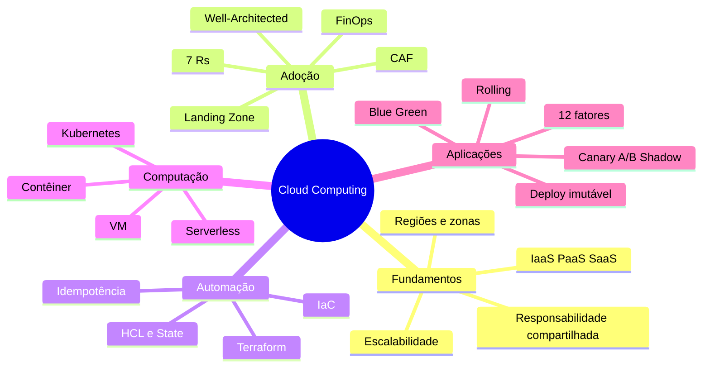

# Cloud Computing — Revisão para a Prova

[← Índice](./README.md) · [Aula 01](./aula-01-provedores-de-nuvem.md) · [Aula 02](./aula-02-preparacao-de-ambiente.md) · [Aula 03](./aula-03-estrategias-implementacao.md)

**Escopo:** revisão temática criada a partir dos e-books e slides de três aulas. As questões são **elaboradas para estudo**; não são reprodução de uma prova oficial.

## 1. Mapa mental da disciplina

## 2. Quadro comparativo de alta incidência

| Conceitos | Diferença essencial |
|---|---|
| **IaaS × PaaS × SaaS** | Infraestrutura gerenciada pelo cliente em software/SO × plataforma gerenciada × software completo |
| **Escalabilidade × elasticidade** | Capacidade de aumentar/reduzir × ajuste à variação da demanda |
| **Região × zona** | Área geográfica × agrupamento de infraestrutura isolável dentro da região |
| **Vertical × horizontal** | Aumentar capacidade de instância × aumentar número de instâncias |
| **Rehost × Relocate** | Refazer hospedagem com poucas mudanças × transferir plataformas/VMs compatíveis |
| **Replatform × Refactor** | Alterar componentes pontuais × redesenhar arquitetura |
| **Cloud enabled × based × native** | Adaptada × usa alguns serviços cloud × projetada para tirar proveito da nuvem |
| **Single-cloud × híbrida × multicloud** | Um provedor × ambiente local + nuvem × vários provedores |
| **Imperativo × declarativo** | Descreve passos × descreve estado final |
| **Provider × resource × state** | Plugin de integração × objeto desejado × vínculo com recursos reais |
| **Terraform init × plan × apply** | Preparar × pré-visualizar × executar |
| **Máquina virtual × contêiner** | SO convidado completo × processos que compartilham kernel host |
| **Dockerfile × imagem × contêiner** | Receita de build × artefato executável × instância em execução |
| **Docker Compose × Kubernetes** | Coordenação declarativa de serviços, muito usada em desenvolvimento × orquestração de clusters |
| **Pod × Deployment × Service** | Execução × gerenciamento de réplicas/atualizações × acesso estável |
| **Block × file × object storage** | Volume em blocos × compartilhamento hierárquico × objetos e metadados por API |
| **Síncrono × assíncrono** | Espera resposta no mesmo fluxo × desacopla processamento por mensagens/eventos |
| **Blue/Green × Rolling** | Duas versões completas com troca de tráfego × substituição gradual de instâncias |
| **Canary × A/B × Shadow** | Validação técnica gradual × experimento de comportamento × tráfego espelhado sem resposta ao usuário |
| **CAF × Well-Architected × FinOps** | Estratégia de adoção × qualidade da arquitetura × valor/custo da nuvem |

## 3. Memorização expressa — os 7 Rs

| R | Pergunta que resolve |
|---|---|
| Relocate | Posso deslocar máquinas existentes? |
| Rehost | Posso hospedar em cloud quase sem modificar? |
| Replatform | Pequenas modificações permitem usar serviços gerenciados? |
| Repurchase | Vale substituir por um SaaS? |
| Refactor | Vale redesenhar a aplicação? |
| Retain | Precisa permanecer local ou aguardar? |
| Retire | Pode ser desativada? |

## 4. Memorização expressa — 12 fatores

| Grupo | Fatores |
|---|---|
| **Base e configuração** | 1 Codebase, 2 Dependencies, 3 Config, 4 Backing Services |
| **Construção e execução** | 5 Build/Release/Run, 6 Processes, 7 Port Binding, 8 Concurrency |
| **Operação** | 9 Disposability, 10 Dev/Prod Parity, 11 Logs, 12 Admin Processes |

Frase-síntese: **uma base de código + dependências e configuração explícitas + processos sem estado + build reprodutível + operação automatizada**.

## 5. Questões de revisão (tente antes do gabarito)

### Bloco A — fundamentos e migração

**1.** Uma organização quer executar seu próprio sistema operacional em infraestrutura contratada. Qual modelo de serviço é mais adequado?

A) SaaS  B) IaaS  C) Apenas FaaS  D) Software on-premises

**2.** Uma equipe contrata um CRM completo acessível por navegador. Qual modelo predomina?

A) SaaS  B) IaaS  C) Bare metal  D) Hypervisor

**3.** Ao adotar banco relacional gerenciado em substituição a um MySQL instalado na VM, mantendo aplicação quase inalterada, qual dos 7 Rs se aplica melhor?

A) Retire  B) Retain  C) Replatform  D) Repurchase

**4.** A empresa substitui o ERP próprio por um produto SaaS. Qual estratégia?

A) Rehost  B) Repurchase  C) Relocate  D) Retain

**5.** Uma aplicação está obsoleta e já não é utilizada. Qual opção é mais coerente?

A) Refactor  B) Replatform  C) Retire  D) Relocate

**6.** Que escolha costuma melhorar tolerância a falhas de infraestrutura dentro de uma região?

A) Uma única VM  B) Múltiplas zonas de disponibilidade  C) Desativar backups  D) Apenas aumentar CPU

**7.** O que caracteriza uma implantação híbrida?

A) Apenas dois provedores públicos  B) Componentes locais e recursos em nuvem  C) Apenas SaaS  D) Apenas contêineres

**8.** O que caracteriza vendor lock-in?

A) Uso obrigatório de Linux  B) Dependência de um provedor que torna a troca difícil  C) Elasticidade automática  D) Redução de custo garantida

**9.** AWS, Azure e GCP têm estruturas administrativas diferentes. Qual associação é correta para a organização básica?

A) AWS/Resource Group, Azure/Projeto, GCP/Conta  
B) AWS/Conta, Azure/Assinatura/Resource Group, GCP/Projeto  
C) Todos usam exclusivamente a mesma estrutura  
D) Nenhuma oferece separação de custos

**10.** Qual é a principal finalidade das tags/labels?

A) Substituir firewall  B) Identificar e organizar recursos para governança e custos  C) Eliminar latência  D) Impedir cobrança

### Bloco B — IaC e execução

**11.** Em Terraform, o que faz `plan`?

A) Sempre altera infraestrutura  B) Apaga o estado  C) Exibe mudanças propostas  D) Instala o Nginx

**12.** Qual arquivo faz a correspondência entre infraestrutura declarada e recursos gerenciados?

A) `README.md`  B) `terraform.tfstate`  C) `Dockerfile`  D) `kubeconfig`

**13.** O que idempotência significa neste contexto?

A) Executar duas vezes duplica recursos  B) Mesmo estado desejado não deve provocar mudanças desnecessárias  C) Nunca poder alterar recursos  D) Todas as mudanças recriam a VM

**14.** Qual artefato declara etapas de construção de imagem Docker?

A) Pod  B) Dockerfile  C) Subnet  D) Resource Group

**15.** Qual é a unidade mínima de implantação do Kubernetes?

A) Cluster  B) Service  C) Pod  D) VPC

**16.** Qual objeto gerencia o número de réplicas de uma aplicação de forma declarativa?

A) Deployment  B) Volume  C) ConfigMap  D) Namespace

**17.** No Kubernetes, qual recurso fornece um ponto estável de acesso a Pods por seletor?

A) Dockerfile  B) Service  C) Container registry  D) Terraform provider

**18.** Quais recursos estão normalmente envolvidos na conexão de uma VM Azure à rede?

A) VNet, Subnet, NIC e NSG  B) Somente VM  C) Apenas Docker Hub  D) Apenas SNS

**19.** No Docker, o que preserva dados de um banco além da vida de um contêiner?

A) Tag da imagem  B) Volume  C) Porta exposta  D) `docker ps`

**20.** A melhor descrição para serverless/FaaS é:

A) Não usa servidores de forma alguma  B) Código/funções executados em infraestrutura gerenciada e acionados conforme eventos/requisições  C) Sempre mais barato em qualquer carga  D) Tem runtime sempre ilimitado

### Bloco C — arquitetura, operações e governança

**21.** Qual fator do Twelve-Factor App instrui que credenciais sejam fornecidas pelo ambiente?

A) III — Config  B) VII — Port Binding  C) XI — Logs  D) I — Codebase

**22.** Qual fator recomenda processos sem estado?

A) VI — Processes  B) II — Dependencies  C) X — Dev/Prod Parity  D) XII — Admin Processes

**23.** Que estratégia mantém dois ambientes independentes e alterna tráfego após validação?

A) Recreate  B) Blue/Green  C) Retain  D) Shadow

**24.** O principal objetivo do teste canário é:

A) Avaliar a nova versão gradualmente com tráfego real  B) Espelhar sem responder a usuários em todos os casos  C) Desativar produção  D) Substituir backup

**25.** Qual estratégia replica requisições para a versão experimental sem usar sua resposta para o usuário?

A) A/B  B) Rolling  C) Shadow  D) Rehost

**26.** Quais componentes pertencem a uma Landing Zone?

A) Somente aplicações  B) IAM, rede, governança, segurança e observabilidade  C) Apenas custos  D) Somente pipeline de build

**27.** Qual framework enfatiza perspectivas Business, People, Governance, Platform, Security e Operations?

A) AWS CAF  B) Docker Compose  C) Terraform  D) Twelve-Factor App

**28.** Qual prática está mais alinhada ao FinOps?

A) Deixar todas as VMs ligadas  B) Ocultar custos de cada equipe  C) Medir custo por transação e eliminar recursos ociosos  D) Tratar otimização financeira só no fim do projeto

**29.** Para reduzir falhas em cascata ao chamar serviço externo instável, qual padrão se destaca?

A) Circuit Breaker  B) Blue/Green  C) Rehost  D) Sharding

**30.** Em serviços gerenciados de nuvem, orçamento configurado é, por padrão, garantia de interrupção de todos os gastos?

A) Sim  B) Não

### Bloco D — casos práticos curtos

**31.** Um órgão público mantém um sistema legado em datacenter próprio por necessidade regulatória e hospeda novas APIs na nuvem. Nomeie o modelo de implantação e dois pontos de atenção.

**32.** Você precisa aumentar a capacidade de uma API sem perder sessões ao substituir contêineres. Quais fatores e escolhas arquiteturais são importantes?

**33.** Após `terraform apply`, outra pessoa executa `terraform plan` e o resultado mostra “no changes”. Qual propriedade/funcionamento está sendo exemplificado?

**34.** Um sistema atende HTTP via dois Pods em nós diferentes, mas não tem Service. Que dificuldade surge e qual objeto resolve?

**35.** Um deployment apresenta aumento de erros em 5% do tráfego direcionado à versão nova. Que estratégia está sendo usada e qual decisão conservadora deve ser tomada?

## 6. Gabarito comentado

| Questão | Resposta | Justificativa |
|---|---|---|
| 1 | **B** | IaaS fornece capacidade virtualizada; o consumidor gerencia SO e aplicação. |
| 2 | **A** | SaaS entrega o aplicativo pronto. |
| 3 | **C** | Replatform moderniza componentes sem redesenho completo. |
| 4 | **B** | Repurchase substitui por outra solução, geralmente SaaS. |
| 5 | **C** | Retire elimina carga obsoleta. |
| 6 | **B** | Distribuição entre zonas reduz dependência de uma única zona. |
| 7 | **B** | Híbrido une on-premises e nuvem. |
| 8 | **B** | Dependência do fornecedor dificulta migração. |
| 9 | **B** | Estruturas administrativas usadas nos provedores. |
| 10 | **B** | Tags permitem organização, alocação e relatórios. |
| 11 | **C** | `plan` antecipa a execução sem aplicá-la. |
| 12 | **B** | State relaciona recursos do provedor e declarações. |
| 13 | **B** | Estado desejado já atendido não exige mudança. |
| 14 | **B** | Dockerfile contém instruções para build da imagem. |
| 15 | **C** | Pod é a unidade mínima implantável. |
| 16 | **A** | Deployment reconcilia réplicas e versões. |
| 17 | **B** | Service oferece descoberta/acesso estável a um conjunto de Pods. |
| 18 | **A** | O laboratório Azure integra rede, sub-rede, NIC e NSG. |
| 19 | **B** | Volume preserva dados independentemente da instância do contêiner. |
| 20 | **B** | Gerenciamento de infraestrutura fica com o provedor. |
| 21 | **A** | Configuração externalizada, separada do código. |
| 22 | **A** | A aplicação deve funcionar com processos descartáveis. |
| 23 | **B** | Blue/Green mantém ambientes paralelos. |
| 24 | **A** | Canary avalia estabilidade em parcela do tráfego. |
| 25 | **C** | Shadow espelha tráfego e mantém resposta da produção. |
| 26 | **B** | Landing Zone prepara a base técnica e administrativa. |
| 27 | **A** | Perspectivas do AWS Cloud Adoption Framework. |
| 28 | **C** | FinOps conecta gastos, eficiência e valor do negócio. |
| 29 | **A** | Circuit Breaker interrompe tentativas a serviços com falhas persistentes. |
| 30 | **B** | Alertas de orçamento geralmente não encerram recursos automaticamente. |

**31.** Implantação **híbrida**; avaliar conectividade/latência e identidades/segurança entre ambientes (além de dados e custo).  
**32.** Processos sem estado (fator VI), concorrência (VIII), descartabilidade (IX), armazenamento de sessão fora de instâncias e balanceamento.  
**33.** Reconciliação declarativa e propriedade de idempotência sob configuração estável.  
**34.** Não existe endpoint estável de descoberta/balanceamento; usar **Service** com seleção dos Pods por labels.  
**35.** **Canary**; interromper expansão, verificar métricas e reverter o direcionamento para a versão estável se o comportamento for inadequado.

## 7. Checklist de domínio para a prova

- [ ] Sei explicar a responsabilidade compartilhada em IaaS, PaaS e SaaS.
- [ ] Consigo comparar região, zona e datacenter.
- [ ] Reconheço os sete Rs em estudos de caso.
- [ ] Entendo por que orçamento e alerta não são bloqueio financeiro automático.
- [ ] Sei o que fazem `init`, `validate`, `plan`, `apply`, `destroy` e `.tfstate`.
- [ ] Distingo bare metal, VM, contêiner, PaaS e serverless.
- [ ] Escolho storage de bloco, arquivo ou objeto conforme necessidade.
- [ ] Comparo APIs síncronas com filas/eventos e seus trade-offs.
- [ ] Sei diferenciar Dockerfile, imagem, contêiner, volumes e Compose.
- [ ] Descrevo as relações entre control plane, worker, Pod, Deployment e Service.
- [ ] Consigo enunciar os 12 fatores e exemplificar pelo menos cinco.
- [ ] Distingo Recreate, Blue/Green, Rolling, Canary, A/B e Shadow.
- [ ] Entendo etapas do CAF, Landing Zone e três estágios de maturidade GCP.
- [ ] Relaciono os pilares de Well-Architected aos requisitos não funcionais.
- [ ] Sei justificar FinOps a partir de visibilidade, otimização e operação contínua.

## 8. Leituras sugeridas para pontos difíceis

- [Aula 01 — Cap. 3: IaaS/PaaS/SaaS](./aula-01-provedores-de-nuvem.md#3-modelos-de-serviço-iaas-paas-e-saas)
- [Aula 01 — Cap. 7: 7 Rs](./aula-01-provedores-de-nuvem.md#7-sete-estratégias-de-migração--os-7-rs)
- [Aula 02 — Cap. 1: Terraform](./aula-02-preparacao-de-ambiente.md#1-preparando-infraestrutura-no-azure-com-terraform)
- [Aula 02 — Cap. 5: Kubernetes](./aula-02-preparacao-de-ambiente.md#5-kubernetes-control-plane-workers-pods-deployments-e-services)
- [Aula 03 — Cap. 1: Twelve-Factor](./aula-03-estrategias-implementacao.md#1-the-twelve-factor-app-doze-fatores-para-aplicações-em-nuvem)
- [Aula 03 — Cap. 2: Estratégias de deploy](./aula-03-estrategias-implementacao.md#2-infraestrutura-imutável-e-publicação-de-versões)
- [Aula 03 — Cap. 6: FinOps](./aula-03-estrategias-implementacao.md#6-finops-operação-financeira-em-nuvem)
